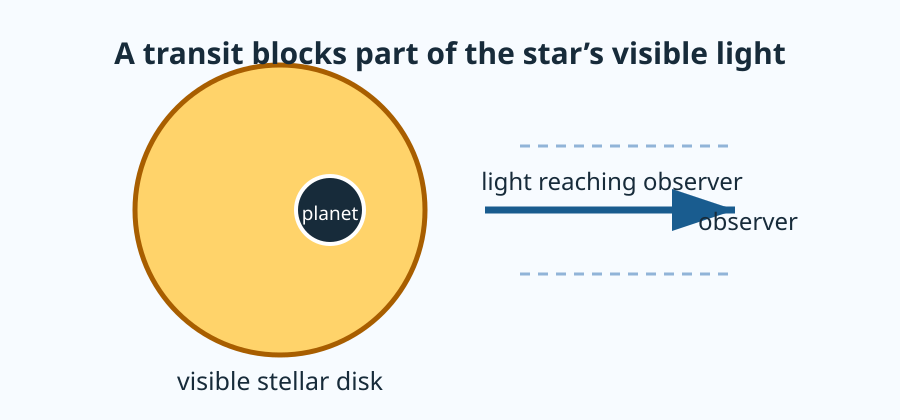

:::{interactive-lecture}
:title: How a Transit Dims a Star
:mode: live
:duration: 12 minutes
:::

This is a live scientific explanation, not a syntax worksheet. First identify
the observable, then make a prediction, inspect a model, and explain what its
evidence does and does not establish.

:::{lecture-scene}
:id: transit-setup
:label: 1. What is a transit?
:time: 2 min

An **exoplanet transit** occurs when a planet passes in front of the visible
disk of its star. The observer does not usually resolve the planet itself;
instead, the measured stellar brightness decreases slightly while the planet
blocks light.
:::



:::{lecture-scene}
:id: depth-model
:label: 2. A deliberately simple model
:time: 1 min

For a uniform stellar disk and a planet that is fully in front of the disk, the
remaining normalized flux is

$$
F = 1 - p^2,
$$

where $p = R_p/R_\star$ is dimensionless.

**Flux** is the light power received per unit collecting area; here it is used
as the measured brightness of the unresolved star. We divide by the baseline,
out-of-transit flux $F_0$, so **normalized flux** is $F/F_0$: it is `1` before
the planet blocks light and smaller than `1` during a transit. The radius ratio
$p$ compares the planet radius $R_p$ with stellar radius $R_\star$. It has no
units, which is why the blocked fraction $p^2$ also has no units. This model
uses projected disk areas, uniform surface brightness, and complete overlap;
it is a first computational model, not a complete light-curve calculation.
:::

:::{lecture-predict}
:id: transit-depth-prediction
:prompt: Before seeing the model output, predict whether changing p from 0.10 to 0.20 doubles or quadruples the blocked fraction. Explain why in one or two sentences.
:options: doubles|quadruples|unchanged
:rows: 4
:reveal: transit-area-reasoning
:::

:::{lecture-scene}
:id: transit-evidence
:label: 3. Inspect evidence
:time: 4 min

```{code-cell} python
from math import isclose

p = 0.10
flux = 1 - p**2
expected_flux = 0.99

print(f"p = {p:.2f}")
print(f"normalized flux = {flux:.3f}")
print("matches the stated expectation:", isclose(flux, expected_flux))
```

At `p = 0.10`, the blocked fraction is `0.010` and normalized flux is `0.990`.
At `p = 0.20`, the blocked fraction is `0.040`. That fixed baseline is enough
to check the scaling even if an interactive model cannot load.
:::

:::{lecture-figure}
:id: transit-geometry-evidence
:label: Transit geometry model
:model: transit-depth
:fallback: The blocked fraction is p squared: p = 0.10 gives 0.010 and p = 0.20 gives 0.040. The model is quadratic and assumes a uniform stellar disk with the planet fully in front of it.
:::

### Explore the same relationship in a dashboard (optional)

The embedded dashboard adds a live curve and a plotted point. Use it only
after making your prediction: change `p`, observe both the number and the
orange point, then describe whether the relationship is linear or quadratic.
The quick model above remains the core activity if this richer visualization is
slow to load.

:::{panel-pyodide}
:id: transit-geometry-dashboard
:height: 570
:code-file: transit-geometry-panel.py
:::

:::{lecture-reveal}
:id: transit-area-reasoning

The blocked fraction is an **area ratio**, so it scales as $p^2$. Doubling the
radius ratio therefore makes the blocked area four times larger, not twice as
large. This model assumes a uniformly bright disk and complete overlap; it does
not capture limb darkening, ingress, or egress.
:::

:::{lecture-scene}
:id: transit-takeaway
:label: 4. Take the model to your notebook
:time: 2 min

For your Project 1 notebook, reproduce the short calculation above, change
`p` from `0.10` to `0.20`, and preserve the printed evidence. The Panel model
is for prediction and inspection; your restartable project notebook is the
scientific record.
:::

:::{lecture-checkpoint}
:id: transit-depth-synthesis
:prompt: State the relationship between radius ratio and transit depth, cite one piece of evidence from the model, and name one assumption that limits the conclusion.
:rows: 5
:::

Run the Project 1 notebook from a clean kernel before submitting. If a result
depends on a variable you forgot to define, that is useful evidence that the
calculation is not yet reproducible.
