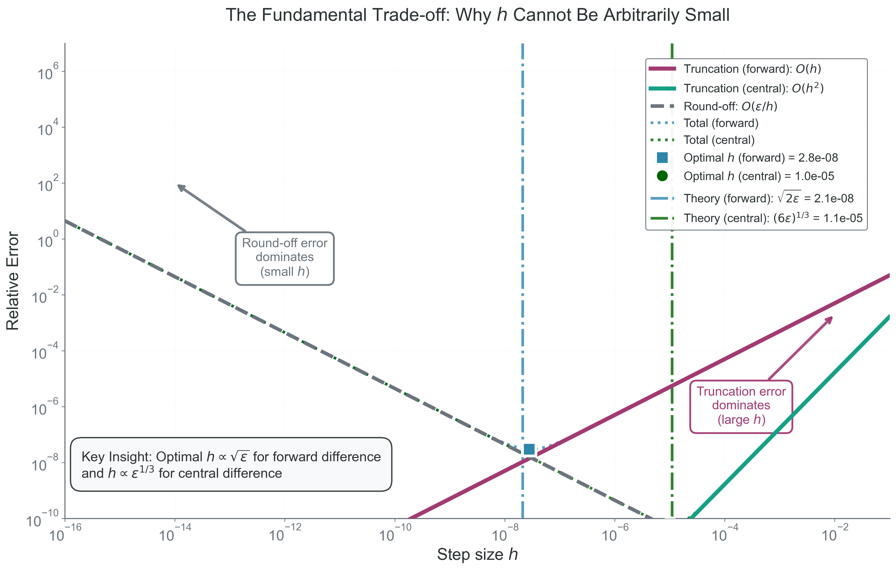

<!-- prep-banner:start -->
:::{warning} This reading is still being revised
Readings are reviewed and finalized **at least one week before they are
assigned**, so you will always have a settled version before you need it. Until
then, expect rough edges — wording, examples, and cross-references may change.

Where a reading disagrees with the syllabus, the syllabus is right. If something
here does not work, tell me: that is genuinely useful and I would rather hear it
from you than not.
:::
<!-- prep-banner:end -->

## Learning Objectives

By the end of this section, you will be able to:

- [ ] **Explain** why a computer cannot take the mathematical limit $h \to 0$ and **distinguish** that ideal from the numerical approximation we actually compute.
- [ ] **Derive** forward, backward, central, and fourth-order central finite-difference formulas from Taylor series with clean error terms.
- [ ] **Analyze** the total-error balance between truncation error and floating-point round-off error and **estimate** an appropriate step size $h$.
- [ ] **Implement** robust finite-difference utilities with validation for invalid step sizes, unknown methods, and non-finite function values.
- [ ] **Predict** how accuracy changes with method choice, function smoothness, and physical scale before you run code.

---

(introduction-why-numerical-derivatives-matter)=
## Introduction: Why Numerical Derivatives Matter

Why this matters: numerical derivatives are not a side topic in computational astrophysics. They sit inside orbit integration, stellar structure, radiative transfer, optimization, and data analysis.

In continuous mathematics, derivatives tell us how a quantity changes at an instant. In computational science, we almost never have access to that exact instantaneous limit. We have function values at nearby points, finite precision arithmetic, and algorithms that must make a choice about how close is "close enough."

Derivatives appear everywhere in the astrophysical problems we care about:

- **Kinematics**: if $\mathbf{r}(t)$ is position in cm, AU, or pc, then
  $$
\mathbf{v}(t) = \frac{d\mathbf{r}}{dt}
$$
  is velocity in $\mathrm{cm\,s^{-1}}$, and
  $$
\mathbf{a}(t) = \frac{d\mathbf{v}}{dt}
$$
  is acceleration in $\mathrm{cm\,s^{-2}}$. These derivatives drive $N$-body dynamics.
- **Stellar structure**: the equations for a star involve gradients such as
  $$
\frac{dP}{dr}, \qquad \frac{dT}{dr}, \qquad \frac{dM_r}{dr},
$$
  where $P$ is pressure in $\mathrm{dyn\,cm^{-2}}$, $T$ is temperature in K, $M_r$ is enclosed mass in g or $M_\odot$, and $r$ is radius in cm.
- **Radiative transfer**: if $I$ is specific intensity in $\mathrm{erg\,s^{-1}\,cm^{-2}\,sr^{-1}\,Hz^{-1}}$, then
  $$
\frac{dI}{ds} = -\kappa I + j
$$
  describes how intensity changes along path length $s$ in cm. In this reading we use $\kappa$ as an attenuation coefficient in $\mathrm{cm^{-1}}$, so $j$ must have units of intensity per unit length, $\mathrm{erg\,s^{-1}\,cm^{-3}\,sr^{-1}\,Hz^{-1}}$.
- **Orbital dynamics and optimization**: when we estimate derivatives of an energy function, a likelihood, or a residual, the numerical derivative is often the first thing we compute when an analytical derivative is inconvenient or unavailable.

Most real scientific problems do not hand us a closed-form answer. We discretize, approximate, and compute. That move from the continuous world to the discrete world is where the central paradox of this reading lives.

:::{important} Course Units Reminder

Throughout COMP 521, we will use explicit physical scales rather than vague "numbers":

- Length: cm, AU, pc
- Mass: g, $M_\odot$
- Time: s, day, year
- Velocity: $\mathrm{cm\,s^{-1}}$
- Acceleration: $\mathrm{cm\,s^{-2}}$

Whenever a physical example appears, ask two questions immediately: what does the derivative mean physically, and what units should it have?
:::

---

(the-core-problem)=
## The Core Problem

Why this matters: if you do not understand the core derivative paradox, every later conversation about truncation error, round-off error, and algorithm design will feel like disconnected rules.

:::{note} Opening Prediction

Before you read the derivative formula too quickly, commit to a prediction: does making $h$ smaller always help?

Write down the answer you want to defend, because the entire part is going to complicate that instinct.

Does making $h$ smaller always help?
:::

The mathematical definition of the derivative is

$$
f'(x) = \lim_{h \to 0}\frac{f(x+h)-f(x)}{h}.
$$

This equation is compact, but it mixes three ideas that we must separate carefully:

- **Mathematical ideal**: the derivative is defined by the limit $h \to 0$.
- **Numerical approximation**: on a computer, we use a finite value of $h$ and approximate that limit.
- **Floating-point limitation**: if $h$ becomes too small, subtraction and rounding errors destroy the accuracy of the approximation.

Mathematics wants $h \to 0$; computers require $h > 0$.

Here is a compact worked example before we derive anything formal. Let
$$
f(x) = x^2.
$$
The exact derivative is
$$
f'(x) = 2x,
$$
so at $x = 3$ the true answer is $f'(3)=6$.

If we use the forward-difference idea with $h=0.5$,
$$
\frac{f(3.5)-f(3)}{0.5} = \frac{12.25-9}{0.5} = 6.5.
$$
If we shrink to $h=0.1$,
$$
\frac{f(3.1)-f(3)}{0.1} = \frac{9.61-9}{0.1} = 6.1.
$$
The approximation improves as $h$ gets smaller, but it is still not exact because we have not taken the true limit.

{#fig-derivative-paradox width="100%"}

On a real computer, we also need to remember that numbers are stored in floating-point form. Double precision gives roughly 16 decimal digits of relative precision near numbers of order unity, but that does **not** mean every subtraction preserves 16 useful digits.

If $h$ is too small, then $x+h$ may round to the same floating-point value as $x$. If $f(x+h)$ and $f(x)$ are nearly equal, the subtraction
$$
f(x+h)-f(x)
$$
can lose most of the significant digits we care about. This is catastrophic cancellation.

:::{important} Read the Derivative Like a Sentence

$$
f'(x) = \lim_{h \to 0}\frac{f(x+h)-f(x)}{h}
$$

Let us unpack each piece:

- $f(x+h)-f(x)$: the change in the function value over a finite step.
- $h$: the step in the input variable.
- $\frac{f(x+h)-f(x)}{h}$: the slope of a secant line.
- $\lim_{h \to 0}$: the instruction that turns the secant slope into a tangent slope.

What this equation is really saying: a derivative is the limiting slope of nearby secant lines, not just "a quotient with a small number in it."
:::

:::{warning} Catastrophic Cancellation: Debugging Intuition

If your derivative estimate suddenly becomes $0$, `nan`, or wildly noisy when you make $h$ smaller, do not assume the code is "almost right." A common failure mode is that the subtraction $f(x+h)-f(x)$ has become numerically meaningless because the two numbers are too close in floating-point arithmetic.
:::

:::{note} Check Your Understanding

1. If $h$ is reduced from $0.5$ to $0.1$ in the $f(x)=x^2$ example, why does the approximation improve?
2. Why is "very small" not the same as "mathematically zero" on a computer?
3. What goes wrong if $f(x+h)$ and $f(x)$ round to the same floating-point value?
:::

---

(finite-difference-landscape)=
## Intuition: Why Taylor Series?

Why this matters: Taylor series gives us a controlled way to connect a continuous function to nearby discrete samples. It is the mathematical bridge between calculus and computation.

Student mental model: Taylor series is a local decoder ring. It tells us exactly what information is hidden inside the nearby function values $f(x+h)$, $f(x-h)$, $f(x+2h)$, and so on.

Around the point $x$, the Taylor expansion of a smooth function is

$$
f(x+h)=f(x)+h f'(x)+\frac{h^2}{2}f''(x)+\frac{h^3}{6}f'''(x)+O(h^4).
$$

This equation says that the value at $x+h$ contains the function value, the slope, the curvature, and higher-order corrections. Computationally, that is exactly what we need: if we rearrange this expansion, we can isolate $f'(x)$ and understand the error we introduce when we truncate the rest.

The backward expansion is equally important:

$$
f(x-h)=f(x)-h f'(x)+\frac{h^2}{2}f''(x)-\frac{h^3}{6}f'''(x)+O(h^4).
$$

Now we have a menu of nearby samples, and we can combine them in clever ways. Some combinations keep the $O(h)$ error term. Others cancel it. The design of a finite-difference formula is really the design of a Taylor-series cancellation pattern.

:::{tip} Mental Model for the Derivations

When you see a Taylor derivation, do not think "symbol pushing." Think:

1. Which nearby samples do I have?
2. Which derivative do I want?
3. Which unwanted terms can I cancel?

That mindset scales from first derivatives to custom stencils for PDEs.
:::

---

(forward-difference)=
## Forward Difference

Why this matters: forward difference is the simplest derivative approximation, and it appears naturally whenever we only know values at the current point and points ahead.

The forward Taylor expansion is

$$
f(x+h)=f(x)+h f'(x)+\frac{h^2}{2}f''(x)+\frac{h^3}{6}f'''(x)+O(h^4).
$$

This expansion tells us how a one-sided sample at $x+h$ mixes the derivative we want with curvature and higher-order contamination.

Subtract $f(x)$ from both sides:

$$
f(x+h)-f(x)=h f'(x)+\frac{h^2}{2}f''(x)+\frac{h^3}{6}f'''(x)+O(h^4).
$$

The left-hand side is now a computable change in the function value over one forward step.

Now divide by $h$:

$$
\frac{f(x+h)-f(x)}{h}=f'(x)+\frac{h}{2}f''(x)+\frac{h^2}{6}f'''(x)+O(h^3).
$$

This turns the finite change into a secant slope, while the remaining Taylor terms reveal the bias we introduced.

Finally, solve for the derivative:

$$
f'(x)=\frac{f(x+h)-f(x)}{h}-\frac{h}{2}f''(x)-\frac{h^2}{6}f'''(x)+O(h^3).
$$

So the forward-difference approximation is

$$
f'(x)\approx \frac{f(x+h)-f(x)}{h}.
$$

This means the leading truncation error is proportional to $h$, so forward difference is a first-order method:

$$
E_{\mathrm{trunc,forward}}(h)=O(h).
$$

Computationally, that statement tells us that halving $h$ only halves the leading truncation error. Forward difference is simple and useful, but not especially accurate.

For the earlier quadratic example with $f(x)=x^2$, $x=3$, and $h=0.1$, we found the approximation $6.1$ instead of $6.0$. That $0.1$ error is exactly the kind of first-order behavior the Taylor analysis predicts.

The leading $\frac{h}{2}f''(x)$ term is the computational price of using a one-sided stencil: curvature leaks directly into the estimate.

Forward difference is simple, but its one-sided bias leaves a first-order error.

---

(backward-difference)=
## Backward Difference

Why this matters: backward difference becomes the natural choice near right-hand boundaries, or whenever "past" values are available but "future" values are not.

Start from the backward Taylor expansion:

$$
f(x-h)=f(x)-h f'(x)+\frac{h^2}{2}f''(x)-\frac{h^3}{6}f'''(x)+O(h^4).
$$

This time we are reading the same local information from the point behind $x$ instead of the point ahead of it.

Rearrange:

$$
f(x)-f(x-h)=h f'(x)-\frac{h^2}{2}f''(x)+\frac{h^3}{6}f'''(x)+O(h^4).
$$

Again, the goal is to isolate a computable finite change before dividing by the step size.

Then divide by $h$:

$$
\frac{f(x)-f(x-h)}{h}=f'(x)-\frac{h}{2}f''(x)+\frac{h^2}{6}f'''(x)+O(h^3).
$$

This secant slope now looks backward, so the sign of the leading bias changes.

Solving for $f'(x)$ gives

$$
f'(x)=\frac{f(x)-f(x-h)}{h}+\frac{h}{2}f''(x)-\frac{h^2}{6}f'''(x)+O(h^3).
$$

So the backward-difference approximation is

$$
f'(x)\approx \frac{f(x)-f(x-h)}{h}.
$$

Like forward difference, backward difference has first-order truncation error:

$$
E_{\mathrm{trunc,backward}}(h)=O(h).
$$

The sign of the leading error term differs from the forward case, but the key computational message is the same: this method is still first-order accurate.

Backward difference has the same order as forward difference; only the direction changes.

---

(central-difference)=
## Central Difference

Why this matters: central difference is the default first derivative in many scientific codes because symmetry cancels the largest truncation term.

Student mental model: forward and backward difference each lean to one side. Central difference stands in the middle and asks the left and right samples to balance each other.

Write both Taylor expansions:

$$
f(x+h)=f(x)+h f'(x)+\frac{h^2}{2}f''(x)+\frac{h^3}{6}f'''(x)+\frac{h^4}{24}f^{(4)}(x)+O(h^5),
$$

This first expansion shows what the forward sample contributes.

$$
f(x-h)=f(x)-h f'(x)+\frac{h^2}{2}f''(x)-\frac{h^3}{6}f'''(x)+\frac{h^4}{24}f^{(4)}(x)+O(h^5).
$$

The backward sample contains the same even-power terms, which is exactly what symmetry needs in order to cancel them.

Subtract the second equation from the first:

$$
f(x+h)-f(x-h)=2h f'(x)+\frac{2h^3}{6}f'''(x)+O(h^5).
$$

The even-power terms disappear, so the largest truncation contribution is now much smaller.

Now divide by $2h$:

$$
\frac{f(x+h)-f(x-h)}{2h}=f'(x)+\frac{h^2}{6}f'''(x)+O(h^4).
$$

This symmetric secant slope already has second-order accuracy built into it.

Solving for $f'(x)$ gives

$$
f'(x)=\frac{f(x+h)-f(x-h)}{2h}-\frac{h^2}{6}f'''(x)+O(h^4).
$$

So the central-difference approximation is

$$
f'(x)\approx \frac{f(x+h)-f(x-h)}{2h}.
$$

Its leading truncation error is proportional to $h^2$:

$$
E_{\mathrm{trunc,central}}(h)=O(h^2).
$$

Computationally, that means halving $h$ reduces the leading truncation error by about a factor of $4$, not just a factor of $2$.

For $f(x)=x^2$, central difference at $x=3$ is especially illuminating:

$$
\frac{f(3+h)-f(3-h)}{2h}=\frac{(3+h)^2-(3-h)^2}{2h}=6.
$$

For a quadratic, the method is exact because the odd-power cancellation leaves no truncation error in the first derivative estimate.

Central difference uses symmetry to cancel the largest truncation term.

---

## The Power of Symmetry

Why this matters: symmetry is one of the most powerful accuracy upgrades in numerical analysis, and central difference is your first clear example of it.

The magic in central difference is not luck. It comes from pairing points symmetrically around $x$. Even-order terms in the Taylor expansions cancel, leaving a smaller leading error term. That is why symmetry improves accuracy without requiring a completely new mathematical idea.

This pattern appears again and again:

- centered finite differences for derivatives,
- Simpson's rule in numerical integration,
- symmetric time integrators in dynamics,
- paired sampling tricks in Monte Carlo methods.

What symmetry is really buying you is cancellation of systematic bias. In computational language: the approximation is still finite, but it is less one-sided.

:::{tip} Symmetry Check

If a method samples at $x-h$ and $x+h$ with equal weight, ask whether odd or even Taylor terms cancel. That question often reveals the order of accuracy before you do the full derivation.
:::

---

## Higher-Order Methods

Why this matters: when the function is smooth and extra function evaluations are affordable, higher-order methods can reduce truncation error dramatically.

By combining more Taylor expansions, we can cancel more unwanted terms. A standard fourth-order central difference for the first derivative is

$$
f'(x)\approx \frac{-f(x+2h)+8f(x+h)-8f(x-h)+f(x-2h)}{12h}.
$$

Its leading truncation error behaves like

$$
E_{\mathrm{trunc,central4}}(h)=O(h^4).
$$

Computationally, this formula spends more function evaluations to buy a much smaller truncation error in the smooth-function regime. That trade is often worthwhile, but only if round-off and function noise do not dominate first.

If the function is noisy, non-smooth, or expensive to evaluate, higher order is not automatically better. A formally high-order method can still perform worse in practice if the assumptions behind the Taylor expansion are not satisfied.

{#fig-error-scaling width="100%"}

---

(optimal-h)=
## The Fundamental Trade-off / Optimal $h$

Why this matters: the best step size is not "the smallest one you can think of." It is the one that balances two different error mechanisms.

There are two competing effects:

- **Truncation error** decreases as $h$ decreases.
- **Round-off error** usually grows like $1/h$ because we subtract nearly equal numbers and then divide by a small step.

For forward difference, the leading truncation and round-off model is

$$
E_{\mathrm{total}}(h)\approx \frac{h}{2}\lvert f''(x)\rvert + \frac{\epsilon_{\mathrm{machine}}\lvert f(x)\rvert}{h}.
$$

This equation says that one part of the error prefers smaller $h$, while the other prefers larger $h$. The total error curve is therefore U-shaped.

Differentiate with respect to $h$ and set the derivative to zero:

$$
\frac{dE_{\mathrm{total}}}{dh}=\frac{1}{2}\lvert f''(x)\rvert-\frac{\epsilon_{\mathrm{machine}}\lvert f(x)\rvert}{h^2}=0.
$$

Solving for the minimizing step size gives

$$
h_{\mathrm{opt}} \approx \sqrt{\frac{2\epsilon_{\mathrm{machine}}\lvert f(x)\rvert}{\lvert f''(x)\rvert}}.
$$

If the local scales of $\lvert f(x)\rvert$ and $\lvert f''(x)\rvert$ are comparable for a particular problem, then forward difference often lands near

$$
h_{\mathrm{opt}} \propto \epsilon_{\mathrm{machine}}^{1/2}.
$$

In double precision, that is roughly $10^{-8}$. This is **order-of-magnitude guidance** for well-scaled smooth problems, not a universal law for every function.

For central difference, the truncation term is smaller, so the model changes to

$$
E_{\mathrm{total}}(h)\approx \frac{h^2}{6}\lvert f'''(x)\rvert + \frac{\epsilon_{\mathrm{machine}}\lvert f(x)\rvert}{h}.
$$

Now the minimizing step size is

$$
h_{\mathrm{opt}} \approx \left(\frac{3\epsilon_{\mathrm{machine}}\lvert f(x)\rvert}{\lvert f'''(x)\rvert}\right)^{1/3}.
$$

So central difference typically prefers

$$
h_{\mathrm{opt}} \propto \epsilon_{\mathrm{machine}}^{1/3},
$$

which is larger than the forward-difference optimum. Computationally, that is excellent news: central difference is both more accurate in truncation error and less sensitive to having an extremely tiny step.

For a fourth-order central derivative, the same balancing logic leads to the scaling

$$
h_{\mathrm{opt}} \propto \epsilon_{\mathrm{machine}}^{1/5}.
$$

That scaling will appear again in the executable code below, but again as heuristic guidance rather than a guaranteed best choice for every function and every scale.

:::{warning} Common Misconception

"Smaller $h$ is always better" is false. Smaller $h$ reduces truncation error, but once round-off error takes over, making $h$ smaller makes the derivative estimate worse.
:::

:::{tip} Floating-Point Honesty

Saying that double precision has "about 16 digits" is only a local statement about relative precision near numbers of order unity. It is not a promise that every numerical operation will preserve 16 correct digits. Subtraction between nearly equal numbers is where that intuition breaks most quickly.
:::

{#fig-error-tradeoff width="100%"}

For forward difference in double precision, it is common to get on the order of 8 correct digits in a well-scaled smooth problem. That is useful guidance, but it is not a universal accuracy ceiling for every derivative calculation.

The best $h$ is a balance between truncation and round-off, not the smallest possible step.

:::{note} Predict -> Run -> Explain

Predict:
- If you shrink $h$ by another factor of $10$, do you expect the total error to keep falling?

Run:
- Use the interactive exploration below to test one smooth function with `forward` and `central` stencils.

Explain:
- Why does the total error form a U-shape instead of decreasing forever as $h$ shrinks?
- Why does central difference usually tolerate a larger optimal $h$ than forward difference?
- What quantity in the error model tells you that different functions can have different optimal step sizes?
:::

Before running any examples below, we need one shared setup cell. It defines the imports and helper functions used throughout the rest of the reading, so if you restart the kernel this is the first cell to rerun.

:::{note} Shared Setup
:class: simple

Purpose: define the shared imports and finite-difference helpers used in every executable example below.

Inputs/Outputs: these functions accept a callable $f$, an evaluation point $x$, a positive step size $h$, and a method name, then return a derivative estimate or an error summary.

Common pitfall: if you skip this cell after a kernel restart, later examples will fail even though the math is fine.
:::

```{code-cell} python
import math
from typing import Callable

import matplotlib.pyplot as plt
import numpy as np


def _checked_function_value(f: Callable[[float], float], point: float) -> float:
    """Evaluate a scalar function and reject non-finite outputs."""
    value = float(f(point))
    if not np.isfinite(value):
        raise ValueError(
            f"Function evaluation produced a non-finite value at x = {point:.6e}."
        )
    return value


def finite_diff(
    f: Callable[[float], float],
    x: float,
    h: float,
    method: str = "central",
) -> float:
    """Estimate the derivative of a scalar function with a finite-difference stencil."""
    if h <= 0:
        raise ValueError("Step size h must be strictly positive.")

    method_name = method.lower()
    valid_methods = {"forward", "backward", "central", "central4"}
    if method_name not in valid_methods:
        raise ValueError(
            f"Unknown method '{method}'. Expected one of {sorted(valid_methods)}."
        )

    if method_name == "forward":
        f_x = _checked_function_value(f, x)
        f_x_plus_h = _checked_function_value(f, x + h)
        return (f_x_plus_h - f_x) / h

    if method_name == "backward":
        f_x = _checked_function_value(f, x)
        f_x_minus_h = _checked_function_value(f, x - h)
        return (f_x - f_x_minus_h) / h

    if method_name == "central":
        f_x_plus_h = _checked_function_value(f, x + h)
        f_x_minus_h = _checked_function_value(f, x - h)
        return (f_x_plus_h - f_x_minus_h) / (2.0 * h)

    f_x_plus_2h = _checked_function_value(f, x + 2.0 * h)
    f_x_plus_h = _checked_function_value(f, x + h)
    f_x_minus_h = _checked_function_value(f, x - h)
    f_x_minus_2h = _checked_function_value(f, x - 2.0 * h)
    return (-f_x_plus_2h + 8.0 * f_x_plus_h - 8.0 * f_x_minus_h + f_x_minus_2h) / (
        12.0 * h
    )


def finite_diff_error(true_value: float, approx_value: float) -> dict[str, float]:
    """Return absolute and relative error for a derivative estimate."""
    true_scalar = float(true_value)
    approx_scalar = float(approx_value)

    if not np.isfinite(true_scalar) or not np.isfinite(approx_scalar):
        raise ValueError("Both true_value and approx_value must be finite.")

    absolute_error = abs(approx_scalar - true_scalar)
    relative_error = (
        absolute_error / abs(true_scalar) if true_scalar != 0.0 else math.nan
    )
    return {
        "absolute_error": absolute_error,
        "relative_error": relative_error,
    }


def practical_optimal_h(
    x: float,
    method: str = "central",
    epsilon: float = np.finfo(float).eps,
) -> float:
    """Choose a scale-aware step size based on floating-point precision."""
    if epsilon <= 0 or not np.isfinite(epsilon):
        raise ValueError("epsilon must be a positive finite floating-point value.")

    method_name = method.lower()
    if method_name in {"forward", "backward"}:
        exponent = 0.5
    elif method_name == "central":
        exponent = 1.0 / 3.0
    elif method_name == "central4":
        exponent = 1.0 / 5.0
    else:
        raise ValueError(
            "Unknown method. Expected 'forward', 'backward', 'central', or 'central4'."
        )

    x_scale = max(abs(float(x)), 1.0)
    return (epsilon**exponent) * x_scale
```

---

## Interactive Exploration

Why this matters: the best way to internalize the error trade-off is to vary $h$ yourself and watch different methods succeed or fail.

In COMP 521, we do this exploration directly in executable Python rather than through a separate browser demo. The goal is the same: choose a function, a point $x$, a method, and a log-scaled step size $h$, then compare what your prediction says to what the calculation actually does.

:::{note} Parameters to Explore

- Function choice: $x^2$, $\sin x$, $e^x$
- Evaluation point $x$
- Step size $h$ on a log scale
- Method: `forward`, `backward`, `central`, `central4`
:::

:::{important} Predict Before You Run

1. Which method should be most accurate for a smooth function when $h$ is moderately small?
2. What happens when $h$ becomes too small?
3. Why does the total error curve have a U-shape instead of a monotonic trend?
:::

This cell reuses the shared helper functions defined earlier. It computes the absolute derivative error for three methods, and you should expect a right-hand truncation regime, a left-hand round-off upturn, and lower curves for higher-order methods while the smooth-function assumptions hold.

```{code-cell} python
exploration_function = np.sin
exploration_label = "sin(x)"
exploration_x = 1.0
exploration_h_values = np.logspace(-16, -1, 80)
true_derivative = float(np.cos(exploration_x))

fig, ax = plt.subplots(figsize=(8, 5))
for method_name in ["forward", "central", "central4"]:
    abs_errors = []
    for h_value in exploration_h_values:
        approx = finite_diff(exploration_function, exploration_x, h_value, method_name)
        error_summary = finite_diff_error(true_derivative, approx)
        abs_errors.append(error_summary["absolute_error"])

    ax.loglog(exploration_h_values, abs_errors, marker="o", markersize=3, label=method_name)

ax.set_xlabel("Step size $h$")
ax.set_ylabel("Absolute derivative error")
ax.set_title(f"Guided exploration for $f(x) = {exploration_label}$ at $x = {exploration_x}$")
ax.grid(True, which="both", alpha=0.3)
ax.legend(title="Method")
plt.show()
```

*What to notice: for large $h$, the right side of each curve is truncation-dominated, and the slopes reflect method order. As $h$ becomes extremely small, each curve turns upward because round-off takes over. The minimum of each curve is the computational version of the U-shaped total-error story.*

Interpretation: the right side of the plot is the truncation regime, where method order controls the slope. The left-side upturn is round-off error. The bottom of each curve is the experimentally visible version of the U-shaped total-error logic from the previous section.

---

(practical-algorithm)=
## Practical Algorithm for Choosing $h$

Why this matters: in real code, you rarely know $f''(x)$ or $f'''(x)$ ahead of time, so you need a practical scale-aware heuristic instead of the exact symbolic optimum.

The most important practical idea is that $h$ should scale with the magnitude of the problem. A step size that makes sense near $x=1$ does not make sense automatically near $x=1.496\times 10^{13}\,\mathrm{cm}$.

This section reuses the shared helper functions defined earlier. The point now is not to re-read the implementation, but to watch how a scale-aware heuristic behaves on concrete examples.

### Worked Example 1: $f(x)=x^2$ at $x=3$

Why this matters: this is the cleanest first test because the exact derivative is simple and central difference on a quadratic exposes the power of symmetry immediately.

The exact derivative is

$$
\frac{d}{dx}(x^2)=2x,
$$

so at $x=3$,

$$
f'(3)=6.
$$

This gives us an exact reference value, so the only question is how each stencil misses it.

This cell reuses the shared helper functions defined earlier. It computes three derivative estimates at the same $h$, and you should expect forward and backward to lean in opposite directions while central benefits from symmetry.

```{code-cell} python
f_quadratic = lambda x: x**2
x0 = 3.0
h0 = 0.1
true_value = 2.0 * x0

quadratic_results = {}
for method_name in ["forward", "backward", "central"]:
    approx = finite_diff(f_quadratic, x0, h0, method=method_name)
    quadratic_results[method_name] = finite_diff_error(true_value, approx)
    print(
        f"{method_name:8s} approx = {approx:6.3f}  "
        f"abs error = {quadratic_results[method_name]['absolute_error']:.3e}"
    )

# Expected pattern:
# - forward is slightly high,
# - backward is slightly low,
# - central is exact for this quadratic.
```

Interpretation: forward and backward differences lean in opposite directions because they are one-sided. Central difference lands exactly on the true derivative here because the symmetry cancels the relevant truncation term for a quadratic.

### Worked Example 2: $f(x)=\sin x$ at $x=1\,\mathrm{rad}$

Why this matters: this example is smooth, familiar, and lets us see how the same method behaves across several choices of $h$.

The exact derivative is

$$
\frac{d}{dx}(\sin x)=\cos x,
$$

so at $x=1\,\mathrm{rad}$,

$$
f'(1)=\cos(1)\approx 0.5403023059\,\mathrm{rad}^{-1}.
$$

This gives us a smooth benchmark where shrinking $h$ helps at first and then eventually hurts.

This cell reuses the shared helper functions defined earlier. It checks one method across several step sizes, and the important pattern is the improvement-then-breakdown sequence rather than any single printed number.

```{code-cell} python
f_sine = np.sin
x1 = 1.0  # radians
true_sine_derivative = float(np.cos(x1))
h_values = [1e-1, 1e-3, 1e-6, 1e-10]

print("Method = central")
for h_value in h_values:
    approx = finite_diff(f_sine, x1, h_value, method="central")
    errors = finite_diff_error(true_sine_derivative, approx)
    print(
        f"h = {h_value:>8.1e}  approx = {approx:.12f}  "
        f"abs error = {errors['absolute_error']:.3e}"
    )

# Expected pattern:
# the approximation improves at first, then eventually gets worse when h is too small.
```

Interpretation: shrinking $h$ helps only until round-off error becomes important. That turning point is the numerical version of the paradox we started with.

### Worked Example 3: Why $h$ Must Scale With the Problem

Why this matters: in astrophysics, the same code often sees variables that differ by many orders of magnitude. A single hard-coded $h$ is rarely defensible.

Consider these representative scales:

- $1\,\mathrm{cm}$,
- $1\,\mathrm{AU}=1.496\times 10^{13}\,\mathrm{cm}$,
- $1\,M_\odot = 1.989\times 10^{33}\,\mathrm{g}$.

If $x$ is a radius or mass coordinate, the perturbation should reflect the size of that coordinate. A dimensionless $h=10^{-6}$ means very different things at those scales.

This cell reuses the shared helper functions defined earlier. It computes scale-aware step sizes for three representative coordinates, and you should expect the recommended perturbation to grow with the magnitude of the physical variable.

```{code-cell} python
astronomical_scales = {
    "lab length (cm)": 1.0,
    "orbital radius (1 AU in cm)": 1.496e13,
    "enclosed mass (1 Msun in g)": 1.989e33,
}

for label, scale_value in astronomical_scales.items():
    h_forward = practical_optimal_h(scale_value, method="forward")
    h_central = practical_optimal_h(scale_value, method="central")
    print(
        f"{label:28s}  x = {scale_value:.3e}  "
        f"h_forward = {h_forward:.3e}  h_central = {h_central:.3e}"
    )

# Expected pattern:
# the chosen h scales with |x|, so large physical coordinates receive proportionally larger steps.
```

Interpretation: the algorithm is not claiming these are physically perfect step sizes for every application. It is enforcing a necessary first principle: a numerically meaningful perturbation should scale with the magnitude of the quantity being perturbed.

:::{warning} Practical Failure Modes

Watch for these bugs in your own derivative code:

1. $h \le 0$ due to a bad parameter choice.
2. A hard-coded $h$ used for variables with wildly different scales.
3. `f(x + h)` returning a non-finite value because the perturbation pushes the function outside its domain.
4. Assuming a higher-order method automatically wins even when the function is noisy or poorly scaled.
:::

---

:::{important} Throughline Recap

The core lesson of Part 1 is that approximation creates truncation error, and smarter stencils change how fast that error falls.

The second lesson is more unsettling: shrinking $h$ is not enough. Once floating-point subtraction and rounding take over, the same instinct that helped at first can make the answer worse.

Carry that into Part 2: the finite-difference formulas only make sense if you also understand the number system that limits them.
:::

## Bridge to Part 2

Why this matters: we have treated round-off error as a real force in the problem, but we have not yet unpacked where it comes from.

You now know the central paradox of numerical differentiation:

- the derivative is defined by a limit,
- the computer replaces that limit with a finite stencil,
- floating-point arithmetic sets a hard floor on how much accuracy that stencil can deliver.

In Part 2, we will zoom in on the floating-point system itself. We will look at machine epsilon directly, see why decimal intuition fails in binary arithmetic, and study the mechanisms behind catastrophic cancellation and error propagation. That is the next layer of the same story, not a separate topic.

*Next: Part 2 - Numbers Aren't Real*
