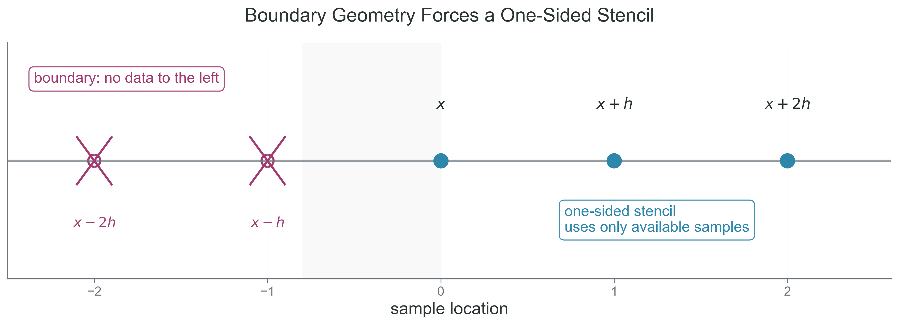

<!-- prep-banner:start -->
:::{warning} This reading is still being revised
Readings are reviewed and finalized **at least one week before they are
assigned**, so you will always have a settled version before you need it. Until
then, expect rough edges — wording, examples, and cross-references may change.

Where a reading disagrees with the syllabus, the syllabus is right. If something
here does not work, tell me: that is genuinely useful and I would rather hear it
from you than not.
:::
<!-- prep-banner:end -->

Part 1 showed how finite differences arise from Taylor series. Part 2 showed why floating-point arithmetic limits accuracy. Part 3 puts those ideas together: verify the theory numerically, build custom formulas on purpose, and decide when finite differences are the wrong tool.

## Learning Objectives

By the end of this section, you will be able to:

- [ ] **Verify** Taylor-series error predictions with numerical experiments and explain where round-off changes the observed trend.
- [ ] **Design** a custom finite-difference stencil by matching and canceling Taylor coefficients.
- [ ] **Measure** convergence order from computed data and use that measurement to check whether a method is behaving as expected.
- [ ] **Diagnose** situations in which finite differences are a poor choice because of noise, cost, or scale.
- [ ] **Compare** analytical derivatives, finite differences, and automatic differentiation when making coding decisions in scientific workflows.

## Introduction: From Theory to Practice

Why this matters: numerical analysis becomes useful only when it changes what you do in code. This reading is where the theory from Module 1 turns into practical method design and scientific judgment.

The main question is no longer "what is a derivative?" The main question is "how should I compute a derivative in a real scientific workflow, and how do I know the result is trustworthy?" Taylor series gives the truncation model, floating-point arithmetic gives the round-off model, and numerical experiments tell us whether the implemented method actually behaves the way the theory predicts.

:::{note} Opening Prediction

Before you see the first plot, make a call: which method should win on a log-log error plot?

Should the extra stencil points in a fourth-order method always make it the clear winner, or do you expect the small-$h$ end of the graph to complicate that story?

Which method should win on a log-log error plot?
:::

:::{note} First Look
:class: simple

Purpose: show the central qualitative pattern before the reusable helpers arrive.

Inputs/Outputs: the code uses one smooth benchmark function, scans a range of step sizes, and plots the error curves for three common stencils.

Common pitfall: reading the method labels and forgetting to inspect the left side of the plot, where round-off changes the ranking.
:::

```{code-cell} python
import math

import matplotlib.pyplot as plt
import numpy as np


def finite_diff_preview(f, x: float, h: float, method: str) -> float:
    """Return a minimal finite-difference preview for the opening experiment."""
    if method == "forward":
        return (float(f(x + h)) - float(f(x))) / h
    if method == "central":
        return (float(f(x + h)) - float(f(x - h))) / (2.0 * h)
    if method == "central4":
        return (
            -float(f(x + 2.0 * h))
            + 8.0 * float(f(x + h))
            - 8.0 * float(f(x - h))
            + float(f(x - 2.0 * h))
        ) / (12.0 * h)
    raise ValueError("method must be 'forward', 'central', or 'central4'.")


preview_function = np.sin
preview_x = 1.0
preview_true = float(np.cos(preview_x))
preview_h_values = np.logspace(-14, -1, 80)

fig, ax = plt.subplots(figsize=(7, 4.5))
for method_name in ["forward", "central", "central4"]:
    preview_errors = np.array(
        [
            abs(finite_diff_preview(preview_function, preview_x, h_value, method_name) - preview_true)
            for h_value in preview_h_values
        ]
    )
    ax.loglog(preview_h_values, preview_errors, label=method_name)

ax.set_xlabel("step size $h$")
ax.set_ylabel("absolute derivative error")
ax.set_title(r"Preview: error curves for $f(x)=\sin x$ at $x=1\,\mathrm{rad}$")
ax.legend()
ax.grid(True, which="both", alpha=0.25)
plt.show()
```

*What to notice: the right-hand side of each curve shows truncation error, so the slope reveals the method order. The left-hand upturn appears when round-off begins to dominate, which is why making $h$ smaller eventually stops helping.*

Interpretation: the preview answers the opening prediction in two stages. On the truncation-dominated side, higher-order methods win because their error falls faster with $h$. On the round-off-dominated side, even a formally better method can lose if the subtraction becomes numerically brittle.

:::{note} Shared Setup
:class: simple

The short reusable helpers below support the later experiments after the opening preview has already shown the main pattern. Later cells will say explicitly when they reuse these definitions.
:::

```{code-cell} python
import math

import matplotlib.pyplot as plt
import numpy as np


def finite_diff(f, x: float, h: float, method: str = "central") -> float:
    """Return a finite-difference approximation to the first derivative."""
    if not np.isfinite(x):
        raise ValueError("x must be finite.")
    if not np.isfinite(h) or h <= 0.0:
        raise ValueError("h must be a positive finite value.")

    method_name = method.lower()
    if method_name == "forward":
        return (float(f(x + h)) - float(f(x))) / h
    if method_name == "central":
        return (float(f(x + h)) - float(f(x - h))) / (2.0 * h)
    if method_name == "central4":
        return (
            -float(f(x + 2.0 * h))
            + 8.0 * float(f(x + h))
            - 8.0 * float(f(x - h))
            + float(f(x - 2.0 * h))
        ) / (12.0 * h)
    raise ValueError("method must be 'forward', 'central', or 'central4'.")


def one_sided_second_derivative(f, x: float, h: float) -> float:
    """Return a one-sided second-derivative approximation at a boundary."""
    if not np.isfinite(x):
        raise ValueError("x must be finite.")
    if not np.isfinite(h) or h <= 0.0:
        raise ValueError("h must be a positive finite value.")
    return (float(f(x + 2.0 * h)) - 2.0 * float(f(x + h)) + float(f(x))) / (h**2)


def observed_order(errors_coarse: float, errors_fine: float) -> float:
    """Estimate method order from two errors at h and h/2."""
    if errors_coarse <= 0.0 or errors_fine <= 0.0:
        raise ValueError("errors must be strictly positive.")
    return math.log(errors_coarse / errors_fine, 2.0)
```

## Verifying Error Predictions

Why this matters: if a method does not show the predicted slope in a controlled test, you should not trust it in a harder scientific problem.

For this experiment, the analytical information is known exactly. We choose $f(x)=\sin x$ and evaluate the derivative at $x=1\,\mathrm{rad}$, so the true derivative is $f'(x)=\cos x$ and the exact value is $\cos(1)$.

What is approximated numerically is the derivative itself, using forward, central, and fourth-order central finite-difference formulas evaluated over a range of step sizes.

What the theory predicts is not just "one method is better." It predicts specific slopes on a log-log plot, specific convergence ratios under halving, and a specific failure mode when round-off takes over.

The forward-difference truncation model is

$$
E_{\mathrm{trunc}}(h) = O(h).
$$

This equation says that, before round-off dominates, halving $h$ should reduce the forward-difference truncation error by about a factor of $2$.

The central-difference truncation model is

$$
E_{\mathrm{trunc}}(h) = O(h^2).
$$

This equation says that, before round-off dominates, halving $h$ should reduce the central-difference truncation error by about a factor of $4$.

The fourth-order central-difference truncation model is

$$
E_{\mathrm{trunc}}(h) = O(h^4).
$$

This equation says that, before round-off dominates, halving $h$ should reduce the fourth-order central-difference truncation error by about a factor of $16$.

More generally, if the leading error behaves like

$$
\text{error} \propto h^p,
$$

this equation says that the error is controlled by a power law in the step size.

Then halving the step size changes the leading error by about

$$
\frac{E(h)}{E(h/2)} \approx 2^p.
$$

This equation turns a theoretical order $p$ into a practical convergence-ratio check that you can measure from computed data.

For forward difference, Taylor series predicts

$$
\frac{f(x+h)-f(x)}{h} - f'(x)
\approx
\frac{h}{2} f''(x).
$$

This equation says that the leading forward-difference error is proportional to the second derivative of the function at the evaluation point.

For $f(x)=\sin x$, we have $f''(x)=-\sin x$, so at $x=1\,\mathrm{rad}$ the prediction becomes

$$
\frac{f(x+h)-f(x)}{h} - f'(x)
\approx
-\frac{h}{2}\sin x.
$$

This equation says that the forward-difference error should be negative at $x=1\,\mathrm{rad}$ because $\sin(1) > 0$.

For central difference, Taylor series predicts

$$
\frac{f(x+h)-f(x-h)}{2h} - f'(x)
\approx
\frac{h^2}{6} f'''(x).
$$

This equation says that the leading central-difference error is proportional to the third derivative and therefore falls more quickly with $h$.

For $f(x)=\sin x$, we have $f'''(x)=-\cos x$, so at $x=1\,\mathrm{rad}$ the prediction becomes

$$
\frac{f(x+h)-f(x-h)}{2h} - f'(x)
\approx
-\frac{h^2}{6}\cos x.
$$

This equation says that the central-difference error should also be negative here, but much smaller for moderate $h$ because it is second order rather than first order.

The experiment below checks four things at once:

- what is known analytically: $f'(1)=\cos(1)$,
- what is approximated numerically: forward, central, and fourth-order central derivatives,
- what the theory predicts: slopes of $1$, $2$, and $4$ on a log-log truncation plot,
- what the computation tests: whether the measured error follows those slopes before round-off turns the curves upward.

This cell reuses the shared helper functions defined earlier.

What students should compare in the output: the slope on the right side of each curve, the ordering of the methods in the truncation-dominated regime, and the left-side upturn where shrinking $h$ stops helping.

```{code-cell} python
f = np.sin
x0 = 1.0
true_value = float(np.cos(x0))
h_values = np.logspace(-14, -1, 80)

errors = {}
for method_name in ["forward", "central", "central4"]:
    errors[method_name] = np.array(
        [abs(finite_diff(f, x0, h_value, method_name) - true_value) for h_value in h_values]
    )

fig, ax = plt.subplots(figsize=(7, 4.5))
for method_name in ["forward", "central", "central4"]:
    ax.loglog(h_values, errors[method_name], label=method_name)
ax.set_xlabel("step size $h$")
ax.set_ylabel("absolute derivative error")
ax.set_title(r"Finite-difference error for $f(x)=\sin x$ at $x=1\,\mathrm{rad}$")
ax.legend()
ax.grid(True, which="both", alpha=0.25)
plt.show()
```

The plotted curves should show straight-line truncation behavior on the right and round-off upturn on the left. That is the practical version of the theory from Parts 1 and 2.

This cell reuses the shared helper functions defined earlier.

What the table is checking: whether halving $h$ changes the error by about the factor Taylor series predicts before round-off interferes.

```{code-cell} python
ratio_h_values = [1.0e-1, 5.0e-2, 2.5e-2, 1.25e-2]
print("Observed convergence orders before round-off dominates")
print("-" * 64)
print(f"{'method':10s} {'h':>10s} {'abs error':>14s} {'observed p':>14s}")

for method_name in ["forward", "central", "central4"]:
    method_errors = [
        abs(finite_diff(f, x0, h_value, method_name) - true_value)
        for h_value in ratio_h_values
    ]
    for idx, (h_value, error_value) in enumerate(zip(ratio_h_values, method_errors)):
        if idx == 0:
            print(f"{method_name:10s} {h_value:10.2e} {error_value:14.3e} {'-':>14s}")
        else:
            p_value = observed_order(method_errors[idx - 1], error_value)
            print(f"{'':10s} {h_value:10.2e} {error_value:14.3e} {p_value:14.3f}")
```

This table checks whether the measured order approaches the Taylor-series prediction before floating-point effects interfere.

The takeaway is simple: when the observed slope matches the predicted slope in the right regime, the implementation and the theory are telling the same story.

## Designing Custom Finite Difference Formulas

Why this matters: real scientific codes often need derivatives at boundaries, interfaces, or irregular data locations where the standard centered stencil is unavailable.

Student mental model: designing a stencil is solving a cancellation problem with Taylor coefficients.

Suppose we want $f''(x)$ at a boundary point and only have access to $f(x)$, $f(x+h)$, and $f(x+2h)$. Boundary points force one-sided formulas because the data do not exist symmetrically on both sides.

The derivative we want is the second derivative $f''(x)$. The unwanted terms are $f(x)$, $f'(x)$, and as many higher-order terms as possible. The strategy is to choose a linear combination that cancels the unwanted Taylor coefficients and leaves the target derivative behind.

What is known exactly in this section is the Taylor expansion of each nearby sample. What is approximated numerically is the boundary second derivative, where symmetry is unavailable. What the theory predicts is that the missing left-hand data will cost accuracy.

Start with the forward Taylor expansion:

$$
f(x+h)=f(x)+h f'(x)+\frac{h^2}{2}f''(x)+\frac{h^3}{6}f'''(x)+O(h^4).
$$

This equation says that a sample one step away contains the value, slope, curvature, and higher-order corrections.

Now write the expansion two steps away:

$$
f(x+2h)=f(x)+2h f'(x)+2h^2 f''(x)+\frac{4h^3}{3}f'''(x)+O(h^4).
$$

This equation says that moving farther away changes the Taylor coefficients in a predictable way, which is exactly what lets us engineer cancellations.

To remove the first-derivative term, form the combination $f(x+2h)-2f(x+h)+f(x)$:

$$
f(x+2h)-2f(x+h)+f(x)=h^2 f''(x)+h^3 f'''(x)+O(h^4).
$$

This equation says that the constant and first-derivative terms cancel, leaving the second derivative as the leading surviving term.

Now divide by $h^2$:

$$
f''(x) \approx \frac{f(x+2h)-2f(x+h)+f(x)}{h^2}.
$$

This equation gives a one-sided approximation to the second derivative using only boundary-accessible function values.

The truncation model for this stencil is

$$
f''(x) = \frac{f(x+2h)-2f(x+h)+f(x)}{h^2} + O(h).
$$

This equation says that the one-sided second-derivative stencil is only first-order accurate, which is the price we pay for losing symmetry at the boundary.

:::{warning} Common Misconception

Using more points does not automatically produce a better method. Extra points help only if their Taylor coefficients are combined in a way that actually cancels lower-order error terms.
:::

This cell reuses the shared helper functions defined earlier.

What students should compare in the output: how the absolute error shrinks when $h$ is halved, and whether the measured order stays near $1$ instead of drifting toward the centered-method orders from earlier.

```{code-cell} python
f_exp = np.exp
x_boundary = 0.0
true_second = float(np.exp(x_boundary))
h_values_boundary = [1.0e-1, 5.0e-2, 2.5e-2, 1.25e-2]
errors_boundary = []

print("One-sided second derivative for f(x) = e^x at x = 0")
print("-" * 64)
print(f"{'h':>10s} {'approx':>14s} {'abs error':>14s} {'observed p':>14s}")
for idx, h_value in enumerate(h_values_boundary):
    approx = one_sided_second_derivative(f_exp, x_boundary, h_value)
    error_value = abs(approx - true_second)
    errors_boundary.append(error_value)
    if idx == 0:
        print(f"{h_value:10.2e} {approx:14.8f} {error_value:14.3e} {'-':>14s}")
    else:
        p_value = observed_order(errors_boundary[idx - 1], error_value)
        print(f"{h_value:10.2e} {approx:14.8f} {error_value:14.3e} {p_value:14.3f}")
```

This numerical check should show observed order near $1$, which confirms the first-order Taylor prediction for the boundary stencil.

This confirms the first-order convergence predicted by Taylor series. Losing symmetry costs an order of accuracy.

{#fig-boundary-stencil width="100%"}

## General Recipe for Custom Methods

Why this matters: once you see stencil design as a systematic process, you can build methods for boundaries, PDE grids, and irregular geometries instead of memorizing isolated formulas.

Use this recipe when you need a custom stencil:

1. Choose the sample locations your problem actually provides, such as $x-h$, $x$, $x+h$, or a one-sided boundary set.
2. Expand each sample value about the point where you want the derivative.
3. Assign unknown stencil weights to the samples you plan to combine.
4. Match the target derivative by forcing its coefficient to become $1$ after the appropriate division by $h$.
5. Cancel the lower-order unwanted terms, starting with constants and then moving through the derivative terms you do not want.
6. Identify the first term that survives, because that term sets the truncation order.
7. Verify the observed order numerically on a smooth function with a known derivative.

The structured summary below is the compact version of the workflow:

| Design step | Question to ask | Typical output |
|---|---|---|
| Geometry | Which sample points are available? | centered or one-sided stencil points |
| Taylor model | What derivatives appear in each expansion? | coefficient table in powers of $h$ |
| Cancellation | Which terms must vanish? | a linear system for the stencil weights |
| Accuracy | Which term survives first? | the order $p$ in $\text{error} \propto h^p$ |
| Validation | Does the implementation show the predicted slope? | numerical verification against the expected order |

This is a stencil-design workflow, not a formula to memorize. This same logic reappears in PDE finite-difference stencils, ghost-cell formulas, and boundary-condition enforcement.

## When NOT to Use Numerical Derivatives

Why this matters: good numerical work includes knowing when not to apply a familiar tool.

### Analytical Derivatives Available

Why this matters: if symbolic differentiation is easy and the expression is stable, finite differences are usually inferior because they add truncation and round-off error to a problem that did not need them.

Consider the polynomial

$$
f(x)=x^3-2x^2+5x-3.
$$

This equation defines a function whose derivative is easy to compute exactly by hand.

The analytical derivative is

$$
f'(x)=3x^2-4x+5.
$$

This equation says that we can evaluate the derivative directly, with no step-size tuning and no finite-difference approximation error.

This cell reuses the shared helper functions defined earlier.

What students should compare in the output: the exact derivative, the finite-difference approximation, and the small but nonzero difference that appears only because the numerical method introduces approximation and floating-point error.

```{code-cell} python
def polynomial(x: float) -> float:
    """Return a cubic polynomial used for a clean derivative comparison."""
    return x**3 - 2.0 * x**2 + 5.0 * x - 3.0


def polynomial_derivative(x: float) -> float:
    """Return the exact derivative of the comparison polynomial."""
    return 3.0 * x**2 - 4.0 * x + 5.0


x_poly = 2.0
exact_poly = polynomial_derivative(x_poly)
numeric_poly = finite_diff(polynomial, x_poly, 1.0e-5, method="central")

print(f"Exact derivative:          {exact_poly:.12f}")
print(f"Finite-difference result:  {numeric_poly:.12f}")
print(f"Absolute difference:       {abs(numeric_poly - exact_poly):.3e}")
```

Finite differences are often a useful fallback, not the gold standard.

### Noisy Data

Why this matters: differentiation amplifies high-frequency variation, so even modest measurement noise can overwhelm the derivative.

Suppose a velocity curve or luminosity signal is measured with small observational noise. The function values may still look reasonable, but numerical differentiation magnifies the noise because differences divide by a small spacing.

What is known exactly here is the smooth underlying signal. What is approximated numerically is the derivative of noisy samples, and what theory predicts is amplification of the shortest-scale fluctuations.

This cell is self-contained and does not depend on the shared helper functions.

```{code-cell} python
rng = np.random.default_rng(536)
x_noise = np.linspace(0.0, 2.0 * np.pi, 250)
y_true = np.sin(x_noise)
y_noisy = y_true + 0.01 * rng.standard_normal(len(x_noise))
dy_dx_numeric = np.gradient(y_noisy, x_noise)
dy_dx_true = np.cos(x_noise)

fig, ax = plt.subplots(figsize=(7, 4.5))
ax.plot(x_noise, dy_dx_true, label="true derivative")
ax.plot(x_noise, dy_dx_numeric, label="derivative of noisy data")
ax.set_xlabel("$x$")
ax.set_ylabel("derivative estimate")
ax.set_title("Noise amplification under numerical differentiation")
ax.legend()
ax.grid(True, alpha=0.25)
plt.show()
```

*What to notice: the derivative curve becomes jagged even though the original noise is mild. The amplification is strongest at small scales because differencing divides by the sample spacing, which is exactly why direct numerical derivatives are dangerous on noisy measurements.*

If the scientific quantity is noisy, smoothing, model fitting, or a weak-form approach is often more defensible than direct finite differencing.

The takeaway is that a visually reasonable signal can still produce a scientifically misleading derivative.

### Expensive Function Evaluations

Why this matters: some "functions" are really whole simulations, optimization solves, or Monte Carlo estimates.

A single function evaluation might mean integrating an ODE system for a stellar model, running a radiative-transfer iteration, or estimating a likelihood with thousands of random samples. In that setting, even a central difference costs two expensive evaluations per scalar derivative, and higher-order stencils cost more.

As a concrete example, suppose one function call means integrating an orbit for $10^5$ timesteps or solving a PDE relaxation to tolerance. Then a gradient with $100$ parameters already requires hundreds of such solves if you use finite differences.

The takeaway is that cost alone can make an otherwise valid derivative estimate a poor scientific choice.

### You Need Many Derivatives

Why this matters: finite differences scale linearly with the number of differentiated inputs, which becomes absurd for modern optimization problems.

If you need derivatives with respect to many parameters, the cost explodes:

```{code-cell} python
def finite_difference_call_count(n_parameters: int, method: str = "central") -> int:
    """Return the number of function calls needed for one gradient."""
    if n_parameters <= 0:
        raise ValueError("n_parameters must be positive.")
    calls_per_parameter = {"forward": 1, "central": 2, "central4": 4}[method]
    return n_parameters * calls_per_parameter


for n_parameters in [10, 10_000, 1_000_000]:
    forward_calls = finite_difference_call_count(n_parameters, method="forward")
    central_calls = finite_difference_call_count(n_parameters, method="central")
    print(
        f"parameters = {n_parameters:>9d}  "
        f"forward calls = {forward_calls:>9d}  "
        f"central calls = {central_calls:>9d}"
    )
```

For neural networks or large inverse problems, finite differences for millions of parameters is not merely inconvenient. It is computationally unreasonable.

The takeaway is that scaling with parameter count is a scientific design constraint, not just an implementation nuisance.

(automatic-differentiation)=
## Automatic Differentiation

Why this matters: automatic differentiation is one of the core modern tools for optimization, inverse problems, and machine learning.

Automatic differentiation differentiates the implemented computation itself. It is not symbolic algebra, and it is not finite differencing. It is also not taking derivatives of some idealized mathematical object floating in Platonic heaven. Instead, it applies the chain rule to the executed computation graph and returns derivatives accurate up to the floating-point precision of that implemented computation.

What is known exactly here is the code path you actually execute. What is approximated or constrained numerically is everything imposed by floating-point arithmetic, control flow, and the smoothness of the implemented operations.

Here is the clean distinction:

| Method | Derivative quality | Cost | Typical use | Limitations |
|---|---|---|---|---|
| Symbolic differentiation | exact algebraic derivative before numerical evaluation | can become algebraically cumbersome | simple closed-form expressions, computer algebra | may be unavailable for black-box code or complex control flow |
| Finite differences | approximate derivative with truncation and round-off error | multiple function evaluations per derivative | black-box verification, quick experiments, small parameter counts | sensitive to $h$, noise, and computational cost |
| Automatic differentiation | derivative of the implemented computation to machine precision | often comparable to a small multiple of function evaluation cost | optimization, neural networks, inverse problems | needs AD-compatible code and still inherits floating-point and differentiability limits |

:::{important} AD Is Powerful, Not Magical

Automatic differentiation does not rescue discontinuous models or numerically unstable implementations. It differentiates the code you wrote, including its weaknesses.

- Discontinuous logic and hard branches can make derivatives misleading or undefined.
- clipping and lookup tables can create flat or non-smooth behavior that hides the sensitivity you actually care about.
- Numerically unstable code can produce unstable derivatives just as easily as unstable function values.
- iterative solvers whose outputs are not smoothly related to inputs can make the reported derivative difficult to interpret scientifically.
:::

This conceptual preview reuses `finite_diff` and `math` from the shared setup above. It is intentionally not a full dependency-heavy tutorial.

```python
import jax
import jax.numpy as jnp


def jax_function(x):
    """Return a smooth function for an automatic-differentiation preview."""
    return jnp.sin(x) * jnp.exp(-x**2) + x**3


def analytical_derivative(x: float) -> float:
    """Return the analytical derivative of the preview function."""
    return (
        math.cos(x) * math.exp(-x**2)
        - 2.0 * x * math.sin(x) * math.exp(-x**2)
        + 3.0 * x**2
    )


x_ad = 1.0
ad_value = float(jax.grad(jax_function)(x_ad))
exact_value = analytical_derivative(x_ad)
fd_value = finite_diff(lambda z: math.sin(z) * math.exp(-(z**2)) + z**3, x_ad, 1.0e-5)

print(f"Analytical derivative:      {exact_value:.12f}")
print(f"Automatic differentiation: {ad_value:.12f}")
print(f"Finite difference:         {fd_value:.12f}")
print(f"|AD - exact|:              {abs(ad_value - exact_value):.3e}")
print(f"|FD - exact|:              {abs(fd_value - exact_value):.3e}")
```

This preview is intentionally shown without in-page execution so the reading stays lightweight and render-stable. The key point is narrower and more honest: AD removes finite-difference truncation error and step-size tuning, but it still inherits the floating-point and smoothness limits of the implemented computation.

The takeaway is that AD is powerful because it matches the code you run, not because it transcends numerical analysis.

## When to Use Each Method

Why this matters: decision frameworks are useful only if they reflect actual computational trade-offs.

Use this decision tree as a heuristic, not a law:

1. If an analytical derivative is easy to derive and evaluate stably, use it.
2. If the function is a black box and you only need a few derivatives, finite differences may be reasonable.
3. If the data are noisy, avoid direct differentiation unless you first smooth or model the signal.
4. If you need many derivatives and have access to differentiable source code, automatic differentiation is usually the right tool.
5. If the function evaluation is extremely expensive, rethink whether derivative-free reformulation, surrogate modeling, or adjoint methods would be better.

The right choice depends on smoothness, cost, noise, and access to the source code of the implemented computation.

| Method | Best when | Main strength | Main weakness | Typical COMP 521 use case |
|---|---|---|---|---|
| Analytical derivative | closed-form math is available | no truncation error and no step-size tuning | may be tedious or unavailable | checking toy models and benchmark functions |
| Finite differences | black-box function, small derivative count | easy to implement and easy to inspect | sensitive to $h$, noise, and evaluation cost | validating convergence ideas and debugging |
| Automatic differentiation | differentiable source code and many parameters | scalable accurate gradients for implemented code | depends on AD-compatible operations | optimization and neural-network training |

{#fig-method-selection width="100%"}

:::{note} Research Reality

The table is easier to trust if you map it to actual workflows:

- Black-box simulation output: finite differences are often the fastest first diagnostic because you can probe behavior without rewriting the solver.
- Noisy observed data: direct differentiation is usually the wrong first move; fit or smooth the signal before treating slopes as trustworthy.
- Many-parameter optimization: automatic differentiation wins because finite differences scale poorly with parameter count.
- Symbolic closed-form benchmark: analytical derivatives are ideal for verification because they give you a clean target before you trust anything more complicated.
:::

## Verification Strategy

Why this matters: scientific verification is stronger than "two numbers seem close."

If you know a true derivative, compare against it. If you do not know a true derivative, compare multiple step sizes and multiple stencils. Agreement between two wrong methods is still possible, so method comparison must be tied to convergence expectations, not just raw closeness.

This section separates three different checks that students often blur together:

- exact-reference testing: compare against a derivative you know analytically,
- cross-method comparison: compare different numerical stencils against one another,
- convergence-order testing: check whether refinement behaves with the slope theory predicts.

For the mixed test function

$$
f(x)=\sin x\,e^{-x^2}+x^3,
$$

we can still differentiate analytically and use that exact derivative as a benchmark.

The analytical derivative is

$$
f'(x)=e^{-x^2}\left(\cos x - 2x \sin x\right) + 3x^2.
$$

This equation gives us a trustworthy target for checking several numerical stencils at once.

This cell reuses the shared helper functions defined earlier.

What students should compare in the output: how the different stencils rank at the same $x$, how the error changes with $h$, and whether the better-looking result is also the one supported by convergence expectations.

```{code-cell} python
def mixed_function(x: float) -> float:
    """Return a smooth benchmark function for verification."""
    return math.sin(x) * math.exp(-(x**2)) + x**3


def mixed_derivative(x: float) -> float:
    """Return the analytical derivative of the benchmark function."""
    return math.exp(-(x**2)) * (math.cos(x) - 2.0 * x * math.sin(x)) + 3.0 * x**2


x_verify = 0.7
true_verify = mixed_derivative(x_verify)
h_verify_values = [1.0e-2, 1.0e-4, 1.0e-6]

print(f"Verification at x = {x_verify}")
print("-" * 72)
print(f"{'method':10s} {'h':>10s} {'approx':>14s} {'abs error':>14s}")
for method_name in ["forward", "central", "central4"]:
    for h_value in h_verify_values:
        approx = finite_diff(mixed_function, x_verify, h_value, method_name)
        error_value = abs(approx - true_verify)
        print(f"{method_name:10s} {h_value:10.1e} {approx:14.8f} {error_value:14.3e}")
```

This comparison teaches a practical lesson: reliable verification uses both exact-reference testing and cross-method comparison, but it becomes compelling only when convergence-order testing tells the same story.

:::{warning} Agreement Is Necessary, Not Sufficient

If two methods agree, that is encouraging. It does not prove they are correct. They may be sharing the same bug, the same bad scaling choice, or the same round-off-dominated regime.
:::

Use this verification checklist when validating a derivative computation:

- Exact-reference testing: test on functions with known derivatives first.
- Cross-method comparison: compare multiple stencils at the same evaluation point.
- Convergence-order testing: compare multiple $h$ values and verify the expected order.

If convergence fails, the cause may be a bug, the wrong asymptotic regime, round-off domination, or loss of smoothness.

Agreement between methods is encouraging, but not by itself proof of correctness.

:::{important} Throughline Recap

Part 3 closes the loop from the rest of Module 1. Taylor series tells you what a stencil is trying to cancel, and numerical experiments tell you whether the implemented method actually behaves that way.

The deeper lesson is that method choice is scientific judgment, not just formal derivation. Smoothness, noise, evaluation cost, and code access all change what "best" means.

Carry that mindset into Module 2: every new algorithm will still ask both questions at once, "what is the approximation?" and "when should I trust it?"
:::

## Bridge to Module 2 and Beyond

Why this matters: Taylor-series reasoning does not disappear after finite differences. It keeps reappearing in almost every major numerical method.

The same habits you built here will reappear when you solve

$$
f(x)=0,
$$

because root-finding methods depend on local approximations and convergence behavior.

The same logic will reappear when you approximate

$$
\int f(x)\,dx,
$$

because quadrature rules are also built by matching and canceling Taylor terms.

The same reasoning returns again for differential equations such as

$$
\frac{dy}{dt}=f(t,y),
$$

because ODE solvers are designed around local truncation error, stability, and the repeated accumulation of floating-point effects.

Module 2 moves from single-point derivative estimates to root finding, quadrature, and time stepping. The throughline is the same: Taylor-series reasoning tells us what the method is trying to approximate, and numerical verification tells us whether the implementation actually behaves that way.

The takeaway to carry forward is that every new method still demands both approximation logic and verification evidence.

## Final Checklist

Before you leave Module 1, make sure you can:

- [ ] verify a predicted convergence order with computed data,
- [ ] derive a one-sided stencil by canceling Taylor terms,
- [ ] explain why noisy data and expensive function evaluations change the method choice,
- [ ] describe what automatic differentiation does and what it does not promise,
- [ ] carry Taylor-series reasoning into later topics such as $f(x)=0$, $\int f(x)\,dx$, and $\frac{dy}{dt}=f(t,y)$.

*Next: Module 2 - Root finding, quadrature, and the first numerical time-evolution methods.*
