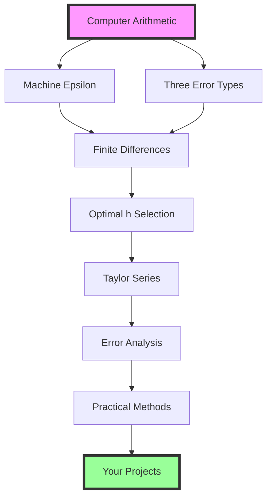

:::{note} Connection to quadrature
Use this synthesis with the quadrature reading while you build and test a
reusable integration module. The relevant habits are to state the discrete approximation, predict its leading
error, measure the prediction before the round-off floor, and test the public
interface rather than only a notebook result.
:::

## Module Summary: Your Numerical Toolkit



This module has given you a complete foundation for numerical computing built on understanding fundamental limitations:

**Part 1** established the discrete derivative problem:
- Computers cannot take limits $h \to 0$
- Finite differences approximate derivatives
- Optimal $h$ balances truncation vs round-off error
- Symmetric methods achieve higher accuracy

**Part 2** established the limits of computer arithmetic:
- Machine epsilon limits precision
- Three error types interact and propagate
- Catastrophic cancellation destroys accuracy
- Reformulation preserves precision

**Part 3** provided the mathematical framework:
- Taylor series identifies leading error terms
- Custom methods for special cases
- When to avoid numerical derivatives
- Modern automatic differentiation

The diagram is a dependency chain: finite representations and finite-difference
approximations lead to Taylor-series error models, which then support practical
verification. The same chain supports quadrature rules.

## Key Takeaways

- Computers represent finite binary approximations, not exact real numbers.
- Reducing $h$ lowers truncation error only until round-off becomes relevant.
- Taylor expansions identify a method's leading omitted term and expected order.
- Symmetry can cancel leading terms, but it does not remove assumptions about
  smoothness or floating-point arithmetic.
- Error type determines the remedy: a stable reformulation cannot remove a
  discretization error, and more panels cannot improve a round-off floor.
- A known reference, a convergence study, and a test of invalid inputs check
  different parts of an implementation.
- Automatic differentiation removes finite-difference step-size tuning; it does
  not make the implemented floating-point computation exact or universally
  differentiable.

(foundations-investigation)=
## Investigation: which derivative should we trust?

You have three plausible answers to the same derivative calculation. One uses
more function evaluations, one uses a smaller step, and one agrees with a
second calculation to many digits. Which evidence would make you trust an
answer? None of those descriptions is sufficient by itself.

We will bring the module together using the smooth, dimensionless function
from the Taylor reading,

$$f(x)=\sin(x)e^{-x^2}+x^3,$$

at $x=0.7$. The function and its derivative are dimensionless here. We will
first inspect numerical evidence, then reveal an analytical reference. This
ordering lets us practice a decision that is useful when an exact reference
is unavailable, while still having a way to check our reasoning afterward.

### Predict: name the mechanism before choosing the repair

Before running the cell, write down:

1. The expected orders of the forward, central, and fourth-order differences.
2. How each error should change when $h$ is halved in its truncation regime.
3. Whether the smallest $h$ should give the most accurate answer.
4. One observation that would make you revise your prediction.

For example, “smaller $h$ must help” would be contradicted by an error that
stops decreasing and then grows. A measured slope is evidence about a regime;
it is not a property that every collection of step sizes must display.

```{code-cell} python
import numpy as np
import matplotlib.pyplot as plt


def investigation_function(x):
    return np.sin(x) * np.exp(-x*x) + x**3


def derivative_estimate(f, x, h, method):
    """Three previously derived stencils; no shared cached evaluations."""
    if method == "forward":
        return (f(x + h) - f(x)) / h
    if method == "central":
        return (f(x + h) - f(x - h)) / (2*h)
    if method == "central4":
        return (-f(x + 2*h) + 8*f(x + h) - 8*f(x - h) + f(x - 2*h)) / (12*h)
    raise ValueError("Choose forward, central, or central4")


x_probe = 0.7
# logspace produces equally spaced exponents: a broad sweep of resolutions.
h_probe = np.logspace(-1, -15, 29)
methods = ("forward", "central", "central4")
estimates = {
    method: np.array([derivative_estimate(investigation_function, x_probe, h, method)
                      for h in h_probe])
    for method in methods
}
# [::4] displays every fourth entry; calculations still use the full sweep.
for i in range(0, len(h_probe), 4):
    values = "  ".join(f"{estimates[m][i]:.10f}" for m in methods)
    print(f"h={h_probe[i]:.1e}: {values}")
```

The columns are forward, central, and fourth-order estimates. Identify a range
where the answers approach one another and a range where the extra digits stop
being persuasive. Record a candidate before consulting the reference.

Agreement is useful but cannot separate a correct calculation from two methods
sharing an input error, a bug, or an unresolved feature. We need evidence tied
to the mechanism of approximation.

### Reveal the reference and measure the regime

Differentiating the function gives

$$f'(x)=e^{-x^2}\bigl(\cos x-2x\sin x\bigr)+3x^2.$$

For this exercise, the accuracy requirement is **relative derivative error at
most $10^{-8}$**. This is a chosen instructional target, not a default tolerance
for scientific work. Because the reference is nonzero, the equivalent absolute
allowance is $10^{-8}|f'(0.7)|$.

```{code-cell} python
reference_probe = np.exp(-x_probe*x_probe) * (
    np.cos(x_probe) - 2*x_probe*np.sin(x_probe)
) + 3*x_probe*x_probe
absolute_target = 1e-8 * abs(reference_probe)
errors_probe = {m: np.abs(estimates[m] - reference_probe) for m in methods}

fig, ax = plt.subplots(figsize=(8, 4.6), layout="constrained")
for method in methods:
    ax.loglog(h_probe, errors_probe[method], "o-", ms=3, label=method)
ax.axhline(absolute_target, color="black", ls="--", label="exercise target")
ax.set(xlabel="h (dimensionless)", ylabel="absolute derivative discrepancy",
       title="Locate an accurate regime before selecting an answer")
ax.grid(alpha=0.2)
ax.legend()
plt.show()

calls_per_estimate = {"forward": 2, "central": 2, "central4": 4}
for method in methods:
    passing = np.isclose(estimates[method], reference_probe,
                         rtol=0.0, atol=absolute_target)
    print(method, "calls per estimate:", calls_per_estimate[method],
          "tested h values meeting target:", h_probe[passing])
```

`np.abs` takes each discrepancy's magnitude. The plot compares those magnitudes
with a target established before inspecting the results. Setting `rtol=0`
ensures that `isclose` uses only the absolute allowance we just derived.
The analytical formula is evaluated in binary64, so this comparison cannot
resolve arbitrarily small errors; the last few digits of its reference are
also subject to floating-point arithmetic.

The call counts describe a single estimate with no caching. They do not include
the cost of the exploratory sweep, and they are not timings. Here central and
forward differences both use two calls; a fourth-order estimate uses four. A
more expensive estimate may earn its cost if it meets an accuracy requirement
at a resolution where another stencil does not.

:::{tip} Compare your diagnosis with the evidence
:class: dropdown

A defensible answer names a method **and a step in a measured reliable range**.
It explains the expected truncation trend, checks that the chosen discrepancy
meets the stated target, and avoids choosing a lone unusually small error at
an accidental cancellation. Nearby resolutions provide a useful cross-check.

The initial decrease follows omitted Taylor terms. At sufficiently small
steps, subtraction and function-evaluation errors are divided by $h$ and
become important. A fourth-order stencil cancels more Taylor terms but still
uses finite-precision function values. It has no exemption from that limit.

Changing the tolerance until a test passes changes the acceptance decision,
not the estimate. Increasing arithmetic precision can move a rounding limit;
it does not increase a stencil's mathematical order. If your selected method
misses the target in its truncation regime, refine or change the stencil. If
it is already dominated by rounding, further refinement is the wrong repair.

A response saying only “central4 is best” or “the methods agree” has not yet
identified why the answer should be trusted.
:::

### Transfer: change the function evaluations, keep the question

Now suppose every function value has a small deterministic perturbation:

$$\widetilde f(x)=f(x)+\delta\sin(kx),\qquad
\delta=10^{-7},\quad k=10^4.$$

This is a controlled surrogate for imperfect function evaluations, not a
statistical model of random noise. We still want the derivative of the
original $f$. Predict what happens when central differences resolve the
perturbation. Will their error relative to $f'$ approach zero?

```{code-cell} python
perturbation_size = 1e-7
perturbation_frequency = 1e4


def perturbed_function(x):
    return investigation_function(x) + perturbation_size*np.sin(perturbation_frequency*x)


perturbed_estimates = np.array([
    derivative_estimate(perturbed_function, x_probe, h, "central") for h in h_probe
])
perturbation_derivative = (
    perturbation_size*perturbation_frequency*np.cos(perturbation_frequency*x_probe)
)
print("Added derivative term at x=0.7:", perturbation_derivative)
print("Central estimate at h=1e-5:", derivative_estimate(perturbed_function, x_probe, 1e-5, "central"))

fig, ax = plt.subplots(figsize=(8, 4.6), layout="constrained")
ax.loglog(h_probe, errors_probe["central"], "o-", ms=3, label="unperturbed evaluations")
ax.loglog(h_probe, np.abs(perturbed_estimates-reference_probe), "s-", ms=3,
          label="perturbed evaluations; original target derivative")
ax.axhline(abs(perturbation_derivative), color="black", ls="--",
           label="magnitude of added derivative")
ax.set(xlabel="h (dimensionless)", ylabel="discrepancy from original derivative")
ax.grid(alpha=0.2)
ax.legend()
plt.show()
```

:::{tip} Explain the changed limit
:class: dropdown

Once it resolves the perturbation, the stencil approximates
$\widetilde f'=f'+\delta k\cos(kx)$, rather than $f'$. The added function term
has amplitude $10^{-7}$, while its derivative has amplitude $10^{-3}$.
Differentiation magnifies rapid variation. More accurate differentiation of
the supplied function does not recover the function we originally intended.

At coarse resolutions the perturbation may be underresolved and its sampled
contribution can oscillate or cancel. One fortunate step does not establish
accuracy. At very fine resolutions floating-point effects still appear.
A useful investigation changes one feature at a time: set $\delta=0$, vary
$k$, and compare the resulting transitions with these predictions.

The repair depends on what the function evaluations mean. If this term models
measurement uncertainty, smoothing requires a justified model and an uncertainty
analysis. If it is a bug in a function evaluator, repair the evaluator. A
smaller finite-difference step cannot make that decision for us.
:::

Before moving on, write a three-sentence numerical conclusion: **what you
computed, which evidence supports it, and which uncertainty remains**. Those
sentences should distinguish truncation, finite precision, and imperfect input
information without treating them as interchangeable causes.

## Looking Forward

These foundations lead directly to:

- **Quadrature**: left rectangle, trapezoid, and Simpson rules; convergence
  orders $1$, $2$, and $4$; tested implementations; and adaptive, substitution,
  and Monte Carlo extensions.
- **Root finding**: contracts for bisection, Newton, and secant methods.
- **Time evolution**: ODE methods, where local error, accumulated global error,
  and stability must all be checked.

Every numerical result is an approximation with assumptions. State the
approximation, measure the regime, and test the contract before drawing a
scientific conclusion.

---

## Quick Reference Tables

### Finite Difference Formulas

| Method | Formula | Truncation order | Rough $h$ scale in well-scaled double precision |
|--------|---------|-------------|-----------|
| Forward | $\frac{f(x+h) - f(x)}{h}$ | $O(h)$ | $\sqrt{\epsilon} \approx 10^{-8}$ |
| Backward | $\frac{f(x) - f(x-h)}{h}$ | $O(h)$ | $\sqrt{\epsilon} \approx 10^{-8}$ |
| Central | $\frac{f(x+h) - f(x-h)}{2h}$ | $O(h^2)$ | $\epsilon^{1/3} \approx 10^{-5}$ |
| 4th-order | $\frac{-f(x+2h) + 8f(x+h) - 8f(x-h) + f(x-2h)}{12h}$ | $O(h^4)$ | $\epsilon^{1/5} \approx 10^{-3}$ |

### Error Types and Mitigation

| Error Type | Source | Typical scaling | Mitigation |
|------------|--------|---------|------------|
| Round-off | Finite precision | Often amplified like $\epsilon/h$ in first-derivative differences; not universal | Inspect operation scaling; reformulate or adjust precision/resolution |
| Truncation | Approximation | $\propto h^p$ | Use smaller h, higher-order methods |
| Propagation | Iteration | Problem- and algorithm-dependent | Stable algorithms, invariants, and cross-resolution checks |

### When to Use Each Differentiation Method

| Situation | Recommended Method | Reason |
|-----------|-------------------|---------|
| Smooth black-box function | Finite differences | Uses values without differentiable source; complex-step is another option when its assumptions hold |
| Smooth function, moderate accuracy | Central difference | Good accuracy/cost balance |
| Boundary points | One-sided differences | Symmetric not possible |
| Noisy data | Model uncertainty; consider justified smoothing or avoid direct differentiation | Derivatives amplify rapid variation; smoothing changes the estimation problem |
| Many inputs, one scalar output | Reverse-mode automatic differentiation | Gradient arithmetic can cost a constant multiple of the primal computation; storage and primal cost still depend on the problem |
| Known analytical form | Analytical derivative | Removes finite-difference truncation; evaluation cost and rounding still matter |

### Common Reformulations for Stability

| Unstable Form | Stable Form | When Needed |
|---------------|-------------|-------------|
| $a - b$ | Store a meaningful relative coordinate when the model permits | Nearby large coordinates; cannot recover information already lost in stored inputs |
| $(a^2 - b^2)/(a - b)$ | $a + b$ | $a \approx b$ |
| $\sqrt{x+1} - \sqrt{x}$ | $1/(\sqrt{x+1} + \sqrt{x})$ | Large $x$ |
| $1 - \cos(x)$ | $2\sin^2(x/2)$ | Small $x$ |
| $\log(x) - \log(y)$ | `np.log1p((x-y)/y)` | Positive nearby inputs; retain their represented difference |

---

## Glossary

**Automatic differentiation (AD)**: Technique for differentiating the operations
in an implemented computation by applying the chain rule. It avoids the
finite-difference truncation error and step-size choice, but still uses
floating-point arithmetic and requires differentiable program operations.

**Catastrophic cancellation**: Severe loss of precision when subtracting nearly
equal floating-point numbers. The subtraction can discard digits needed to
resolve the small difference.

**Central difference**: Finite difference method using points symmetrically placed around the evaluation point: $f'(x) \approx \frac{f(x+h) - f(x-h)}{2h}$. Achieves $O(h^2)$ accuracy.

**Convergence**: The property that numerical results approach the true solution
as a resolution parameter is refined under the method's assumptions. Check it by
observing the predicted trend in a valid refinement regime.

**Floating-point arithmetic**: System for representing real numbers in computers using a fixed number of bits (typically 64 for double precision), leading to finite precision.

**Forward difference**: Simplest finite difference using current and next point: $f'(x) \approx \frac{f(x+h) - f(x)}{h}$. First-order accurate with $O(h)$ error.

**Machine epsilon ($\epsilon$)**: The spacing from 1 to the next larger representable floating-point value. For double precision: $\epsilon \approx 2.2 \times 10^{-16}$.

**Optimal step size**: The value of $h$ that minimizes total error by balancing truncation error (decreases with h) and round-off error (increases as h decreases).

**Order of accuracy**: The power $p$ in the error scaling $O(h^p)$. Higher-order methods have errors that decrease more rapidly as $h$ is reduced.

**Propagation error**: Accumulation and amplification of errors through repeated calculations. Critical in long-term integrations like orbital mechanics.

**Relative error**: Error normalized by the true value:
$|x_{\mathrm{computed}}-x_{\mathrm{true}}|/|x_{\mathrm{true}}|$. It is useful
away from zero and misleading when the reference value is near zero.

**Round-off error**: Error introduced by representing real numbers with finite precision. Fundamental limitation of floating-point arithmetic.

**Taylor polynomial and series**: A finite polynomial matches derivatives at an expansion point, with a remainder controlling local error. The infinite series $\sum_{n=0}^{\infty}h^n f^{(n)}(x)/n!$ equals $f(x+h)$ only where the remainder tends to zero. Smoothness alone is insufficient.

**Truncation error**: Error from approximating an infinite process with finite terms. In finite differences, it's the error from neglecting higher-order terms in Taylor series.

---

These ideas support quadrature. Root finding and time-evolution methods use the
same habits of stating assumptions and measuring error.
