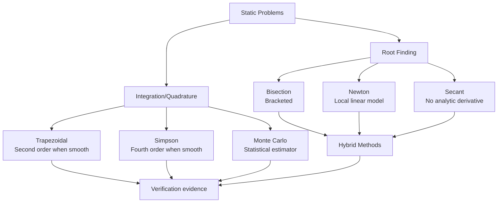

<!-- prep-banner:start -->
:::{note} Sequence and scope
This synthesis covers two distinct numerical tasks. Block 2 and Project 2 use
the quadrature material: composite rules, adaptive Simpson, and substitution
in a tested Python module. Monte Carlo is optional conceptual enrichment. Root finding and the `Star`
class begin in Block 3 and Project 3.
:::
<!-- prep-banner:end -->

## Step acceptance, stopping, and accuracy

Keep these three decisions separate:

| Decision | Root finding | Quadrature |
|:--|:--|:--|
| Accept a proposal | A line search tests decrease; a hybrid tests a bracket-preserving proposal. | An adaptive method compares local estimates before accepting a panel. |
| Stop the algorithm | Check the declared bracket, residual, or step criterion and iteration budget. | Check the allocated estimated-error budget and refinement limits. |
| Trust the answer | Check physical root selection, conditioning, and independent cases. | Check sampling adequacy, smoothness assumptions, cancellation, and independent cases. |

The [backtracking example](01-mod2-part1-root-finding.md#backtracking-newton)
illustrates one accepted Newton step, not a complete solve. Line search does
not preserve a bracket. Levenberg regularization changes the direction itself.
These extensions are conceptual context; Project 3 still implements only its
specified bisection, Newton, and secant methods.

For nested calculations, an outer root solver acts on the function supplied by
an inner calculation. Neither accepted steps nor smaller outer tolerances can
remove a fixed quadrature or trajectory error. The investigation below gives
a concrete example of that limit.

## Module Summary



The diagram separates two task families. They share the need for an explicit
contract and convergence evidence; one is not the inverse of the other.

**Part 1** introduces root-finding methods for Block 3:
- **Bisection** halves a continuous sign-change bracket.
- **Newton** can converge quadratically near a simple root when its local
  assumptions and starting point are suitable.
- **Secant** avoids an analytic derivative and has superlinear local
  convergence under suitable assumptions.
- **Hybrid methods** combine safeguards with faster local steps.

**Part 2** supplies the Project 2 quadrature methods and a conceptual comparison:
- **Left rectangles** make panel construction and first-order global error
  visible.
- **Trapezoid** and **Simpson** have global orders 2 and 4 for sufficiently
  smooth functions.
- **Adaptive Simpson** estimates a local error from one panel and two panels.
- **Monte Carlo**, an optional extension, reports an estimator and sampling uncertainty, not a
  deterministic convergence guarantee.

Use the same review questions for either task: What is being approximated? What
regularity or sampling assumption is required? What error is measured? Which
test can show that the requested tolerance is met?

The implementation details and convergence laws remain specific to the task.

## Key Takeaways

- A continuous sign change is the precondition for bisection's bracketed
  convergence guarantee.
- Newton's quadratic local convergence requires a simple root, a usable
  derivative, and an iterate already in the local convergence region.
- A nominally higher-order quadrature rule is not guaranteed to retain that order at a
  discontinuity, kink, unresolved oscillation, or noisy-data fit.
- With independent finite-variance samples, Monte Carlo RMS error scales as
  $N^{-1/2}$; its practical cost also depends on variance and sampler quality.
- A refinement study tests an observed error law. It does not prove that an
  asymptotic law applies at every resolution.
- Richardson extrapolation requires a known leading error form and a regime in
  which that form is visible.

(shared-error-budget)=
## Investigation: an integral inside a root problem

:::{note} After both readings
This connects quadrature and root finding after both have been taught. It is
not an additional Project 2 requirement. The reference plots were generated
separately; the diagnostic arithmetic below does not supply either solver.
:::

Consider a dimensionless accumulated amount

$$A(r)=\int_0^r e^{-x}\,dx.$$

We want the location where $A(r)=0.9$, so the root residual is
$F(r)=A(r)-0.9$. The integral measures an accumulated quantity; the root solver
finds the position where that quantity reaches a target. These remain separate
numerical tasks even when one calls the other.

An independent reference is available here:
$A(r)=1-e^{-r}$ and $r_*=-\ln(0.1)=\ln 10$.
We use it to evaluate the evidence, not as an input to the numerical solvers.

### Predict which tolerance matters

A reference calculation uses composite trapezoids for $A(r)$, then bisects its
computed residual on $[0,4]$. For each root tolerance it keeps the quadrature
panel count fixed. Before looking at the results, predict:

1. Will a root half-width tolerance of $10^{-10}$ necessarily locate $r_*$
   to $10^{-10}$?
2. What should happen when we keep that tolerance fixed but increase the
   number of quadrature panels?
3. Which information would let us bound the final position error?

:::{figure} figures/nested-error-budget.png
:label: nested-error-budget
:alt: Tightening the root tolerance at fixed quadrature resolution produces a position-error plateau. Increasing the quadrature panel count reduces the error, and a bound including quadrature stays above the measured error.

Each curve in the left panel solves a different fixed-resolution approximation
to the integral. A narrow bracket for that approximate function is not a narrow
bracket for the exact function. The right panel fixes the root tolerance and
compares actual error with a conservative bound including quadrature error.
All quantities are dimensionless.

[Open full-size figure](figures/nested-error-budget.png)
:::

### Derive the shared error budget

Let $\widehat F$ be the computed residual and suppose a justified bound at the
returned position satisfies

$$|F(\widehat r)-\widehat F(\widehat r)|\le\eta_{\mathrm{quad}}.$$

Assume the exact root and $\widehat r$ lie in an interval where $F$ is
continuously differentiable and $|F'|\ge m>0$. The mean value theorem and
triangle inequality give

$$m|\widehat r-r_*|\le |F(\widehat r)|
\le |\widehat F(\widehat r)|+\eta_{\mathrm{quad}},$$

and therefore

$$\boxed{|\widehat r-r_*|\le
\frac{|\widehat F(\widehat r)|+\eta_{\mathrm{quad}}}{m}.}$$

The two terms in the numerator have the residual's units. Dividing by a slope
converts them into position units. The first term describes how closely the
computed equation was solved; the second describes how closely that equation
approximates the intended one.

Here $F'(r)=e^{-r}\ge e^{-4}$ on $[0,4]$, so we may use $m=e^{-4}$.
For $n$ uniform trapezoid panels on $[0,\widehat r]$, the integrand has
$|f''(x)|=e^{-x}\le1$, giving the exact-arithmetic bound

$$\eta_{\mathrm{quad}}\le\frac{\widehat r^3}{12n^2}.$$

This bound is conservative; it uses the largest second derivative on every
panel and the smallest residual slope on the full root-search interval.
Floating-point evaluation and accumulation errors must also be included if they
are material. In this example their scale is small relative to the displayed
margins. If $\eta_{\mathrm{quad}}$ comes from an adaptive estimator instead of
a proven bound, the final allowance is an estimate too.

<!-- budget-data:start -->
```{code-cell} python
import numpy as np

# Recorded reference results at root half-width tolerance 1e-10.
# Columns: quadrature panel count, returned position, computed residual magnitude.
reference_runs = np.array([[8, 2.2456068421597593, 9.704459458248493e-13], [32, 2.2987243363750167, 1.929789661403447e-12], [128, 2.302342479757499, 2.7243762801276716e-12]])
n_panels = reference_runs[:, 0].astype(int)
positions = reference_runs[:, 1]
computed_residuals = reference_runs[:, 2]
quadrature_bounds = positions**3 / (12*n_panels**2)
position_bounds = (computed_residuals + quadrature_bounds) / np.exp(-4)
actual_errors = np.abs(positions - np.log(10))

for n, residual, error, bound in zip(n_panels, computed_residuals, actual_errors, position_bounds):
    print(f"n={n:3d}: residual={residual:.2e}, position error={error:.2e}, bound={bound:.2e}")
```

<!-- budget-data:end -->

The printed residual can be tiny while the position error is much larger.
For a desired absolute position error $\tau_r$, the bound suggests requiring
$|\widehat F(\widehat r)|+\eta_{\mathrm{quad}}\le m\tau_r$.
An equal split is one possible budget, not a universal optimum: the relative
costs of reducing the two contributions determine a sensible allocation.

### A subtle consequence: even the signs can be uncertain

If $\widehat F(x)$ has absolute error bounded by $\eta$, its sign is certified
positive only when $\widehat F(x)-\eta>0$, and certified negative only when
$\widehat F(x)+\eta<0$. Otherwise the allowed interval includes zero.
A sign change in uncertain computed values alone cannot certify a bracket for
$F$. In the reference calculation, bisection narrows the approximate equation;
the shared budget is the additional check against the exact equation.

:::{tip} Answer: which computation should receive more work?
:class: dropdown
A narrow bracket controls position for the function whose signs it reliably
tracks. At fixed quadrature resolution, tightening that bracket eventually
solves the approximate equation more precisely without improving the intended
answer. If quadrature dominates the budget, refine the integral and check the
change in the root. If the residual term dominates, refine the root solve.
If function signs remain uncertain, improve their evaluation or retain that
uncertainty; do not discard half an exact-function bracket using an uncertified
sign. The analytic reference lets us test these claims in this example, but
the argument identifies what information is needed when no reference is known.
:::

### Transfer: report only the claim your evidence supports

A collaborator reports: “The solver converged at tolerance $10^{-10}$.”
Write a replacement explanation naming the target quantity, both approximation
errors, the assumption converting residual to position, and one comparison that
could falsify the claimed accuracy. If the target amount 0.9 also has a known
absolute uncertainty, explain where that additional term belongs in the budget.

:::{tip} Reasoning to check against
:class: dropdown
The tolerance must name its quantity and units. A residual or approximate-bracket
tolerance alone is insufficient. Bound or estimate the integral error, account
for any uncertainty in the target amount, and divide their combined residual
allowance by a valid slope lower bound. Compare roots from independently tighter
quadrature while controlling root-solver error. Agreement is supporting evidence;
it is not a replacement for the assumptions underlying a rigorous bound.
:::


## Looking Forward

For the current sequence:

- **Project 2:** implement `rectangle`, `trapezoid`, and `simpson` in a Python
  module; test their contracts and convergence; then add adaptive Simpson,
  and substitution. Monte Carlo has no assigned implementation, test, figure, or written response.
- **Project 3:** use root-finding methods and introduce the `Star` class.
- **Later:** distinguish quadrature from time-stepping methods for ODEs.

Before moving on, be able to name the quantity, state the rule's preconditions,
and show a test or convergence result for an implementation.

---

## Quick Reference Tables

### Root Finding Methods

| Method | Formula | Convergence | Iterations for ε | When to Use |
|--------|---------|-------------|------------------|-------------|
| Bisection | $c = \frac{a+b}{2}$ | Interval width halves | $\lceil\log_2(L/\epsilon)\rceil$ for width $\leq\epsilon$ | Continuous sign-change bracket |
| Newton | $x_{n+1} = x_n - \frac{f(x_n)}{f'(x_n)}$ | Quadratic locally near a simple root | Problem-dependent | Derivative and suitable initial guess |
| Secant | $x_{n+1} = x_n - f(x_n)\frac{x_n-x_{n-1}}{f(x_n)-f(x_{n-1})}$ | Superlinear locally | Problem-dependent | No analytic derivative; suitable starting pair |

### Integration Methods

| Method | Local Error | Global Error | Function Evals | Best For |
|--------|-------------|--------------|----------------|----------|
| Left rectangle | $O(h^2)$ | $O(h)$ | $n$ | Baseline rule; one-sided panels |
| Trapezoid | $O(h^3)$ | $O(h^2)$ | $n+1$ | Smooth callable or tabulated data |
| Simpson | $O(h^5)$ | $O(h^4)$ | $n+1$; $n$ even | Smooth callable with even panel count |
| Gauss-Legendre | Exact through degree $2n-1$ for $n$ nodes | Depends on the integrand and interval mapping | $n$ | Smooth integrands; extension beyond Project 2 |
| Monte Carlo | — | RMS $O(N^{-1/2})$ with independent finite-variance samples | $N$ | High-dimensional or irregular domains when sampling is practical |

(method-selection)=
### Method Selection Guide

| If your problem has... | Use this method | Because... |
|------------------------|-----------------|------------|
| Continuous sign-change bracket | Bisection | Preserves a bracket while reducing its width |
| Root with an expensive derivative | Secant or a safeguarded method | Avoids analytic derivative evaluation |
| Smooth one-dimensional integral | Simpson | Fourth-order global error after verifying the regime |
| Tabulated data | Trapezoid | Uses measured endpoint values without inventing a global interpolant |
| High-dimensional or irregular-domain integral | Monte Carlo candidate | Rate avoids tensor-grid scaling; compare variance and sampling cost |
| Several possible zeros | Use physical constraints, scan, and investigate candidates | A sign scan can miss tangencies or several crossings within a cell; one bracket need not isolate one root |
| Near machine precision | Reformulate and inspect error scale | More refinement may not improve a floating-point result |

### Common Failure Modes and Fixes

| Problem | Symptom | Solution |
|---------|---------|----------|
| $f'(x) \approx 0$ | Newton step is unstable or uninformative | Safeguard the step or use a bracketed method |
| No sign change | Bisection cannot start | Scan the domain or use a method with different assumptions |
| Oscillatory integrand | Poor or misleading convergence | Resolve the shortest wavelength, split intervals, and verify refinement |
| High-dimensional integral | Tensor grid cost grows rapidly | Compare Monte Carlo, importance sampling, or problem-specific structure |
| Odd $n$ for Simpson | Project 2 contract is violated | Raise `ValueError`; do not silently alter the rule |
| Round-off dominance | Convergence plateau | Report the plateau and reconsider the scale or formulation |

---

## Glossary

**Adaptive quadrature**: An integration method that estimates local error and
subdivides intervals selectively. The estimate and stopping rule are part of
the method contract.

**Bisection method**: A root-finding algorithm that repeatedly halves an
interval containing a sign change. For a continuous function, the interval
width is halved at every iteration.

**Bracketing**: Maintaining opposite endpoint signs on an interval. Continuity on that interval is required for the Intermediate Value Theorem to guarantee a root.

**Catastrophic cancellation**: Severe loss of significant digits when
subtracting nearly equal floating-point numbers.

**Condition number**: A measure of how input perturbations affect an output.
For a simple scalar root $r$, $1/|f'(r)|$ describes the sensitivity of the root
to an additive perturbation of the function value; its units depend on the
problem's variables.

**Iteration order**: A local relation $|e_{k+1}|\sim C|e_k|^p$ between successive root errors. This differs from **quadrature refinement order**, $|E(h)|\sim C h^p$, which compares different grid spacings at fixed integration limits. In both cases the stated regime and a nonzero leading term matter.

**Curse of dimensionality**: Rapid growth in the number of grid cells needed to
resolve each additional dimension. The practical limit depends on resolution,
structure, and computational budget; it is not a fixed dimension threshold.

**Gaussian quadrature**: A quadrature rule using nodes and weights chosen from
an orthogonal-polynomial family. An $n$-node Gauss-Legendre rule is exact for
polynomials through degree $2n-1$ on its reference interval.

**Hybrid method**: Algorithm combining multiple approaches, like Brent's method mixing bisection's reliability with interpolation's speed for robust root finding.

**Ill-conditioned**: A problem in which small input perturbations can cause a
large output change. Rapid oscillation creates a resolution problem; it is not
by itself a condition-number statement.

**Intermediate Value Theorem**: If f is continuous on [a,b] and k is between f(a) and f(b), then there exists c $\in$ [a,b] where f(c) = k; strictly intermediate values occur in (a,b).

**Interpolation**: Approximating a function between known points using simpler functions (lines for secant method, parabolas for Simpson's rule).

**Kepler's equation**: Transcendental equation E - e·sin(E) = M relating eccentric anomaly E to mean anomaly M for elliptical orbits. Classic root-finding application.

**Lagrange points**: Five equilibrium configurations of the circular restricted
three-body problem. A spacecraft mission near one models an orbit in a rotating
frame; the physical coordinate and stability conventions must be specified.

**Linear convergence**: Asymptotically the error decreases by a constant factor below one. Bisection halves a guaranteed interval-width bound; its actual midpoint error need not decrease by exactly one half.

**Monte Carlo integration**: A statistical estimator based on random samples.
With independent finite-variance samples, its root-mean-square error scales as
$N^{-1/2}$. Its suitability depends on variance, sampling method, dimensional
structure, and cost.

**Newton-Raphson method**: A root-finding method using a tangent-line update.
It has quadratic local convergence near a simple root under suitable smoothness
and initialization assumptions.

**Quadratic convergence**: A local error law of the form
$e_{n+1} \propto e_n^2$. Newton's method has this behavior near a simple root
when its assumptions hold.

**Quadrature**: Numerical integration — approximating continuous integrals with discrete sums. From Latin "quadratura" meaning squaring, originally finding square with same area as curve.

**Richardson extrapolation**: Using results at different resolutions to cancel leading error terms, achieving higher accuracy from lower-order methods.

**Root/Zero**: A value $x^*$ for which $f(x^*)=0$. In physics, it can represent
an equilibrium or an event location. An extremum is a root of a derivative only
when that derivative exists and is the quantity being solved.

**Secant method**: Root-finding using line through two points instead of tangent. Achieves superlinear convergence (order $\approx$1.618, the golden ratio) without needing derivatives.

**Simpson's rule**: Integration using parabolic interpolation through consecutive triplets of points. Achieves fourth-order accuracy despite using only quadratic polynomials.

**Superlinear convergence**: $|e_{k+1}|/|e_k|\to0$. Quadratic convergence belongs to this category; the secant method has the particular local order $\phi\approx1.618$ under its assumptions.

**Transcendental equation**: An equation involving functions such as sine, exponential, or logarithm. Many require numerical solution; special cases can have explicit answers.

**Trapezoidal rule**: Integration by connecting consecutive data points with
straight lines. It is second-order accurate for a sufficiently smooth uniform
grid; for measured data, it is a defined interpolation choice rather than a
guarantee about an unknown underlying curve.

**Well-conditioned**: A problem whose output is relatively insensitive to the specified input perturbations and scaling. **Algorithmic stability** concerns how the numerical procedure propagates its own errors. A well-conditioned problem can still be evaluated by an unstable algorithm.

---

For Project 2, use the quadrature contract and its tests. Root-finding
implementations and the `Star` class enter in Project 3.
