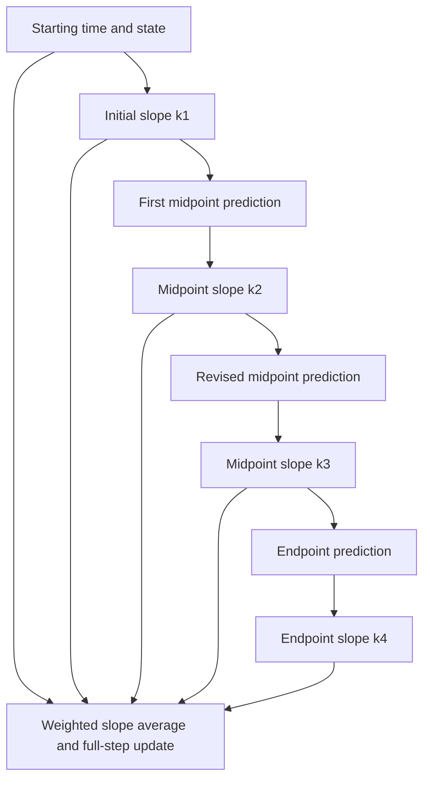

<!-- prep-banner:start -->
:::{warning} This reading is still being revised
Readings are reviewed and finalized **at least one week before they are
assigned**, so you will always have a settled version before you need it. Until
then, expect rough edges — wording, examples, and cross-references may change.

Where a reading disagrees with the syllabus, the syllabus is right. If something
here does not work, tell me: that is genuinely useful and I would rather hear it
from you than not.
:::
<!-- prep-banner:end -->

## Learning Objectives

By the end of this section, you will be able to:

- [ ] **Derive** explicit midpoint RK2 and **explain** the stage dependencies of RK4
- [ ] **Use** the mathematical specification to write and verify your own RK implementations
- [ ] **Connect** RK weights to quadrature rules from Module 2
- [ ] **Trace** adaptive step acceptance and rejection using a worked Euler example
- [ ] **Analyze** when higher-order methods help vs harm
- [ ] **Choose** appropriate RK methods based on problem requirements

---

## The Key Insight: Sample Multiple Points

Euler extends the initial tangent through the step. Curvature introduces a one-step defect, which motivates sampling additional slopes. **Runge-Kutta methods** evaluate the derivative at carefully chosen intermediate points, then combine these samples with specific weights to achieve higher-order accuracy.

This connects to quadrature from Module 2: We're essentially performing numerical integration on:

$$x_{n+1} = x_n + \int_{t_n}^{t_{n+1}} f(t, x(t)) dt$$

But now the integrand depends on the unknown solution $x(t)$ itself, requiring us to estimate intermediate values.

## RK2 - The Midpoint Method

### Geometric Intuition

Instead of blindly following the tangent from the starting point, we:

1. Take a half-step using the initial derivative
2. Evaluate the derivative at this midpoint
3. Use this midpoint derivative for the full step

This is analogous to the midpoint rule for integration, which we know from Module 2 is second-order accurate!

(mathematical-formulation)=
### Complete Mathematical Formulation

:::{div}
:class: reading-definition
**Predictor-corrector method**: A two-stage process where an initial estimate (predictor) is refined using better information (corrector).
:::

The RK2 midpoint method is a **predictor-corrector method**:

**Stage 1 - Predictor:**
$$k_1 = f(t_n, x_n)$$
$$x_{mid} = x_n + \frac{h}{2}k_1$$

**Stage 2 - Corrector:**
$$k_2 = f(t_n + \frac{h}{2}, x_{mid})$$
$$x_{n+1} = x_n + h k_2$$

:::{figure} figures/3_3_rk2_midpoint.webp
:label: fig-3-3-rk2-midpoint
:width: 800px
:alt: RK2 midpoint method: First evaluate derivative at start (k_{1}), use it to estimate midpoint, evaluate derivative there (k_{2}), then use midpoint derivative for full step

This dimensionless example solves $y'=-y+\sin t$, $y(0)=1$, with exact reference $y(t)=\tfrac32e^{-t}+\tfrac12(\sin t-\cos t)$ (the figure labels the independent variable $x$). In the left panel, $h=1$: the initial slope predicts the midpoint state, and the slope at that predicted state advances the full step. Its absolute error is about 0.2770, versus Euler's 0.7024; this coarse step is still inaccurate. The right panel compares errors at the fixed endpoint $t=2$ as $h$ decreases. The asymptotic trends approach first order for Euler and second order for midpoint RK2.

[Open full-size figure](figures/3_3_rk2_midpoint.webp)
:::

### Error Analysis via Taylor Series

Differentiate the ODE along its solution. For a vector state, let
$J=\partial f/\partial x$ be the state Jacobian. Then

$$x''=f_t+Jf,$$

so the exact solution begins

$$x(t+h)=x+h f+\frac{h^2}{2}(f_t+Jf)+O(h^3).$$

Try two stages, with $k_1=f(t,x)$ and
$k_2=f(t+ch,x+ah f)$, and an update $x+h(b_1k_1+b_2k_2)$.
A multivariate expansion gives

$$k_2=f+h(c f_t+aJf)+O(h^2),$$

and the resulting update is

$$x+h(b_1+b_2)f+h^2b_2(c f_t+aJf)+O(h^3).$$

Matching the independent terms requires

$$b_1+b_2=1,\qquad b_2c=\frac12,\qquad b_2a=\frac12.$$

Choose $b_2=1$. Then $b_1=0$ and $a=c=1/2$, giving the explicit midpoint
formulas above. The midpoint slope consequently satisfies

$$f(t_{mid},x_{mid})=f+\frac h2(f_t+Jf)+O(h^2).$$

Another choice, $b_1=b_2=1/2$ and $a=c=1$, gives Heun's explicit trapezoidal
method. Both are second-order RK methods, but their intermediate states differ.
This reading uses **explicit midpoint** when it says RK2. On a linear
autonomous system they have the same one-step map; a nonlinear test can
separate them. For $x'=x^2$, $x(0)=1$, their one-step values are
$1+h+h^2+h^3/4$ and $1+h+h^2+h^3/2$, respectively. Neither cubic coefficient
matches the exact local expansion of $1/(1-h)$; both methods match through
second order. Do not mix their stages and weights.

The RK2 update matches the true solution through $O(h^2)$:

- **Local truncation error**: $O(h^3)$
- **Global error**: $O(h^2)$

In a resolved truncation regime at fixed duration, halving the timestep reduces the leading global error by approximately four.

### From mathematics to your implementation

The stage equations are the specification you will translate into Python.
Write the RK2 and RK4 implementations yourself. We will use complete Euler
examples to demonstrate array handling, stepping, and diagnostics; a working
RK routine is not supplied here.

For Python, use **independent variable first**: `f(t, state)` returns the rate
of change of the NumPy-array state. In the equations above, $x_n$ denotes that
state; it can have several components. Addition and scalar multiplication then
operate on the entire array. The stage slopes must have the same shape as the
state. Their units are state units divided by time units; multiplying a slope
by $h$ gives a state increment.

Separate two responsibilities:

| Responsibility | Inputs | Output | What to establish |
|---|---|---|---|
| One step | A derivative callable, starting time and state, and a step length | A new state | Stage times, stage states, weights, shape, and no mutation of the supplied state |
| Repeated steps | A step routine and an integration interval | The endpoint or a recorded trajectory, as the caller needs | Endpoint handling, time bookkeeping, and where samples are stored |

First explain the method in mathematical statements, then write your own code.
Before writing the loop, answer: which quantities belong to the original state,
and which belong to a temporary stage? If a stage accidentally overwrites the
starting state, later formulas describe a different method.

Do not judge correctness from a smooth-looking trajectory alone. A constant
right-hand side checks basic increments. A time-dependent right-hand side tests
whether stage times are used. A nonlinear state-dependent right-hand side tests
whether intermediate states are used. Refinement over a fixed interval then
checks the claimed global order. These checks probe different mistakes; none
is a replacement for deriving the update.

:::{tip} Check the units and the meaning of a stage
:class: dropdown

In this reading, $k_i$ is a **slope**, not a step increment. It has the units of
$f$. Each predicted state therefore includes a factor of $h$, and the final
weighted sum includes one factor of $h$. Some books define $k_i=h f(\ldots)$
instead; copying one convention's stage formulas into the other's final update
introduces an extra or missing factor of $h$.

The midpoint state is a prediction used to evaluate a slope. It is not a second
initial condition or a replacement for the starting state. Keeping those roles
separate is part of the implementation work.
:::

(rk4-classical)=
## RK4 - The Classical Workhorse

:::{div}
:class: reading-definition
**Runge-Kutta 4 (RK4)**: A classical explicit method with four derivative evaluations per step and fourth-order global accuracy under its smoothness and stability assumptions.
:::

**RK4** samples the derivative at four carefully chosen points:

**Stage 1:** $k_1 = f(t_n, x_n)$ (derivative at start)

**Stage 2:** $k_2 = f(t_n + \frac{h}{2}, x_n + \frac{h}{2}k_1)$ (derivative at midpoint using $k_1$)

**Stage 3:** $k_3 = f(t_n + \frac{h}{2}, x_n + \frac{h}{2}k_2)$ (derivative at midpoint using $k_2$)

**Stage 4:** $k_4 = f(t_n + h, x_n + hk_3)$ (derivative at endpoint using $k_3$)

**Final update:**
$$\boxed{x_{n+1} = x_n + \frac{h}{6}(k_1 + 2k_2 + 2k_3 + k_4)}$$

### The Connection to Simpson's Rule

For a time-only right-hand side $x'=g(t)$, the two midpoint evaluations are identical. The RK4 update then becomes

$$x_{n+1}=x_n+\frac h6\left[g(t_n)+4g(t_n+h/2)+g(t_n+h)\right],$$

which is exactly Simpson quadrature over the time interval. Euler similarly
reduces to left rectangles and explicit midpoint RK2 to midpoint quadrature.

For $f(t,x)$, however, $k_2$ and $k_3$ generally differ: they evaluate different
predicted states at the same time. Simpson's weights alone do not establish
fourth-order ODE accuracy. The stage locations and dependencies must satisfy
additional order conditions involving state derivatives of $f$.

**Check:** for $x'=x$, start at $x=1$, $t=0$ with $h=0.1$. Then
$k_1=1$, $k_2=1.05$, $k_3=1.0525$, and $k_4=1.10525$. The unequal midpoint
slopes are precisely what the state-dependent problem adds to the quadrature analogy.

### Error Analysis

Through Taylor series expansion to fourth order:

- **Local truncation error**: $O(h^5)$
- **Global error**: $O(h^4)$

In a resolved truncation regime at fixed duration, halving the timestep reduces the leading global error by approximately sixteen.

(general-framework)=
## The General Runge-Kutta Framework

:::{div}
:class: reading-definition
**Butcher tableau**: A compact notation for Runge-Kutta methods invented by John Butcher (1964), organizing the coefficients that define each method.
:::

All explicit RK methods follow this pattern:

$$k_i = f\left(t_n + c_ih, x_n + h\sum_{j=1}^{i-1} a_{ij}k_j\right)$$

$$x_{n+1} = x_n + h\sum_{i=1}^s b_i k_i$$

The coefficients $(a_{ij}, b_i, c_i)$ define the method and are displayed in a **Butcher tableau**:

```markdown
c₁ |
c₂ | a₂₁
c₃ | a₃₁ a₃₂
⋮  | ⋮
cₛ | aₛ₁ aₛ₂ ... aₛ,ₛ₋₁
---|--------------------
   | b₁  b₂  ...  bₛ
```

For RK4:

```markdown
0   |
1/2 | 1/2
1/2 | 0   1/2
1   | 0   0   1
----|----------------
    | 1/6 2/6 2/6 1/6
```

### Follow the dependencies, not just the weights

The two midpoint stages occur at the same time but generally at different
predicted states. The second midpoint evaluation revises the slope information
used to predict the endpoint.



Every stage state in the formulas is built from the original $x_n$ plus a
specified increment. The arrows show dependencies; they do not mean that stage
states are advanced sequentially by a full ODE step. The two midpoint states
are generally not points on the exact trajectory either.

:::{figure} figures/rk-stage-geometry.png
:label: rk-stage-geometry
:width: 100%
:alt: Four RK4 slope samples for x prime equals x are shown at the start, two distinct midpoint predictions, and an endpoint prediction, alongside the exact exponential trajectory.

For $x'=x$, $x(0)=1$, and $h=0.5$, the midpoint predictions are $1.25$ and
$1.3125$, whereas the exact midpoint value is $e^{0.25}$. RK4 uses information
from approximate stage states to construct an accurate endpoint; it does not
require every intermediate state to have fourth-order accuracy.

[Open full-size figure](figures/rk-stage-geometry.png)
:::

(rk-order-conditions)=
::::{note} Optional derivation: where fourth order comes from
:class: dropdown

The scalar exponential test is useful, but it cannot test all the terms that
occur in a nonlinear system. To see the missing terms, consider an autonomous
vector equation $y'=F(y)$. A time-dependent problem fits this form after adding
time as a state component: $(t,y)'=(1,f(t,y))$.

Write $J=F'(y)$ for the Jacobian, $F''(u,v)$ for the second derivative applied
to two vectors, and $F'''(u,v,w)$ for the third derivative applied to three.
All quantities below are evaluated at the starting state. Repeated application
of the chain rule gives

$$y''=JF,$$
$$y'''=F''(F,F)+J^2F,$$
$$y''''=F'''(F,F,F)+3F''(F,JF)+J F''(F,F)+J^3F.$$

These are distinct ways that the vector field can vary along a solution. For
example, differentiating $JF$ changes both $J$ and $F$, which produces the two
terms in $y'''$. In a linear problem, $F''$ and $F'''$ vanish. That is why a
linear convergence test alone cannot establish general nonlinear fourth order.

The stage/tableau formulation is also described in
[Butcher's introduction to practical Runge–Kutta methods, Section 3](https://www.cambridge.org/core/services/aop-cambridge-core/content/view/F356AA1AE59BED1D14B298ED18B851D7/S1446181109000030a.pdf/practical-rungekutta-methods-for-scientific-computation.pdf).
Here we work out the matching conditions needed for this reading.

Let $A=(a_{ij})$, $b=(b_i)$, and $c=A\mathbf 1$ be the tableau coefficients.
Superscripts on $c$ in the table mean **componentwise powers**, and
$C=\operatorname{diag}(c)$. Expanding the stage equations and matching each
coefficient in
$y+h y'+h^2 y''/2+h^3 y'''/6+h^4 y''''/24$ gives:

| Term in the solution expansion | Required condition |
|---|---|
| $hF$ | $b^T\mathbf 1=1$ |
| $h^2 JF$ | $b^Tc=1/2$ |
| $h^3 F''(F,F)$ | $b^Tc^2=1/3$ |
| $h^3 J^2F$ | $b^TAc=1/6$ |
| $h^4 F'''(F,F,F)$ | $b^Tc^3=1/4$ |
| $h^4 F''(F,JF)$ | $b^TCAc=1/8$ |
| $h^4 JF''(F,F)$ | $b^TAc^2=1/12$ |
| $h^4 J^3F$ | $b^TA^2c=1/24$ |

The factors are not all $1/24$: the stage expansion itself supplies factorials
and multiplicities. For instance, its coefficient of $h^3F''(F,F)$ is
$b^Tc^2/2$, which must equal $1/6$.

For the classical RK4 tableau, $c=(0,1/2,1/2,1)^T$ and
$b=(1/6,1/3,1/3,1/6)^T$. Two checks illustrate the calculation:

$$b^Tc^2=\frac13\frac14+\frac13\frac14+\frac16=\frac13,$$

$$Ac=(0,0,1/4,1/2)^T,\qquad
b^TAc=\frac13\frac14+\frac16\frac12=\frac16.$$

The conditions involving $A$ are what a list of quadrature weights leaves out.
Verify one fourth-order condition by hand before checking the result below.

:::{tip} Check a fourth-order condition
:class: dropdown
$CAc=(0,0,1/8,1/2)^T$, so
$b^TCAc=(1/3)(1/8)+(1/6)(1/2)=1/8$.
Also, $Ac^2=(0,0,1/8,1/4)^T$ and $A^2c=(0,0,0,1/4)^T$ give $1/12$ and
$1/24$, respectively. These checks supplement the quadrature-like conditions;
they do not replace them.
:::

Under sufficient smoothness, these conditions give a one-step defect of
$O(h^5)$. Propagation over a fixed interval, with the appropriate stability and
regularity assumptions, gives $O(h^4)$ global error. This is the mathematical
claim to test with your implementation, not an assurance that every plot of
error versus step length will have slope four.
::::

(adaptive-timestep)=
## Adaptive Timestep Control

Real problems have varying timescales. When a planet is far from the sun, we can take large steps. During close encounters, we need tiny steps. Adaptive methods adjust $h$ dynamically.

### The Embedded Runge-Kutta Approach

The idea: compute two different order estimates using the same function evaluations, then use their difference to estimate error.

### An embedded example: Fehlberg 4(5)

The original six-stage Fehlberg pair computes both fourth- and fifth-order solutions. The name `RK45` is also used for other pairs: SciPy uses Dormand–Prince, not these six stages. For the Fehlberg example:

1. Compute six $k_i$ values (shared between both estimates)
2. Combine with 4th-order weights $\to$ $x_{(4)}$
3. Combine with 5th-order weights $\to$ $x_{(5)}$
4. Error estimate: $\epsilon = ||x_{(5)} - x_{(4)}||$
5. Suggested next timestep (with a safety factor): $h_{new} = h \cdot 0.9 \cdot (\text{tolerance}/\epsilon)^{1/5}$

For vectors, first scale each component by an allowance such as `atol + rtol * abs(reference_state)` and use a stated norm. Bound the step-growth factor and handle a zero estimate explicitly. If the scaled estimate is acceptable, accept the step and continue. Otherwise, reject and retry with smaller $h$.

:::{figure} figures/3_4_adaptive_timestep.webp
:label: fig-3-4-adaptive-timestep
:width: 800px
:alt: Exact Kepler ellipse at eccentricity 0.9 sampled in 64 equal eccentric-anomaly intervals. The corresponding time intervals are shorter near perihelion and longer near aphelion.

This is a **kinematic sampling schematic**, not an adaptive-solver benchmark. The exact Kepler ellipse has eccentricity $e=0.9$ and is sampled at 64 equal increments of eccentric anomaly $E$. Kepler's relation $t/P=(E-e\sin E)/(2\pi)$ gives the time of each point. The left panel colors each point by the following time interval; the right plots those intervals against their time midpoints. This illustrates why the rapid motion near perihelion calls for finer time resolution. It makes no accuracy or efficiency claim; the executable Euler experiment below demonstrates an actual error-controlled acceptance rule.

[Open full-size figure](figures/3_4_adaptive_timestep.webp)
:::

### Watch an adaptive controller make a decision

We can study acceptance and rejection using **Euler steps**, while leaving the
RK implementations to you. Consider the dimensionless decay problem
$u'=-u$, $u(0)=1$, with exact solution $u(t)=e^{-t}$. It gives us a reference
for checking the numerical experiment without introducing another physical
model.

Take one Euler step of length $h$ and, separately, two Euler steps of length
$h/2$, both starting from the same $(t,u)$. If the leading one-step defect is
$Ch^2$, the two-half-step result has approximately half the defect of the coarse
result. Their difference therefore estimates the **two-half-step local error**
in the smooth, small-step regime:

$$\widehat e=|u_{\rm fine}-u_{\rm coarse}|.$$

This is still a first-order method. We accept $u_{\rm fine}$ itself; we do not
apply an extrapolation correction. The comparison estimates a local error and
does not reveal the exact accumulated error of the trajectory.

For this example, define the scale and normalized estimate explicitly:

$$s=\mathrm{atol}+\mathrm{rtol}\max(|u|,|u_{\rm fine}|),
\qquad \eta=\widehat e/s.$$

Accept when $\eta\le1$. Rejection leaves **both the accepted time and accepted
state unchanged**. The proposed next step uses $h_{\rm new}\propto h\eta^{-1/2}$
because this estimator scales as $h^2$. The exponent would change for another
estimator. Growth limits and a safety factor make the controller less abrupt;
they do not turn an estimate into a mathematical bound.

**Predict before running:** Will the initial step of length 1 be accepted?
When the solution becomes small, which part of the allowance will eventually
matter more? Does every accepted step imply that the final solution is within
one tolerance of the exact answer?

```{code-cell} python
import numpy as np
import matplotlib.pyplot as plt


def euler_trial(f, t, u, h):
    """Compare one Euler step with two Euler half-steps; scalar state."""
    coarse = u + h*f(t, u)
    half = u + (h/2)*f(t, u)
    fine = half + (h/2)*f(t + h/2, half)
    return fine, abs(fine-coarse)


def adaptive_euler_decay(rtol, atol, initial_h=1.0, end_time=4.0):
    """A teaching controller for u'=-u; accepts the two-half-step state."""
    if not np.all(np.isfinite([rtol, atol, initial_h, end_time])):
        raise ValueError("Parameters must be finite")
    if rtol < 0 or atol <= 0 or initial_h <= 0 or end_time <= 0:
        raise ValueError("Require rtol >= 0 and positive atol, step, and end time")
    t, u, h = 0.0, 1.0, initial_h
    times, values, trials = [t], [u], []
    for attempt in range(10000):
        if t >= end_time:
            return np.array(times), np.array(values), np.array(trials)
        h = min(h, end_time-t)  # Land on the requested final time.
        if t + h == t:
            raise RuntimeError("The proposed step cannot advance floating-point time")
        fine, estimate = euler_trial(lambda time, value: -value, t, u, h)
        scale = atol + rtol*max(abs(u), abs(fine))
        ratio = estimate/scale
        if not np.isfinite(ratio):
            raise RuntimeError("Non-finite error estimate")
        accepted = ratio <= 1.0
        trials.append((t, h, ratio, accepted))
        if accepted:
            t, u = t+h, fine
            times.append(t)
            values.append(u)
        # Zero estimated error permits bounded growth, not an infinite step.
        factor = 2.0 if ratio == 0 else np.clip(0.9*ratio**(-0.5), 0.2, 2.0)
        h *= factor
    raise RuntimeError("Attempt limit reached")


adaptive_t, adaptive_u, adaptive_trials = adaptive_euler_decay(1e-3, 1e-5)
print("  start t    trial h    scaled estimate   accept?")
for t, h, ratio, accepted in adaptive_trials[:6]:
    print(f"{t:9.4f}  {h:9.4f}  {ratio:15.4f}   {bool(accepted)}")
print("Final actual absolute error:", abs(adaptive_u[-1]-np.exp(-adaptive_t[-1])))
```

The first three statements in `euler_trial` are exactly Euler updates. This
transparent version evaluates the starting derivative twice; caching it would
save one call per trial, without changing the method. The controller records
rejected trials as well as accepted ones, so the work cannot be inferred just
from the number of stored solution points.

```{code-cell} python
accepted_trials = adaptive_trials[:, 3].astype(bool)
fig, axes = plt.subplots(2, 1, figsize=(8, 6), layout="constrained")
axes[0].plot(adaptive_t, adaptive_u, label="accepted Euler half-steps")
axes[0].plot(adaptive_t, np.exp(-adaptive_t), "--", label="exact decay")
axes[0].set(xlabel="dimensionless time", ylabel="dimensionless u")
axes[0].legend()
for mask, label, marker in ((accepted_trials, "accepted", "o"),
                            (~accepted_trials, "rejected", "x")):
    axes[1].semilogy(adaptive_trials[mask, 0], adaptive_trials[mask, 1],
                     marker, ms=4, label=label)
axes[1].set(xlabel="start time of trial", ylabel="trial step length")
axes[1].legend()
plt.show()

for requested_rtol in (1e-2, 1e-3, 1e-4):
    ts, us, trials = adaptive_euler_decay(requested_rtol, 1e-5)
    actual = abs(us[-1]-np.exp(-ts[-1]))
    final_allowance = 1e-5 + requested_rtol*abs(us[-1])
    print(f"rtol={requested_rtol:.0e}: accepted={len(ts)-1}, attempts={len(trials)}, "
          f"final error={actual:.3e}, error/final allowance={actual/final_allowance:.2f}")
```

:::{tip} Explain the controller's evidence
:class: dropdown

At the first trial, Euler gives $u_{\rm coarse}=0$ and the two half-steps give
$u_{\rm fine}=1/4$. The discrepancy is much larger than the allowance
$10^{-5}+10^{-3}$, so the controller rejects the step. Repeated rows with the
same starting time show retries, not repeated advancement of the solution.

While $\mathrm{rtol}|u|$ dominates, an approximately constant relative decay
rate leads to roughly constant accepted steps. As $u$ becomes smaller, the
absolute allowance becomes more influential. Extending the end time makes
that transition easier to observe; decreasing $u$ does not create unlimited
information about its relative accuracy.

The printed final error can exceed the allowance used for an individual step.
Local defects accumulate and propagate. Tighter tolerances should be tested
against the actual quantity of interest under refinement; the solver's
acceptance decision alone does not certify a final-time error target.

For a new problem without an exact solution, compare tolerances and another
justified diagnostic. The exact decay here lets us test that reasoning before
using it in a harder setting.
:::

The same controller logic can use an embedded RK error estimate, with the
appropriate estimator order and vector scaling. Constructing the RK stages
remains your work. A request for evenly spaced output is also different from a
request for evenly spaced internal steps: established libraries can interpolate
between accepted steps. [SciPy's solver documentation](https://docs.scipy.org/doc/scipy/reference/generated/scipy.integrate.solve_ivp.html)
distinguishes these roles and describes component-dependent absolute tolerances.

### When to Use Adaptive Methods

**Good for:**

- Problems with varying timescales
- Unknown dynamics
- Achieving specified accuracy efficiently
- Initial exploration of new systems

**Bad for:**

- Long-term Hamiltonian systems when ordinary state-dependent step selection would compromise a fixed-step symplectic method
- Parallel simulations (variable timesteps complicate synchronization)

## Compare accuracy and work with a defined benchmark

A comparison needs a defined system, initial state, duration, step size, error
metric, and cost metric. We use the dimensionless simple harmonic oscillator
(SHO), $q'=p$, $p'=-q$, with $(q(0),p(0))=(1,0)$. Its exact solution is
$(\cos t,-\sin t)$ and its period is $2\pi$.

The reference plots below retain the comparisons among Euler, explicit midpoint
RK2, classical RK4, and kick–drift–kick leapfrog. The figures were generated
separately; no RK implementation is supplied in the page or an accompanying
notebook. Use the mathematics to construct your own methods, and use the
observables to decide what your implementation needs to establish.

(oscillator-comparison)=
### One oscillator, four diagnostics

Each method uses 100 steps per period for 20 periods. Before examining the
figure, predict which method increases energy, which damps it, and whether
bounded energy guarantees accurate phase. The inset enlarges the trajectories
near the unit circle; Euler's growth would otherwise hide their differences.

:::{figure} figures/oscillator-diagnostics.png
:label: oscillator-diagnostics
:width: 100%
:alt: Euler, midpoint RK2, RK4, and leapfrog are compared over twenty oscillator periods using phase-plane trajectories with a magnified inset, energy error, unwrapped phase error, and state error.

At the same step length, the four methods differ in amplitude, phase, and
state error. These are reference calculations for the stated linear oscillator,
not a claim that one method wins for every equation or duration. The energy
axis uses a symmetric logarithmic scale so small damping and large growth can
both be seen. The inset resolves trajectories near the exact unit circle.

[Open full-size figure](figures/oscillator-diagnostics.png)
:::

For this oscillator, the diagnostic definitions are

$$E_n=\frac12(q_n^2+p_n^2),\qquad
\phi_n=\operatorname{unwrap}\!\bigl(\operatorname{atan2}(-p_n,q_n)\bigr),$$

$$e_{\rm state}(t_n)=\left\|(q_n,p_n)-(\cos t_n,-\sin t_n)\right\|_2.$$

The phase error is $\phi_n-t_n$. Unwrapping chooses a continuous branch by
removing $2\pi$ jumps; it requires sufficiently resolved phase advances.
At this resolution, that assumption holds. A point close to the unit circle
can still be at the wrong angle, so energy agreement alone is incomplete.

### Tools for inspecting a trajectory

These diagnostics consume a trajectory; they do not construct RK stages.
The next cell demonstrates them using a complete Euler calculation. The
state has two dimensionless components; a physical state with mixed units
would need specified component scales before taking a combined norm.

```{code-cell} python
def euler_sho(steps_per_period=100, periods=20):
    """A complete Euler example; returns times and two-component states."""
    if any(isinstance(value, (bool, np.bool_)) or not isinstance(value, (int, np.integer))
           or value <= 0 for value in (steps_per_period, periods)):
        raise ValueError("Use positive integer step and period counts")
    n = steps_per_period*periods
    h = 2*np.pi/steps_per_period
    times = h*np.arange(n+1)
    states = np.empty((n+1, 2))
    states[0] = [1.0, 0.0]
    for i in range(n):
        q, p = states[i]  # Both derivatives use the old state.
        states[i+1] = states[i] + h*np.array([p, -q])
    return times, states


def sho_diagnostics(times, states):
    """Measure energy, phase, and Euclidean state error for omega=1."""
    times = np.asarray(times, dtype=float)
    states = np.asarray(states, dtype=float)
    if times.ndim != 1 or states.shape != (len(times), 2):
        raise ValueError("Expected times (n,) and states (n, 2)")
    if not np.all(np.isfinite(times)) or not np.all(np.isfinite(states)):
        raise ValueError("Diagnostics require finite data")
    energy = np.sum(states**2, axis=1)/2
    phase = np.unwrap(np.arctan2(-states[:, 1], states[:, 0]))
    exact = np.column_stack((np.cos(times), -np.sin(times)))
    state_error = np.linalg.norm(states-exact, axis=1)
    return energy, phase-times, state_error


euler_times, euler_states = euler_sho()
euler_energy, euler_phase_error, euler_state_error = sho_diagnostics(euler_times, euler_states)
print("Euler maximum state error:", euler_state_error.max())
print("Euler final relative energy change:", euler_energy[-1]/euler_energy[0]-1)
print("Euler final phase error (rad):", euler_phase_error[-1])
```

Apply the definitions to another trajectory only after checking its equations,
initial condition, time units, and state ordering. The helper's exact reference
is specific to this SHO setup. A plausible output from a helper used on the
wrong problem is not a validation.

| Method | Derivative evaluations per step | What is counted? |
|---|---|---|
| Euler | 1 | Full oscillator right-hand side |
| Explicit midpoint RK2 | 2 | Full right-hand side |
| Classical RK4 | 4 | Full right-hand side |
| Leapfrog | 2 without reuse | Force evaluations; retaining the final force can reduce later steps to 1 new call |

Each trajectory has 2000 steps. A force evaluation and a full right-hand-side
call need not have equal cost in an application. These counts are not timings.
To compare efficiency, select the observable, duration, and error requirement
first, then compare work needed to meet that same requirement. Formal order
alone does not determine a universal crossover accuracy.

:::{tip} Answer: interpret the diagnostics together
:class: dropdown
Euler grows in amplitude; explicit midpoint RK2 also injects energy but much
more slowly here. RK4 damps slightly. Leapfrog's energy oscillates in a bounded
band at this stable step, while its phase still drifts. The state-error panel
combines discrepancies that an energy-only diagnostic can miss.

Halving the step at fixed duration tests the expected orders. Increasing the
duration tests a different question: the accumulated error over the time span
we care about. A method can pass one experiment and miss the requirement in
the other. The axes and the comparison must state which question is being asked.
:::

## Why high order does not imply energy conservation

For the oscillator, put $z=ih$. The explicit RK stability function determines
the energy factor per step. Euler gives $|1+ih|^2=1+h^2$; explicit midpoint
gives $1+h^4/4$; classical RK4 gives

$$|R(ih)|^2=1-\frac{h^6}{72}+\frac{h^8}{576}.$$

Thus RK4 **damps** this oscillator for $0<h<\sqrt8$, while Euler and RK2
increase its energy. Neither the direction nor the size of a Kepler-orbit
energy drift follows from this linear calculation. RK4 is globally fourth
order and has an $O(h^5)$ one-step defect; those orders say how state error
scales at fixed duration, not that a conserved quantity remains exact.

The explicit RK methods discussed here are not symplectic for general
Hamiltonian systems. Some **implicit** RK methods are symplectic, so this is
not a defect of every Runge–Kutta method. A measured energy drift, the
Jacobian's volume change, and the full symplectic condition are related
diagnostics, but one does not substitute for the others.

:::{warning} Common Mistakes with RK Methods
1. **Using RK4 for long conservative integrations without checking energy and phase** - Assess drift over the intended number of dynamical times; duration in years alone does not determine the appropriate method.
2. **Assuming higher order is always better** - RK8 isn't necessarily more stable than RK4
3. **Using adaptive timesteps carelessly** - Can destroy conservation properties
4. **Not checking the stability region** - RK4 can still go unstable for large h
5. **Implementing RK4 with wrong weights** - The 1,2,2,1 pattern divided by 6 is crucial
:::

:::{note} Check Your Understanding
1. Why does RK2 sample at the midpoint rather than the endpoint?
2. What's the connection between RK4 weights and Simpson's rule?
3. When would adaptive timesteps be essential vs harmful?
4. Why doesn't higher order eliminate energy drift?
5. How many function evaluations does RK4 require per step?
6. What does the oscillator's RK4 amplification factor predict about phase-space area?
:::

:::{tip} Answers and reasoning
:class: dropdown

1. The predicted midpoint state provides a slope whose update matches the solution through second order; using an endpoint slope requires different weights to obtain a second-order method.
2. For $x'=g(t)$, the two midpoint slopes coincide and RK4 reduces exactly to Simpson. State-dependent problems need the stage order conditions too.
3. Adaptation helps resolve changing timescales. Ordinary state-dependent step selection can compromise the geometric argument for fixed-step symplectic integration; uniform output times alone do not forbid adaptive internal steps.
4. A high Taylor order reduces finite-time truncation error but does not impose an exact conservation identity.
5. Classical RK4 uses four right-hand-side evaluations per step.
6. On the oscillator, the real two-dimensional map has area factor $|R(ih)|^2$. It contracts inside the stated RK4 stable interval, consistent with the observed damping.
:::

---

## Bridge to Part 3: The Need for Geometric Integration

The Runge–Kutta family improves finite-time state accuracy by evaluating the
derivative at carefully chosen stages. For a short trajectory calculation,
adaptive RK can be an excellent choice. For long autonomous Hamiltonian
integrations, geometric preservation supplies a different source of control.

In Part 3, we will derive leapfrog and ask exactly what its geometry preserves.
Second-order leapfrog does not automatically beat fourth-order RK4: the answer
depends on the observable, duration, resolution, and cost. Energy can remain
well behaved while orbital phase becomes inaccurate. The comparison experiment
keeps these diagnostics separate so you can justify a method choice.

*Next: Part 3 - Symplectic Integration*
