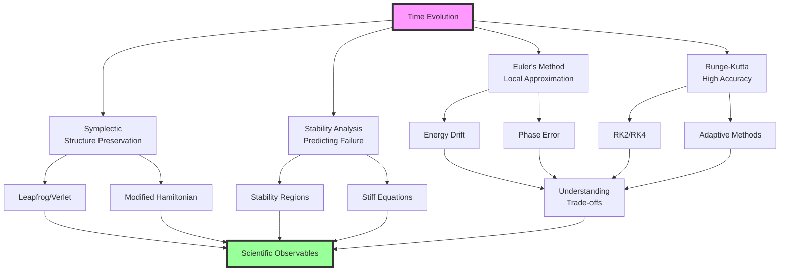

<!-- prep-banner:start -->
:::{warning} This reading is still being revised
Readings are reviewed and finalized **at least one week before they are
assigned**, so you will always have a settled version before you need it. Until
then, expect rough edges — wording, examples, and cross-references may change.

Where a reading disagrees with the syllabus, the syllabus is right. If something
here does not work, tell me: that is genuinely useful and I would rather hear it
from you than not.
:::
<!-- prep-banner:end -->

## Module Summary: Your Dynamics Toolkit



This module has given you a complete toolkit for temporal evolution built on understanding fundamental trade-offs:

**Part 1** connected Euler’s local approximation to its behavior on an oscillator:
- **Forward Euler on an undamped oscillator** creates systematic energy growth
- **Local accuracy** doesn't guarantee global stability
- **Oscillator phase errors** accumulate with duration at fixed step
- **Geometric structure** matters more than we thought

**Part 2** showed how Runge-Kutta methods achieve higher accuracy:
- **Multiple sampling** captures solution curvature
- **RK4's weights** reduce to Simpson quadrature for a time-only right-hand side
- **Adaptive timesteps** handle varying timescales
- **Higher order** does not by itself guarantee energy conservation

**Part 3** introduced symplectic integration's profound insight:
- **Preserve geometry** while still measuring trajectory accuracy
- **Leapfrog** has favorable long-time energy behavior for resolved, smooth, bounded conservative trajectories
- **Modified Hamiltonians** explain near-conservation under stated assumptions; step stability must still be checked
- **Time reversibility** follows from the symmetric kick–drift–kick composition

**Part 4** analyzed when methods become unstable:
- **Stability regions** diagnose amplification on the linear test equation
- **Stiff equations** can force explicit stability steps much smaller than accuracy requires
- **Implicit methods** trade computation for stability
- **CFL conditions** connect space and time discretization

These aren't separate topics — they're one framework showing how continuous physics becomes discrete computation while preserving what matters most.

## Key Takeaways

- **Local and global errors differ:** Euler's one-step defect is $O(h^2)$; its global error is $O(h)$ at fixed duration under appropriate assumptions.
- **Geometric preservation complements accuracy**; compare them for the observable and duration
- **Near-energy conservation has conditions**: smoothness, appropriate fixed steps, and bounded trajectories
- **Classical RK4 has fourth-order global accuracy** under its assumptions; the SHO example also exhibits small artificial damping.
- **Linear stability tests diagnose mode amplification**; they do not replace accuracy, nonlinear stability, or physical-admissibility checks.
- **Stiff equations often favor implicit methods**, although specialized explicit and exponential methods also exist
- **Ordinary state-dependent step selection generally loses symplecticity**; specialized constructions need a separate argument
- **Modified Hamiltonians explain** why symplectic methods work
- **Hamiltonian flow preserves canonical phase-space volume**; a dissipative physical model need not.
- **Transfer the questions with care:** identify the equations and observable before choosing the relevant diagnostics.

(ode-investigation)=
## Investigation: a stable answer to the wrong question

The oscillator showed that a small energy error can coexist with a growing
phase error. Now change the physics. Let $u$ be a population divided by its
initial population and let $\tau$ be time divided by its decay timescale:

$$\frac{du}{d\tau}=-u,\qquad u(0)=1,\qquad u(\tau)=e^{-\tau}.$$

This is a dimensionless model of exponential loss. A physically meaningful
solution is nonnegative and decreases monotonically. Conservation of $u$ would
be wrong. The mathematical model itself removes population.

### Predict from the update before looking at a trajectory

Euler gives

$$u_{n+1}=(1-h)u_n.$$

For each candidate step $h=0.25$, $1.5$, and $3$, predict three separate
properties: boundedness, positivity, and accurate decay. Explain your prediction
using $1-h$, rather than a memorized ranking of method names.

- $|1-h|<1$ means the discrete magnitude decreases.
- $0\le1-h\le1$ also preserves nonnegative, nonincreasing values.
- Neither statement establishes a particular accuracy over the requested duration.

```{code-cell} python
import numpy as np
import matplotlib.pyplot as plt


def euler_decay_trace(h, end_time=6.0):
    """Fixed steps for the dimensionless decay example; endpoint must align."""
    if not np.isfinite(h) or not np.isfinite(end_time) or h <= 0 or end_time <= 0:
        raise ValueError("Use a finite positive step and end time")
    n = int(round(end_time/h))
    if n <= 0 or not np.isclose(n*h, end_time, rtol=0, atol=1e-12):
        raise ValueError("Use a positive step that divides this example's interval")
    times = h*np.arange(n+1)
    values = np.empty(n+1)
    values[0] = 1.0
    for i in range(n):
        values[i+1] = values[i] + h*(-values[i])
    return times, values


fig, axes = plt.subplots(1, 2, figsize=(9, 4), layout="constrained")
fine_times = np.linspace(0, 6, 301)
for ax in axes:
    ax.plot(fine_times, np.exp(-fine_times), "k--", label="exact decay")
    ax.axhline(0, color="gray", lw=0.7)
    ax.set(xlabel="dimensionless time", ylabel="population / initial population")
for h, ax in ((0.25, axes[0]), (1.5, axes[1]), (3.0, axes[1])):
    ts, us = euler_decay_trace(h)
    ax.plot(ts, us, "o-", ms=4, label=f"Euler h={h}")
    print(f"h={h}: multiplier={1-h:+.2f}, minimum={us.min():+.4f}, "
          f"final absolute error={abs(us[-1]-np.exp(-6)):.3e}")
axes[0].set_title("Positive and decaying; still approximate")
axes[1].set_title("Alternating sign: stable or unstable?")
for ax in axes:
    ax.legend()
plt.show()
```

The panels use different vertical ranges so both the resolved trajectory and
the larger failures are readable. This is a comparison of mechanisms, not a
visual claim that equal distances on the two panels mean equal errors.

:::{tip} Explain all three properties
:class: dropdown
At $h=0.25$, the multiplier is $0.75$: the numerical values remain positive and
decay. They still differ from the exact one-step factor $e^{-0.25}$, and that
difference accumulates. Refine at a fixed final time to measure accuracy.

At $h=1.5$, the multiplier is $-0.5$: the trajectory alternates sign while its
magnitude decreases. It is stable for the scalar test equation but produces
negative populations. Stability alone does not establish the physical behavior
we requested.

At $h=3$, the multiplier is $-2$: both alternating sign and growing magnitude
contradict the model. This is outside Euler's decay stability interval.

The oscillator needs faithful phase and amplitude. This decay problem needs
faithful loss and nonnegative values. A universal instruction to conserve
energy or preserve phase-space volume would miss that change of question.
:::

### Does an implicit step settle the question?

Backward Euler gives $u_{n+1}=u_n/(1+h)$. For every positive $h$, it preserves
positive decay in this example. At $h=3$, however, its one-step factor is $1/4$,
whereas the exact factor is $e^{-3}\approx0.0498$. A stable step can retain much
more population than the model predicts. Whether that discrepancy is acceptable
depends on the desired observable and accuracy, not the word “implicit.”

This example separates **model behavior**, **numerical stability**, and
**numerical accuracy**. We need evidence for all three when they matter to the
scientific claim.

### Transfer: which conclusion survives the evidence?

Consider these reports without choosing a new method immediately:

| Report | What it establishes | What you still need to investigate |
|---|---|---|
| “The oscillator energy stays within a narrow band.” | An energy diagnostic over the tested duration | Phase and state error; refinement at the intended duration |
| “The population remains bounded.” | No growth in the measured magnitude over that run | Positivity, the correct decay law, and accuracy |
| “The solver accepted every step.” | Its own error-estimate criterion was met | Actual error in the observable; sensitivity to tolerances and unresolved features |
| “The fourth-order method costs four calls per step.” | One part of per-step work | The steps needed to meet the same accuracy requirement; rejected work if adaptive |

Choose one row and design the smallest additional comparison that could
contradict the report's implied claim. State what each possible outcome would
mean. For example, compare oscillator phase at a fixed physical time under
refinement; do not merely extend an energy plot and call it a different test.

:::{tip} What a complete numerical argument contains
:class: dropdown
A strong answer names the equations and observable, specifies the comparison,
and states which conclusion the result supports. It does not treat a property
of one diagnostic as a certificate for everything else.

For the first row, bounded energy plus phase that changes substantially under
refinement would reject a claim of accurate timing. For the second, a negative
population would reject physical admissibility even if the magnitude is
bounded. For the third, disagreement under tighter tolerances motivates a
closer error study, but agreement alone cannot exclude a feature that all runs
miss. For the fourth, a higher per-step cost may or may not be offset by fewer
steps; the comparison must use the same accuracy requirement.

If you cannot yet choose a method, state what measurement would resolve the
choice. Recognizing missing evidence is more useful than declaring a winner
from its order or name.
:::

## Looking Forward

The next scientific application should determine the diagnostic. Orbital
motion needs phase and trajectory checks as well as conservation. A cooling
or reacting system needs the correct dissipative behavior and resolved slow
evolution. A Hamiltonian Monte Carlo proposal also needs the sampler's own
acceptance and reversibility arguments; an accurate ODE trajectory alone is
not a sampling validation.

These are applications of the numerical ideas, not a revised assignment map.
Project 2 remains quadrature; Project 3 introduces root finding and the `Star`
class. The assignment briefs specify deliverables.

Before transferring a solver, record the equations, units, initial state,
duration, observable, comparison, and acceptance criterion. Then ask which
failure from this module could survive your planned checks.

---

## Quick Reference Tables

### Integration Methods Comparison

The energy and area entries below refer to the linear oscillator, except for
the decay behavior explicitly identified for backward Euler. They are not
universal properties of every system a method could integrate.

| Method | Order | Energy Behavior | Phase Space | When to Use |
|--------|-------|-----------------|-------------|-------------|
| Euler | 1 | Oscillator energy grows exponentially | Oscillator area expands | Baseline; resolved decay problems |
| RK2 | 2 | Systematic drift | Not preserved | Short integrations |
| RK4 | 4 | Slow drift | Not preserved | Moderate accuracy needs |
| Leapfrog | 2 | Bounded oscillator error for $0<h\omega<2$ | Symplectic in exact arithmetic | Resolved separable Hamiltonian systems |
| Yoshida4 | 4 | Check stability and refinement | Symplectic in exact arithmetic | Smooth separable Hamiltonian systems |
| Backward Euler | 1 | Artificial oscillator damping; positive scalar decay | Contracts for oscillator and decay examples | Consider for stiff decay; measure damping error |

### Timestep selection: restrictions and measurements

| System | What restricts the step? | What should be measured? |
|---|---|---|
| Harmonic oscillator | Leapfrog requires $0<h\omega<2$; forward Euler has no stable nonzero step | State, energy, and unwrapped phase at fixed duration |
| Kepler orbit | Resolve periapsis; no universal fraction of period certifies accuracy | Orbital elements, phase, and energy under refinement |
| Close encounter | Resolve force variation and encounter timescales | Deflection and energy transfer, with singularity handling stated |
| Stiff decay | Forward Euler requires $h\gamma<2$; implicit methods have different damping | Slow solution accuracy and decay of fast transients |
| Semidiscrete wave equation | Scheme-dependent CFL restriction | Dispersion, dissipation, and spatial plus temporal refinement |

### Stability regions summary

For the scalar test equation, the entries give the portion of each axis with
$|R(z)|\le1$. Boundary points may fail to damp a decaying mode. The leapfrog
row instead describes the two-state oscillator update; its endpoints are
excluded because repeated eigenvalues can allow growth.

| Method | Negative real axis | Imaginary axis |
|---|---|---|
| Forward Euler | $[-2,0]$ | Only 0 |
| Explicit midpoint RK2 | $[-2,0]$ | Only 0 |
| Classical RK4 | Approximately $[-2.785,0]$ | $[-i\sqrt8,i\sqrt8]$ |
| Kick–drift–kick leapfrog on an oscillator | Not a scalar decay rule | $0<|h\omega|<2$ |
| Backward Euler | Entire nonpositive axis | Entire axis, with artificial damping away from zero |
| Implicit midpoint / trapezoidal on the linear test equation | Entire nonpositive axis | Entire axis; unit amplification |

### Diagnose before choosing a repair

| Symptom | Candidate explanation | Discriminating check |
|---|---|---|
| Oscillator energy grows | Numerical amplification, an implementation error, or a force-law error | Compare the derived one-step energy factor and refine |
| Orbit spirals | Numerical phase/amplitude error or physical dissipation | Check the equations and an independent trajectory diagnostic |
| Simulation grows without bound | Physical growth, instability, overflow, or a singularity | Locate the first discrepancy and test the applicable step restriction |
| Very many steps | Tight accuracy target, stiffness, unresolved structure, or overhead | Separate function cost from step count and compare relevant timescales |
| Phase drifts | Numerical frequency differs | Refine at fixed duration and compare phase; bounded energy is insufficient |
| NaN values | Invalid domain, overflow, or instability | Inspect the first non-finite operation |


---

## Glossary

**A-stable**: A method whose scalar linear stability region contains the entire left half-plane. This removes that linear stability step restriction; it does not guarantee accuracy or rapid damping of stiff modes.

**Adaptive timestep**: Adjusting the step using an error estimate. Ordinary state-dependent adaptation generally does not preserve a fixed-step method's symplectic structure.

**Butcher tableau**: Compact notation organizing the coefficients (aᵢⱼ, bᵢ, cᵢ) that define a Runge-Kutta method.

**CFL condition**: The numerical domain of dependence must contain the physical one. A common explicit bound is $h\le C_{\rm CFL}\Delta x/c_{\max}$; the coefficient depends on the space/time discretization and dimension, and the bound alone is not a sufficient stability proof.

**Conjugate momenta**: In Hamiltonian mechanics, the momenta p conjugate to generalized coordinates q, related by p = $\partial$L/$\partial$q̇.

**Energy drift**: Systematic change in total energy that should be conserved, indicating non-physical behavior of integrator.

**Euler's method**: A first-order update using the initial slope. Its suitability depends on the equations, step length, duration, and required accuracy; its oscillator instability is one specific failure.

**Global error**: Total accumulated error over entire integration interval, typically O(h^p) for method of order p.

**Hamiltonian**: Function H(q,p,t) representing total energy of system. H = T + V for kinetic T and potential V.

**Implicit method**: Integration scheme where unknown appears on both sides, requiring an algebraic solution each step. Its stability properties depend on the particular method.

**Initial Value Problem (IVP)**: Finding function x(t) given dx/dt = f(x,t) and x(t₀) = x₀. Fundamental problem of dynamics.

**Leapfrog/Verlet**: Symplectic integrator that staggers position and momentum updates to preserve symplectic structure in exact arithmetic for the separable Hamiltonian setting described here.

**Liouville's theorem**: Phase space volume is preserved under Hamiltonian flow. Symplectic maps preserve canonical volume in exact arithmetic; floating-point implementations add rounding error.

**Local truncation error**: Error introduced in single step assuming perfect starting values, typically $O(h^{p+1})$ for order-$p$ method.

**Modified Hamiltonian**: A formal nearby Hamiltonian describing a symplectic map order by order. Suitable truncations explain long-time near-conservation under stated assumptions; the infinite series need not converge.

**Order of accuracy**: Power $p$ in global error scaling $O(h^p)$. Higher order doesn't guarantee better long-term behavior.

**Phase space**: Space of all possible states $(q,p)$ of Hamiltonian system. For an autonomous Hamiltonian, trajectories remain on constant-energy surfaces.

**Poisson bracket**: $\{f,g\} = \partial f/\partial q \cdot \partial g/\partial p - \partial f/\partial p \cdot \partial g/\partial q$. Fundamental operation in Hamiltonian mechanics.

**Predictor-corrector**: Two-stage integration where initial estimate (predictor) is refined using additional information (corrector).

**RK4 (Runge-Kutta 4)**: Classical fourth-order method using weighted average of four derivative evaluations whose update reduces to Simpson quadrature for a time-only right-hand side.

**Stability function**: $R(z)$ relating consecutive values $y_{n+1} = R(h\lambda)y_n$ for test equation $y' = \lambda y$.

**Stability region**: Set of complex values $z = h\lambda$ where $|R(z)| \leq 1$, ensuring bounded numerical solutions.

**Stiff equation**: An ODE for which an explicit method’s stability requirement forces much smaller steps than accuracy requires over the interval of interest. Multiple separated modes are one common mechanism, not a requirement.

**Symplectic integrator**: Numerical method preserving symplectic structure (including canonical phase-space volume, but not necessarily time reversibility) of Hamiltonian systems.

**Symplectic structure**: Geometric structure of phase space preserved by Hamiltonian flow, characterized by 2-form $\omega = dq \wedge dp$.

**Time reversibility**: Property where integrating forward then backward returns exactly to start. Holds for symmetric methods in exact arithmetic; symplecticity alone is insufficient.

**Yoshida coefficients**: Special timestep ratios $w_0$, $w_1$ involving $2^{1/3}$ that achieve fourth-order accuracy while maintaining symplecticity.

---

A useful numerical conclusion states the observable, the measured error or
comparison, and the conditions under which the evidence applies. The methods
in this module give you ways to build that conclusion and ways to challenge it.
