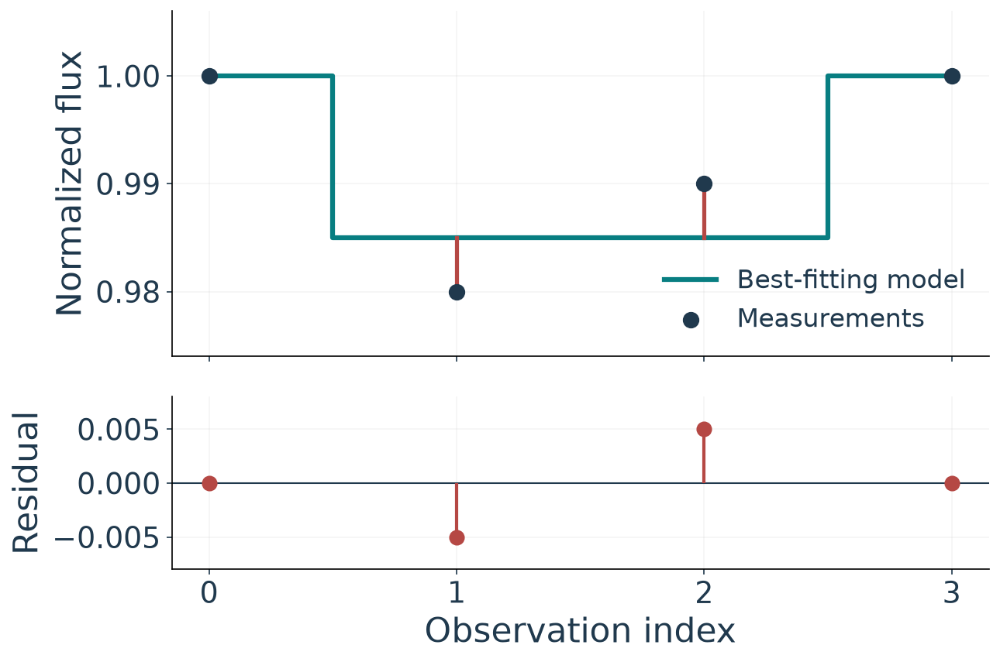
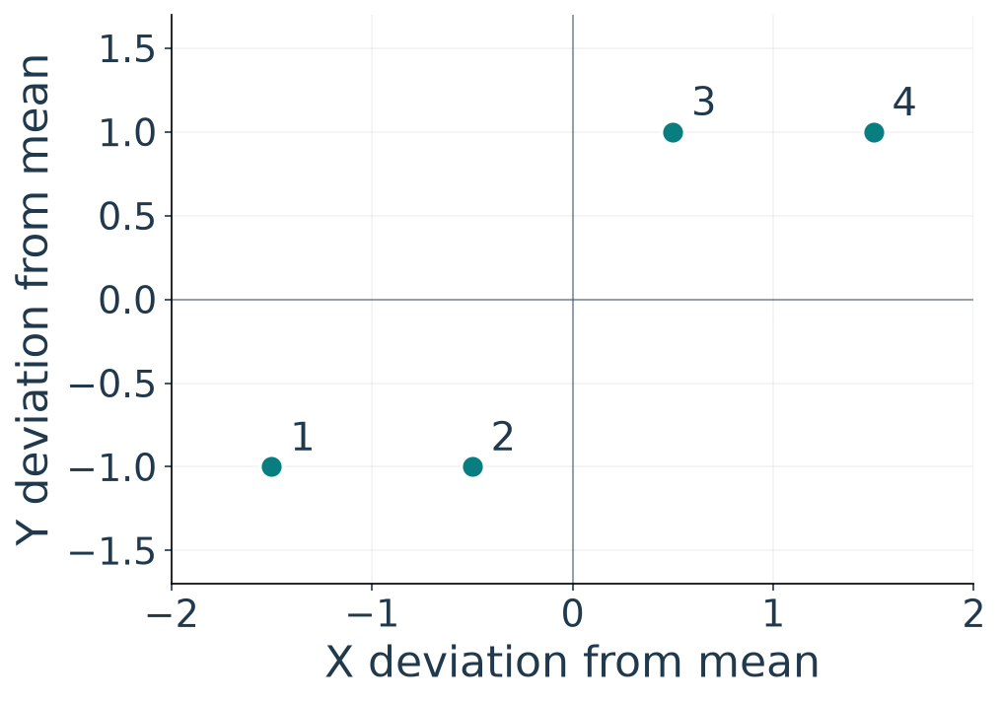
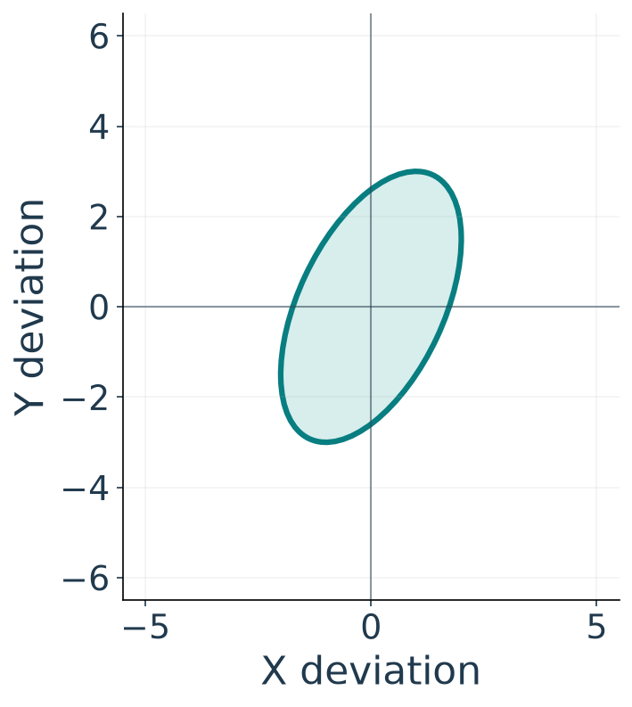
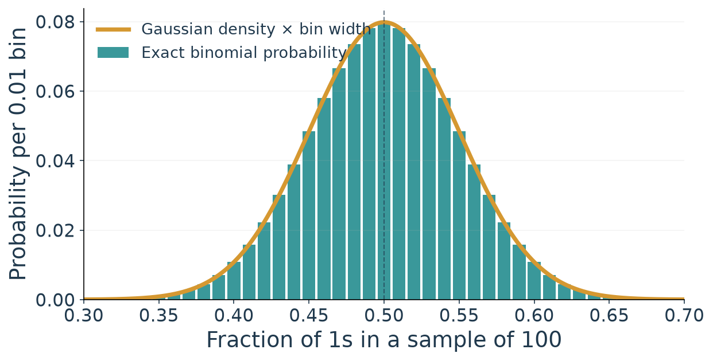
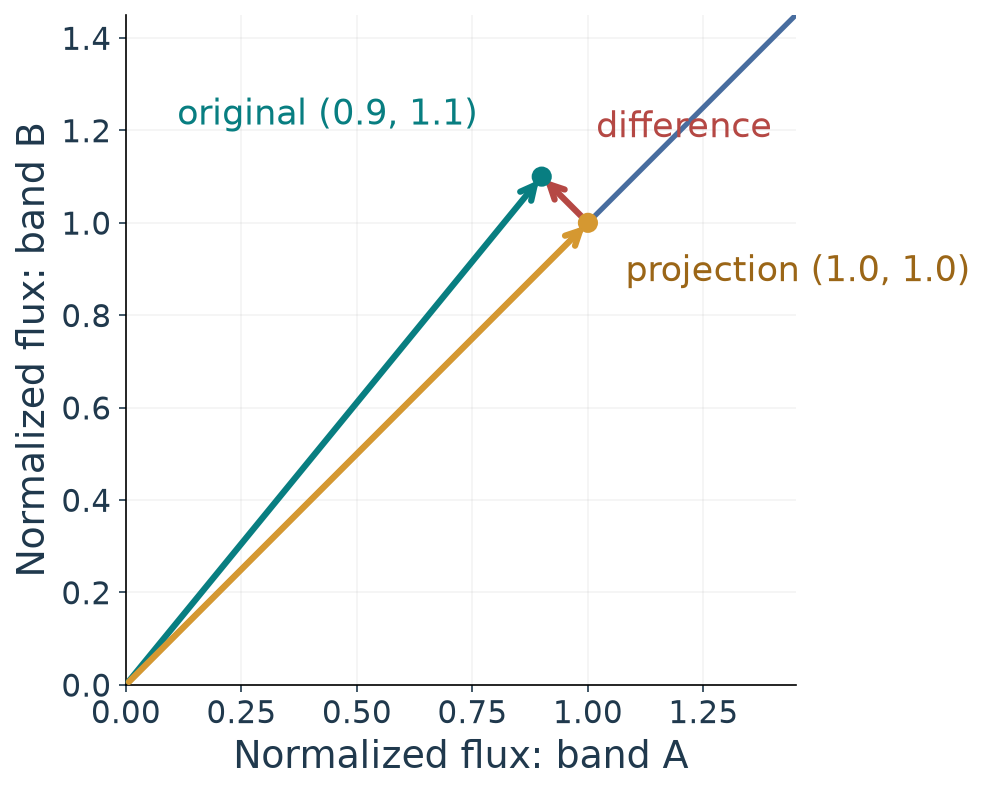

# Measurements, probability, and geometry

A telescope records a star's brightness at many times. A small dip might be a planet passing in front of the star, but the recorded brightness also varies because of measurement noise, the star, and the instrument. How can measurements constrain a physical quantity when the measurements are imperfect?

We need three connected ideas. A **forward model** predicts observations from physical parameters. Probability describes the variation we expect in measurements and makes uncertainty explicit. Linear algebra organizes many measurements and model predictions so that we can compare them. Later, the same tools will help us identify patterns in collections of objects.

## 1. From a scientific question to measurements

Let $y_i$ be the measured flux at time $t_i$. A useful starting model is

$$
y_i = m(t_i;\boldsymbol\theta) + \epsilon_i.
$$

Here $m$ predicts the flux for parameters $\boldsymbol\theta$, and $\epsilon_i$ is the difference between the measurement and that model prediction. A transit model might describe a dip using a depth and a time. The model is a simplification: stellar variability or instrumental effects can also contribute to the difference. Calling that entire difference “noise” does not establish its cause.

Inference runs the question in the other direction: given measurements $y_i$, which parameter values are compatible with them, under the chosen model and assumptions? A best fit is one part of the answer; its uncertainty and remaining discrepancies matter too.

### Forward and inverse: a transit example

A forward model starts with physical quantities and predicts what we observe. For a central transit across a uniformly bright star, an opaque planet with radius $R_p$ blocks the fraction $(R_p/R_\star)^2$ of the stellar disk when it is fully in front of the star. A radius ratio of $0.1$ therefore predicts a depth of $0.01$: the normalized flux falls from 1 to 0.99. A complete transit model predicts a flux at each time, including ingress and egress.

The inverse problem begins with the light curve: which parameter values could have produced it? To compare a proposed model with measurements, compute residuals $r_i=y_i-m(t_i;\boldsymbol\theta)$. Changing the parameters changes the predicted curve and its residuals. Fitting chooses parameters according to a stated criterion; uncertainty asks how much those estimates could vary. The answer depends on the data and on which parameters and assumptions the model holds fixed.

### A first inverse problem, worked through

For a simple example, suppose the out-of-transit flux is known to be 1 and the transit timing and shape are fixed. Let $T_i=1$ inside the transit and $T_i=0$ outside it. The model is

$$m_i(\delta)=1-\delta T_i.$$

Here $\delta$ is the unknown depth. Take four normalized measurements $\mathbf y=(1.00,0.98,0.99,1.00)$ and the corresponding template $\mathbf T=(0,1,1,0)$. For a trial depth $\delta=0.01$, the predicted values are $(1.00,0.99,0.99,1.00)$. We can compare other trial depths using the unweighted sum of squared residuals,

$$S(\delta)=\sum_i[y_i-(1-\delta T_i)]^2.$$

Differentiating with respect to $\delta$ and setting the result to zero gives

$$\hat\delta=\frac{\sum_i T_i(1-y_i)}{\sum_i T_i^2}
=\frac{0.02+0.01}{2}=0.015.$$

The best-fitting depth is $1.5\%$. The two in-transit model values are both 0.985, leaving residuals $-0.005$ and $+0.005$. Under the uniform-star model used above, the corresponding radius ratio is $\sqrt{0.015}\approx0.122$. The data constrain the ratio through the assumed model; they do not separately determine the stellar and planetary radii. In this example the baseline and template were held fixed and each residual received the same weight.

## 2. Probability describes possible outcomes

A **random variable** represents a quantity whose possible outcomes are described by a probability distribution. For a continuous quantity, a probability density $p(y)$ assigns probability to an interval through its area, $P(a<Y<b)=\int_a^b p(y)\,dy$. A density at a point is not itself the probability of that exact value.

Imagine repeating a brightness measurement under the same conditions. The distribution of the resulting measurements describes how outcomes vary across repetitions. Its **expectation** $\mu=E[Y]$ is the distribution's mean; its **variance** and **standard deviation** are

$$
\operatorname{Var}(Y)=E[(Y-\mu)^2], \qquad \sigma_Y=\sqrt{\operatorname{Var}(Y)}.
$$

For a continuous variable with density $p(y)$, these expectations are integrals:

$$
\mu=\int_{-\infty}^{\infty}y\,p(y)\,dy,\qquad
\operatorname{Var}(Y)=\int_{-\infty}^{\infty}(y-\mu)^2p(y)\,dy.
$$

The density weights each value in the mean, and weights each squared deviation in the variance. These formulas require the corresponding integrals to exist. For a discrete distribution, replace the integrals with sums over possible outcomes, weighted by their probabilities.

### Worked example: a uniform distribution

Suppose $Y$ is uniformly distributed between 0 and 2: $p(y)=1/2$ on that interval and zero elsewhere. Then

$$
\mu=\int_0^2 y\frac12\,dy=1,
\qquad
\operatorname{Var}(Y)=\int_0^2(y-1)^2\frac12\,dy=\frac13,
\qquad \sigma_Y=\frac1{\sqrt3}.
$$

The mean and variance describe the distribution. A sample provides estimates of those quantities.

Variance has the square of the measurement's units; standard deviation has the original units. For measurements $y_1,\ldots,y_n$, the sample mean $\bar y=\frac{1}{n}\sum_i y_i$ estimates the distribution mean. The sample variance $s^2=\frac{1}{n-1}\sum_i(y_i-\bar y)^2$ estimates the population variance for independent, identically distributed observations with finite variance. The denominator $n-1$ accounts for estimating the mean from the same sample.

**Spread and uncertainty are different.** The standard deviation describes the spread of individual outcomes. The standard error describes the spread of an estimator across hypothetical repeated datasets. If independent measurements have the same variance $\sigma^2$, then

$$
\operatorname{Var}(\bar Y)=\frac{\sigma^2}{n}, \qquad
\operatorname{SD}(\bar Y)=\frac{\sigma}{\sqrt n}.
$$

More independent observations improve the precision of the mean. They do not automatically eliminate a shared calibration bias.

## 3. Dependence, independence, and covariance

Two events $A$ and $B$ are independent when $P(A,B)=P(A)P(B)$. Knowing that $A$ occurred then does not change the probability of $B$ (provided $P(A)>0$). Random variables are independent when their joint distribution factors into their marginal distributions. Dependence means the joint distribution does not factor this way.

For example, consecutive brightness measurements may share an instrumental drift. A high reading now can then provide information about a nearby reading. By contrast, separate random measurement errors may be approximated as independent when the measurement process supports that assumption. Independence is an assumption to examine, not a consequence of taking many measurements.

Covariance measures joint *linear* variation:

$$
\operatorname{Cov}(X,Y)=E[(X-E[X])(Y-E[Y])].
$$

Positive covariance means the average product of the deviations is positive; negative covariance means it is negative. Large deviations can contribute more than small ones. Its units are the product of the two variables' units. Correlation divides covariance by $\sigma_X\sigma_Y$ when both standard deviations are nonzero, producing a dimensionless number between $-1$ and $1$.

### Correlation: a dimensionless measure

The Pearson correlation coefficient is

$$\rho_{XY}=\frac{\operatorname{Cov}(X,Y)}{\sigma_X\sigma_Y}.$$

It exists when the variances are finite and both standard deviations are nonzero. The units cancel. A positive value indicates positive linear association, a negative value indicates negative linear association, and a value near zero indicates little *linear* association. Values close to $+1$ or $-1$ indicate a strong linear relationship; the sign gives its direction. Correlation is not a measure of causation.

For paired observations $(x_i,y_i)$, the sample covariance and correlation are

$$s_{XY}=\frac{1}{n-1}\sum_{i=1}^n(x_i-\bar x)(y_i-\bar y),\qquad
r_{XY}=\frac{s_{XY}}{s_Xs_Y}.$$

The pairing matters: each product compares deviations for the same observation. For example, if $\sigma_X=2$, $\sigma_Y=3$, and $\operatorname{Cov}(X,Y)=3$, then $\rho_{XY}=3/(2\cdot3)=0.5$. Scaling one variable by a positive constant changes its covariance but leaves the correlation unchanged.

As a calculation from data, take four pairs $(-1.5,-1)$, $(-0.5,-1)$, $(0.5,1)$, and $(1.5,1)$. Both sample means are zero. Their products sum to 4, while the squared $x$ and $y$ values sum to 5 and 4. The shared $n-1$ factors cancel when forming the sample correlation:

$$r=\frac{4/(n-1)}{\sqrt{5/(n-1)}\sqrt{4/(n-1)}}=\frac{4}{\sqrt{20}}\approx0.894.$$

The positive correlation matches the upward pattern of the pairs.

Independence implies zero covariance when the relevant moments exist. The converse is not generally true. Let $X$ take $-1$, $0$, and $1$, each with probability $1/3$, and let $Z=X^2$. Then $E[X]=0$ and $E[XZ]=E[X^3]=0$, so $\operatorname{Cov}(X,Z)=0$. But knowing $X=0$ tells us $Z=0$ with certainty; without that information, $P(Z=0)=1/3$. These variables are dependent even though their covariance is zero. Correlation can miss nonlinear dependence.

### Why covariance appears in uncertainty propagation

When two uncertain quantities are combined, their deviations combine too. For $Z=X+Y$, write $\Delta X=X-\mu_X$ and $\Delta Y=Y-\mu_Y$. Since $Z-E[Z]=\Delta X+\Delta Y$,

$$
\begin{aligned}
\operatorname{Var}(X+Y)
&=E[(\Delta X+\Delta Y)^2]\\
&=E[\Delta X^2]+E[\Delta Y^2]+2E[\Delta X\Delta Y]\\
&=\operatorname{Var}(X)+\operatorname{Var}(Y)+2\operatorname{Cov}(X,Y).
\end{aligned}
$$

The cross term comes from the ordinary algebraic expansion of a square. For a difference the cross term has the opposite sign:

$$\operatorname{Var}(X-Y)=\operatorname{Var}(X)+\operatorname{Var}(Y)-2\operatorname{Cov}(X,Y).$$

When $\sigma_X=2$, $\sigma_Y=3$, and $\rho_{XY}=0.5$, the covariance is 3, so

$$\operatorname{Var}(X+Y)=4+9+2(3)=19,\qquad
\operatorname{Var}(X-Y)=4+9-2(3)=7.$$

Positive shared variation makes the sum more variable and the difference less variable than they would be at zero covariance. In an observation, a common instrument fluctuation is an example of a mechanism that can produce shared variation.

### The covariance matrix keeps track of mixing

For the same two variables, arrange all pairwise covariances in

$$\Sigma=\begin{bmatrix}4&3\\3&9\end{bmatrix}.$$

The diagonal entries are variances; the off-diagonal entries are covariances. For $Z=aX+bY$ and $\mathbf a=(a,b)^T$,

$$\operatorname{Var}(Z)=a^2\operatorname{Var}(X)+b^2\operatorname{Var}(Y)
+2ab\operatorname{Cov}(X,Y)=\mathbf a^T\Sigma\mathbf a.$$

The matrix expression collects the same squared and cross terms. More generally, for a random vector $\mathbf X$ with covariance $\Sigma$ and a linear transformation $\mathbf Z=A\mathbf X$, the output covariance is $A\Sigma A^T$. For the sum and difference together,

$$A=\begin{bmatrix}1&1\\1&-1\end{bmatrix},\qquad
A\Sigma A^T=\begin{bmatrix}19&-5\\-5&7\end{bmatrix}.$$

The diagonal gives the same variances, 19 and 7, obtained above. The off-diagonal value describes covariance between the sum and the difference.

Dependence also changes the uncertainty of an average:

$$
\operatorname{Var}(\bar Y)=\frac{1}{n^2}
\left[\sum_i\operatorname{Var}(Y_i)+2\sum_{i<j}\operatorname{Cov}(Y_i,Y_j)\right].
$$

The familiar $\sigma/\sqrt n$ expression follows when the variances are equal and the off-diagonal covariances vanish. Positively correlated measurements generally provide less independent information than the same number of independent measurements.

For two measurements with equal variance $\sigma^2$ and correlation $\rho$, the expression becomes

$$
\operatorname{Var}\!\left(\frac{Y_1+Y_2}{2}\right)
=\frac{\sigma^2}{2}(1+\rho).
$$

When $\rho=0$, the variance is $\sigma^2/2$. When $\rho>0$, shared random variation means the average is less precise than under independence. A shared *bias* is a different issue: it shifts the expectation of the measurements and need not disappear when they are averaged.

## 4. Why Gaussian distributions appear

A Gaussian distribution with mean $\mu$ and standard deviation $\sigma$ has density

$$
p(y)=\frac{1}{\sqrt{2\pi}\sigma}
\exp\left[-\frac{(y-\mu)^2}{2\sigma^2}\right].
$$

The mean sets the center; the standard deviation sets the scale. Gaussians are useful models for many measurement errors, but not a universal description of all data.

The **central limit theorem** gives one reason they arise. For independent, identically distributed variables with finite mean $\mu$ and finite, nonzero variance $\sigma^2$, the distribution of the standardized sample mean approaches a standard Gaussian as $n$ grows:

$$
\frac{\bar Y-\mu}{\sigma/\sqrt n}
\xrightarrow{\ d\ } \mathcal N(0,1).
$$

The theorem concerns the distribution of a **sum or average across repeated samples**. It does not say that each original observation becomes Gaussian. A measurement error that combines many small, sufficiently independent contributions may be approximately Gaussian, but a few dominant effects, strong correlations, heavy tails, selection effects, or systematic bias can make that approximation poor. The rate of approximation depends on the underlying distribution; there is no universal sample size that guarantees a good Gaussian approximation. Inspect the data and the measurement process rather than invoking the theorem automatically.

### Example: a distribution of sample means

Suppose each independent outcome is 1 with probability $1/2$ and 0 otherwise. One outcome is not Gaussian: it has only two possible values. Collect $n=100$ outcomes and take their mean, the fraction of 1s. Its expectation is $1/2$, and its standard deviation is

$$
\sqrt{\frac{(1/2)(1/2)}{100}}=0.05.
$$

Now repeat the **whole 100-outcome experiment**. The resulting sample means vary from experiment to experiment. Their exact distribution is a scaled binomial distribution; for this example, it is well approximated by a Gaussian centered on $0.5$ with standard deviation $0.05$. The distribution of individual outcomes has not changed. We are describing a different random quantity: the mean of a sample.

## 5. A worked measurement: why uncertainties change a result

Suppose two independent measurements of the same constant normalized brightness are $y_1=0.980$ with $\sigma_1=0.010$ and $y_2=1.000$ with $\sigma_2=0.020$. Assume unbiased Gaussian errors and that the quoted standard deviations are known. The likelihood is the product of the two Gaussian densities,

$$L(\mu)=\prod_i\frac{1}{\sqrt{2\pi}\sigma_i}\exp\!\left[-\frac{(y_i-\mu)^2}{2\sigma_i^2}\right].$$

Taking the logarithm turns products into sums. The normalization factors do not depend on $\mu$ because the $\sigma_i$ are fixed. Consequently, maximizing $L$ is equivalent to minimizing the sum of squared residuals measured in units of their uncertainties:

$$
Q(\mu)=\sum_i\frac{(y_i-\mu)^2}{\sigma_i^2}.
$$

Differentiate: $dQ/d\mu=2\sum_i(\mu-y_i)/\sigma_i^2$. Setting this equal to zero gives the inverse-variance weighted mean below. The second measurement has four times the variance, so the first receives four times the weight:

$$
\hat\mu=\frac{\sum_i y_i/\sigma_i^2}{\sum_i 1/\sigma_i^2}
=\frac{4(0.980)+1.000}{5}=0.984.
$$

The standard error is $\sigma_{\hat\mu}=1/\sqrt{\sum_i 1/\sigma_i^2}\approx0.0089$. This quantifies uncertainty from the stated independent measurement errors. It does not include an unknown shared calibration error, a changing source, or errors in the quoted uncertainties. The unweighted mean is $0.990$; the weighted estimate is closer to the more precise measurement.

## 6. Why vectors and matrices?

A scalar is enough to record one number. Scientific questions usually involve many related numbers: fluxes at many times, or many properties of each star. A **vector** gathers an ordered set of numbers, for example

$$
\mathbf y=\begin{bmatrix}y_1\\y_2\\\vdots\\y_n\end{bmatrix}.
$$

A **matrix** arranges related vectors. If each row represents one star and each column a measured property, an $n\times d$ matrix $X$ represents $n$ stars with $d$ features. A feature is a recorded or constructed quantity used to describe an observation, such as temperature, luminosity, or a color index. **Dimensionality** $d$ is the number of feature coordinates in this representation; it is not necessarily the number of physical spatial dimensions.

For example, let the columns be normalized brightness in two bands, A and B, for two illustrative stars:

$$
X=\begin{bmatrix}0.9&1.1\\1.0&0.8\end{bmatrix}.
$$

The first row describes one star with two feature coordinates, $(0.9,1.1)$; the second row describes the other. A light-curve vector instead groups one object's measurements at different times. Coordinates get their meaning from the data and the scientific question.

This representation lets us state a calculation once for an entire dataset. It also exposes relationships: multiplying $X$ by a coefficient vector combines its columns into predictions. Row and column meanings, units, missing values, and labels still matter. Not every dataset is naturally a complete numerical table, and choosing a matrix does not guarantee that a relationship is linear.

### Matrices as transformations

A linear transformation $A$ takes an input vector to an output vector, $\mathbf z=A\mathbf x$, and satisfies $A(a\mathbf x+b\mathbf y)=aA\mathbf x+bA\mathbf y$. Its columns tell us where the input basis directions go. Depending on $A$, the transformation can rotate, scale, project, or combine coordinates. The input and output can have different numbers of coordinates.

A nonlinear physical model need not be a linear transformation of its parameters. We can still organize its input data, outputs, and residuals as vectors, and use matrices to express linear pieces or local approximations.

For the first star above, consider a transformation that replaces both band values by their average:

$$
\mathbf x=\begin{bmatrix}0.9\\1.1\end{bmatrix},\quad
A=\frac12\begin{bmatrix}1&1\\1&1\end{bmatrix},\quad
A\mathbf x=\begin{bmatrix}1.0\\1.0\end{bmatrix}.
$$

Geometrically, $A$ projects $\mathbf x$ onto the line of equal band values. The original vector is the sum of the projection $(1.0,1.0)$ and the discarded difference $(-0.1,0.1)$. Both transformed coordinates are equal, so the result needs only one number, the band average, for its representation along that line. If the difference between bands carries scientific information, that information is lost.

## 7. Dot products, projections, and fitting

The dot product combines corresponding entries: $\mathbf x^{\mathsf T}\mathbf y=\sum_i x_i y_i$. It measures alignment after accounting for the vectors' lengths. Consider a simple model in which the predictions are $a\mathbf x$, where the direction $\mathbf x\ne\mathbf 0$ is known and the amplitude $a$ is unknown. Choose $a$ to minimize the squared residual length

$$
S(a)=\|\mathbf y-a\mathbf x\|^2.
$$

Expanding and differentiating gives $S'(a)=-2\mathbf x^{\mathsf T}\mathbf y+2a\mathbf x^{\mathsf T}\mathbf x$. Setting this equal to zero gives

$$
\hat a=\frac{\mathbf x^{\mathsf T}\mathbf y}{\mathbf x^{\mathsf T}\mathbf x}.
$$

The fitted vector $\hat a\mathbf x$ is the projection of $\mathbf y$ onto $\mathbf x$. The residual $\mathbf r=\mathbf y-\hat a\mathbf x$ is perpendicular to $\mathbf x$: $\mathbf x^{\mathsf T}\mathbf r=0$. This is an unweighted fit through the origin. It treats errors in the entries equally and does not include a separate baseline.

For example, let $\mathbf x=(1,2)$ and $\mathbf y=(2,3)$. Then $\hat a=(2+6)/(1+4)=1.6$, the prediction is $(1.6,3.2)$, and the residual is $(0.4,-0.2)$. Its dot product with $\mathbf x$ is zero. Projection is therefore a geometric view of choosing the best amplitude for this model, not a claim that the model describes all physical effects.

## 8. Why reduce dimensionality?

A spectrum may contain thousands of measured wavelengths per object. Some features may vary together or mostly reflect noise. A lower-dimensional representation can make patterns easier to visualize, reduce storage, and help a model focus on a smaller number of directions. It can also discard useful information: a low-variance feature may carry a rare but scientifically important signal.

Later we will study principal component analysis (PCA), which finds directions of large variance in centered data, and the singular value decomposition (SVD), a matrix factorization used to compute those directions. These are choices about representation, not automatic discoveries of physical populations. Centering and scaling affect the result; the scientific question determines whether a compressed representation is useful.

## From here to model fitting

For Thursday, we will inspect a light curve and compare measurements with a first model using residuals and measurement uncertainties. The simple projection above becomes weighted least squares when measurements have different uncertainties. The fitting objective follows from an explicit noise model, and residuals help us examine what that model leaves unexplained.

For additional reference, see [dot products and projections](00a-linear-algebra-core-module.md#dot-product), [variance and covariance](../01-probability/02-mod1-part2-statistical-tools.md), and Chen's [*The Little Book of Generative AI Foundations*](https://arxiv.org/pdf/2605.29713), §§1.1–1.2. Chen's book is an optional mathematical reference; its PCA and SVD sections will be useful later.
