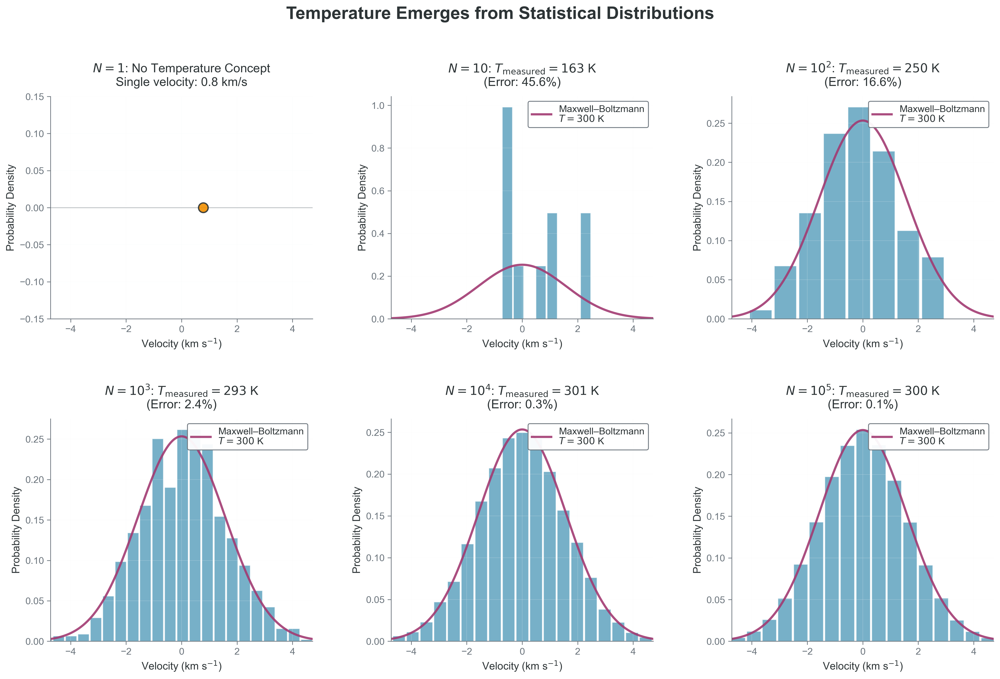
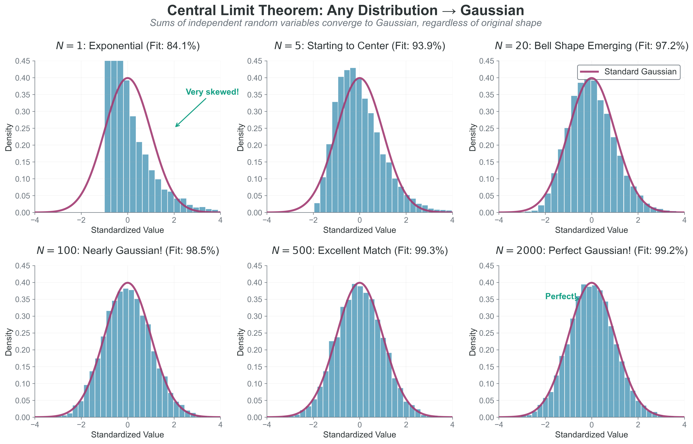
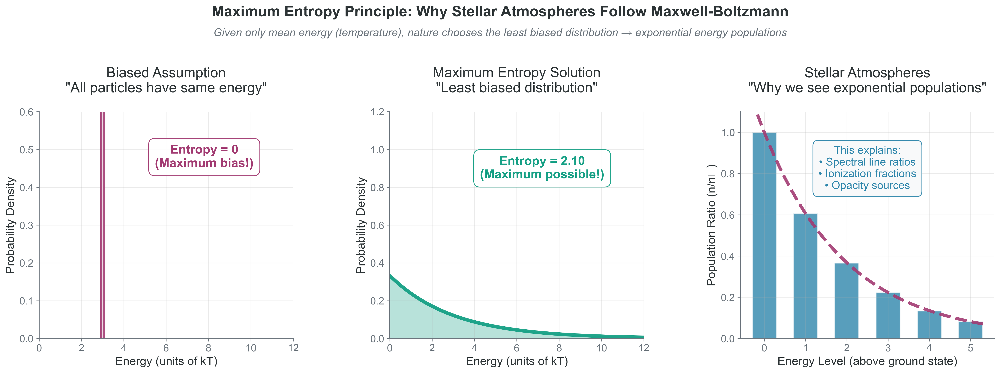

<!-- prep-banner:start -->
:::{warning} This reading is still being revised
Readings are reviewed and finalized **at least one week before they are
assigned**, so you will always have a settled version before you need it. Until
then, expect rough edges — wording, examples, and cross-references may change.

Where a reading disagrees with the syllabus, the syllabus is right. If something
here does not work, tell me: that is genuinely useful and I would rather hear it
from you than not.
:::
<!-- prep-banner:end -->

## Learning Outcomes

By the end of Part 1, you will be able to:

- [ ] **Explain** why temperature cannot exist for individual particles and identify it as a distribution parameter
- [ ] **Derive** how steady pressure emerges from chaotic particle collisions through statistical averaging
- [ ] **Apply** the Central Limit Theorem (CLT) to understand why Gaussian distributions appear universally in physics
- [ ] **Justify** why nature chooses exponential distributions using the maximum entropy principle
- [ ] **Connect** these statistical foundations to computational methods in astrophysics

---

:::{tip} Core Path in 45 Minutes

**Must-read blocks**:
1. [Section 1.1](#temperature-lie): temperature as a distribution parameter
2. [Section 1.2](#pressure-emerges): pressure from ensemble averaging
3. [Section 1.3](#central-limit): why fluctuations shrink as $1/\sqrt{N}$

**Optional deep dives**:
- [Section 1.4 optimization derivation](#maximum-entropy)
- "Try This" computational boxes in Sections 1.3 and 1.4
:::

(temperature-lie)=
## 1.1 Temperature is a Lie (For Single Particles)

:::{margin}
**Parameter**  
A variable that characterizes an entire distribution or model. Unlike individual data points, parameters describe global properties. *Examples:* mean $(\mu)$, standard deviation $(\sigma)$, temperature $(T).$

**Ensemble**  
A collection of many similar systems or particles considered together for statistical analysis. In our case, the collection of all gas molecules in a container.
:::

**Priority: 🔴 Essential**

In this section we replace "temperature = how fast" with "temperature = distribution width for an ensemble."
**Catchphrase -> Precision**: "Temperature is a Lie" means it is undefined for a single particle but well-defined for equilibrium ensembles.

Let's start with something that should bother you: we routinely say "this hydrogen atom has a temperature of 300 K." **This statement is fundamentally meaningless!** A single atom has kinetic energy $(\tfrac{1/2} m v^2)$, momentum $(m v)$, and position $(r)$ — but not temperature. To understand why, we need to confront what you probably think temperature is versus what it actually is.

Temperature is well-defined for an equilibrium (or near-equilibrium) ensemble, not for an individual particle.

**What temperature actually is**: Temperature is a **parameter** that characterizes the width (spread) of a velocity distribution. It describes how much variety there is in particle speeds across an **ensemble** — not the speed of any individual particle. Just as "average height" requires multiple people to have meaning, temperature requires multiple particles to exist.

**The Common Misconception**: You likely learned that temperature measures the average kinetic energy of particles:

$$\langle E_{\text{kinetic}} \rangle = \frac{3}{2}k_B T$$

This leads to thinking "hot = fast particles, cold = slow particles." While not entirely wrong, this is dangerously incomplete. It suggests that a single fast particle is "hot" — but this is meaningless! A single particle moving at 1 km/s doesn't have temperature any more than a single person has an average height.

**The fundamental truth**:

- For any one Cartesian component, temperature sets the velocity-component variance: $\sigma_{v_x}^2 = k_B T/m$ where $\sigma_{v_x}^2$ is the variance of $v_x$, $k_B$ is Boltzmann's constant ($1.38 \times 10^{-16}$ erg/K), $T$ is temperature in Kelvin, and $m$ is particle mass
- Higher temperature = broader distribution = more spread in speeds
- Lower temperature = narrower distribution = particles clustered around mean velocity

The **Maxwell-Boltzmann distribution** describes particle velocities in **thermal equilibrium**:

$$f(\vec{v}) = n \left(\frac{m}{2\pi k_B T}\right)^{3/2} \exp\left(-\frac{m|\vec{v}|^2}{2k_B T}\right)$$

where:

- $n$ = number density (particles per cm$^3$)
- $m$ = particle mass (grams)
- $k_B$ = Boltzmann constant ($1.38 \times 10^{-16}$ erg/K)
- $T$ = temperature (Kelvin)
- $\vec{v}$ = velocity vector (cm/s)
- $|\vec{v}|^2 = v_x^2 + v_y^2 + v_z^2$ = speed squared

Here, $T$ isn't a property of any particle — it's the parameter that sets the distribution width.

More precisely: each Cartesian component ($v_x, v_y, v_z$) is Gaussian with variance $k_B T/m$; the speed $v = |\vec{v}|$ is not Gaussian (it follows the Maxwell speed distribution).

Related 3D identities: $\langle v^2 \rangle = 3k_B T/m$ and $\langle E_\mathrm{kin} \rangle = \tfrac{3}{2}k_B T$.

:::{tip} Common confusion
Gaussian in $v_x$ does not mean Gaussian in speed $v = |\vec{v}|$.
:::

:::{note} 💻 Computational Demo: Create Your Own Temperature Plot

Copy and paste this code to see how temperature emerges with particle number from a single velocity component $v_x$:

**Code Reliability Contract**
- **Purpose**: estimate temperature from the variance of one velocity component.
- **Inputs/Outputs**: input is particle count $N$; output is a histogram and inferred $T$.
- **Pitfall**: at very small $N$, variance estimates are noisy and can look inconsistent.
- **Quick fix**: increase $N$ by at least one order of magnitude and compare convergence.

```python
import numpy as np
import matplotlib.pyplot as plt

def plot_temperature_emergence(N):
    """Plot the v_x distribution for N particles to see temperature emerge."""
    # Physical constants
    T_true = 300  # K (room temperature)
    m_H = 1.67e-24  # g (hydrogen mass)  
    k_B = 1.38e-16  # erg/K (Boltzmann constant)
    sigma = np.sqrt(k_B * T_true / m_H)  # one-component velocity width (v_x)
    
    # Generate N random values for one velocity component, v_x
    vx_samples = np.random.normal(0, sigma, N)
    
    # Create the plot
    plt.figure(figsize=(8, 6))
    
    if N == 1:
        # Single particle - no temperature concept!
        plt.scatter([vx_samples[0]], [0], s=100, color='red')
        plt.title(f'N = {N}: No Temperature Concept!\nSingle component velocity: {vx_samples[0]:.0f} cm/s')
        plt.xlim(-3*sigma, 3*sigma)
        plt.ylim(-0.1, 0.1)
    else:
        # Multiple particles - temperature emerges
        plt.hist(vx_samples, bins=min(20, N//2), density=True, 
                alpha=0.7, color='skyblue', edgecolor='black')
        
        # Overlay the theoretical 1D Gaussian for v_x
        v_theory = np.linspace(-3*sigma, 3*sigma, 200)
        pdf_theory = (1/np.sqrt(2*np.pi*sigma**2)) * np.exp(-v_theory**2/(2*sigma**2))
        plt.plot(v_theory, pdf_theory, 'r-', linewidth=2, 
                label=f'Gaussian for $v_x$ at T = {T_true} K')
        
        # Estimate temperature from v_x variance
        T_measured = m_H * np.var(vx_samples) / k_B
        error = abs(T_measured - T_true) / T_true * 100
        
        plt.title(f'N = {N}: Measured T = {T_measured:.0f} K (Error: {error:.1f}%)')
        plt.legend()
    
    plt.xlabel('Velocity component $v_x$ (cm/s)')
    plt.ylabel('Probability Density')
    plt.grid(True, alpha=0.3)
    plt.tight_layout()
    plt.show()

# Try different values of N to see temperature emerge:
plot_temperature_emergence(N=1)      # No temperature concept
plot_temperature_emergence(N=100)    # Temperature starts to make sense  
plot_temperature_emergence(N=10000)  # Temperature well-defined
```

**Try it yourself**: Change N to see how temperature becomes meaningful with more particles!

**Copy/paste quick-check**: Imports: `numpy`, `matplotlib`. Seed recommendation: set `np.random.seed(536)` before sampling for repeatable comparisons. Variability: inferred temperature fluctuates across runs at small $N$.
:::

 {#fig-temperature-emergence width="100%" fig-align="center"}

**What to notice:**
- At very small $N$, "measured temperature" is unstable because variance estimates are noisy.
- As $N$ grows, the empirical histogram converges to the theoretical distribution.
- The key observable is spread (variance), not an individual particle speed.


:::{note} 🎯 Connection to Equipartition and LTE
:class: dropdown

The equipartition theorem — that each quadratic degree of freedom gets $\tfrac{1}{2}k_B T$ of energy — is a *consequence* of temperature being the distribution parameter, not its definition.

**Why this matters for stellar physics**: In stellar interiors, where collision times are ~$10^{-9}$ seconds, particles constantly exchange energy and maintain their thermal distribution. This is why we can use a single temperature at each point despite enormous gradients — locally, there are always enough particles colliding frequently enough to define and maintain a meaningful temperature.

**The universal pattern**:

- Monatomic gas: 3 translational DOF $\to$ $E = \frac{3}{2}Nk_B T$
- Diatomic gas: 3 translation + 2 rotation $\to$ $E = \frac{5}{2}Nk_B T$ (at room temp)
- Solid: 3 kinetic + 3 potential $\to$ $E = 3Nk_B T$ (Dulong-Petit law)

Temperature democratically distributes energy — every quadratic degree of freedom gets an equal share, regardless of its physical nature.
:::

**This connection appears everywhere**:

- **Neural networks**: "Temperature" in softmax controls output distribution spread
- **MCMC**: "Temperature" in simulated annealing controls parameter space exploration  
- **Optimization**: High temperature = exploration, low temperature = exploitation

:::{important} 💡 What We Just Learned
**Temperature is a statistical parameter, not a particle property.** It characterizes the width (variance) of the velocity distribution. This teaches us that macroscopic properties emerge from distributions, not individuals — a principle that applies from thermodynamics to machine learning.
:::

(pressure-emerges)=
## 1.2 Pressure Emerges from Chaos

:::{margin}
**Ensemble average**  
The average value of a quantity over all possible microstates, weighted by their probabilities. Denoted by angle brackets $\langle \cdot \rangle$. For velocity:<br> $\langle v \rangle = \int v\,p(v)\,dv$.
:::

**Priority: 🔴 Essential**

In this section we map random wall collisions to a stable macroscopic observable: pressure.

Here's something remarkable: the steady pressure you feel from the atmosphere emerges from pure chaos. Air molecules hit your skin randomly, from random directions, with random speeds. Yet somehow this randomness produces perfectly steady, predictable pressure. How?

**Physical intuition**: Think of rain on a roof. Individual drops hit randomly — different spots, different times, different speeds. But you hear steady white noise and the roof feels constant pressure. Gas pressure works the same way — chaos at the microscopic scale averages into order at the macroscopic scale.

### Building Pressure from Individual Collisions

Let's derive pressure step by step, starting from single molecular collisions.

**Step 1: Single collision momentum transfer**
When a molecule with velocity $v_x$ hits the wall and bounces back elastically:

- Initial momentum toward wall: $p_i = mv_x$
- Final momentum away from wall: $p_f = -mv_x$
- Momentum transferred to wall: $\Delta p = p_i - p_f = 2mv_x$

**Step 2: Collision rate**
How many molecules hit the wall per second? Consider molecules within distance $v_x \Delta t$ of the wall:

- Volume that can reach wall: $A \cdot v_x \Delta t$ (where A is wall area)
- Number of molecules in this volume: $n \cdot A \cdot v_x \Delta t$ (where n is number density)
- But only half move toward the wall: $\frac{1}{2} n \cdot A \cdot v_x \Delta t$

Formally the flux average is over molecules with $v_x > 0$, but by symmetry the $v_x^2$ moment is the same, so we can use $\langle v_x^2 \rangle$.

**Step 3: Total momentum transfer per unit time**
Force = momentum transfer per unit time. For all molecules:

$$F = \frac{\text{total momentum transfer}}{\Delta t} = \frac{1}{2} n A \cdot 2m \langle v_x^2 \rangle = n A m \langle v_x^2 \rangle$$

Here we use the **ensemble average** $\langle v_x^2 \rangle$ because molecules have different velocities.

**Step 4: From force to pressure**
Pressure is force per unit area:
$$P = \frac{F}{A} = nm\langle v_x^2 \rangle$$

For Maxwell-Boltzmann distributed velocities, $\langle v_x^2 \rangle = k_B T/m$, giving:

$$\boxed{P = nk_B T}$$

The ideal gas law emerges from pure statistics — no empirical fitting needed!

**Visual insight**: Random molecular collisions $\to$ steady macroscopic pressure through averaging.

![**Maxwell-Boltzmann molecular chaos averages to create steady macroscopic pressure.**<br> This scientifically accurate illustration demonstrates how pressure emerges from statistical mechanics: individual molecular collisions (gray points, sized proportional to momentum transfer) follow Maxwell-Boltzmann velocity statistics and create highly variable momentum transfers. However, their cumulative running average (blue line) converges smoothly to the theoretical pressure value (red dashed line). The particle sizes visually represent the physical reality that some molecules move much faster than others, yet statistical averaging over ~2000 collisions produces the stable pressure we observe macroscopically. This fundamental principle — microscopic chaos $\to$ macroscopic order through averaging — underlies all thermodynamic properties from atmospheric pressure to stellar interior conditions.](figures/02_simple_pressure_illustration.webp) {#fig-simple-pressure width="100%" fig-align="center"}


**The key insight**: Macroscopic observables are ensemble averages of microscopic quantities:

- **Pressure**: average momentum transfer
- **Current**: average charge flow
- **Magnetization**: average spin alignment
- **Neural network output**: average over dropout masks

This principle — individual randomness + large numbers = predictable averages — makes both physics and machine learning possible.

**Project Hook**: This appears in **Project 3** when you estimate stable radiation-field statistics from many stochastic packet interactions.

:::{important} 💡 What We Just Learned
**Pressure emerges from ensemble averaging of chaotic molecular collisions.** Individual randomness creates collective predictability through the magic of large numbers. This isn't approximation — at $N \sim 10^{23}$, the "average" is more stable than any measurement could ever detect.
:::

(central-limit)=
## 1.3 The Central Limit Theorem: Why Everything is Gaussian

**Priority: 🔴 Essential**

In this section we explain why averaging chaos produces Gaussian, predictable behavior.

:::{margin}
**Random variable**: A quantity whose value depends on random events. Examples: the speed of a randomly chosen molecule, the outcome of a coin flip, measurement errors. Denoted by capital letters like X, with specific values as lowercase x.
:::

In Section 1.2, we saw that averaging chaotic molecular collisions creates steady pressure. But WHY does averaging create such remarkable stability? Why don't we sometimes feel pressure fluctuations? The answer is one of the most powerful theorems in mathematics: the **Central Limit Theorem (CLT)**.

:::{important} 🎯 The Central Limit Theorem

**If you add many independent random variables, their sum approaches a Gaussian distribution, regardless of the original distribution shape.**

Mathematically: If $X_1, X_2, ..., X_n$ are independent random variables with mean $\mu$ and variance $\sigma^2$, then:

$$\frac{\sum_{i=1}^n X_i - n\mu}{\sigma \sqrt{n}} \xrightarrow{n \to \infty} \mathcal{N}(0,1)$$

The normalized sum converges to a standard Gaussian.
:::

Assumption break cue: This relation can fail when variance is infinite, dependence is strong, or the effective sample size is too small.

**Why this matters for pressure stability**:

Remember from Section 1.2 that pressure is the average of N molecular momentum transfers:
$$P \propto \frac{1}{N}\sum_{i=1}^N \text{(momentum transfer)}_i$$

Each collision transfers random momentum. By the CLT:

Typical relative fluctuations of an average scale as $1/\sqrt{N}$ (while the variance of the mean scales as $1/N$).

- For $N = 100$: pressure fluctuates by ~10%
- For $N = 10^6$: pressure fluctuates by ~0.1%
- For $N = 10^{23}$ (real gas): fluctuates by ~$10^{-11}$%

The CLT guarantees that pressure becomes incredibly stable as N increases!

**Why air pressure doesn't fluctuate**: Each cm$^3$ of air contains $\sim 2.5 \times 10^{19}$ molecules. The relative pressure fluctuations scale as $1/\sqrt{N} \sim 10^{-10}$, far too small for ordinary measurements to detect. This is why macroscopic properties appear perfectly stable despite microscopic chaos.

:::{note} 💻 Computational Demo: Watch Chaos Become Gaussian

Copy and paste this code to see the Central Limit Theorem in action:

```python
import numpy as np
import matplotlib.pyplot as plt

def demonstrate_clt(original_distribution='exponential'):
    """Show how any distribution becomes Gaussian when summed."""
    
    # Choose a decidedly NON-Gaussian starting distribution
    if original_distribution == 'exponential':
        sample_func = lambda size: np.random.exponential(1.0, size)
        dist_name = "Exponential (very skewed!)"
        mean_single = 1.0
        var_single = 1.0
    elif original_distribution == 'uniform':
        sample_func = lambda size: np.random.uniform(-1, 1, size)  
        dist_name = "Uniform (flat!)"
        mean_single = 0.0
        var_single = 1.0 / 3.0
    
    # Show different levels of summing
    sum_sizes = [1, 5, 20, 100]  # how many to add together
    fig, axes = plt.subplots(2, 2, figsize=(10, 8))
    
    for i, n_sum in enumerate(sum_sizes):
        ax = axes[i//2, i%2]
        
        # Create sums of n_sum random variables
        sums = []
        for _ in range(5000):  # 5000 trials
            sample = sample_func(n_sum)  # draw n_sum random numbers
            sums.append(np.sum(sample))  # sum them up
        
        # Standardize: mean=0, variance=1
        sums = np.array(sums)
        mean_theory = n_sum * mean_single
        std_theory = np.sqrt(n_sum * var_single)
        sums_std = (sums - mean_theory) / std_theory
        
        # Plot histogram
        ax.hist(sums_std, bins=30, density=True, alpha=0.7, 
               color='skyblue', edgecolor='black')
        
        # Overlay perfect Gaussian
        x = np.linspace(-4, 4, 200)
        normal_pdf = np.exp(-0.5 * x**2) / np.sqrt(2 * np.pi)
        ax.plot(x, normal_pdf, 'r-', linewidth=2, 
               label='Perfect Gaussian')
        
        # Titles showing the magic
        if n_sum == 1:
            ax.set_title(f'{dist_name}\n(Original - not Gaussian!)')
        else:
            ax.set_title(f'Sum of {n_sum} variables\n(Getting Gaussian!)')
        
        ax.set_xlim(-4, 4)
        ax.set_ylim(0, 0.45)
        ax.legend()
        ax.grid(True, alpha=0.3)
    
    plt.suptitle('Central Limit Theorem: Any Distribution $\to$ Gaussian', fontsize=14)
    plt.tight_layout()
    plt.show()
    
    print("🎯 The Magic: No matter how weird your starting distribution,")
    print("   sums ALWAYS become Gaussian! This is why Gaussians are everywhere.")

# Try it with different starting distributions!
demonstrate_clt('exponential')  # Very skewed $\to$ Gaussian
# demonstrate_clt('uniform')      # Flat $\to$ Gaussian  
```

**Try changing the starting distribution** - the CLT works for ANY distribution with finite variance!

**Copy/paste quick-check**: Imports: `numpy`, `matplotlib`. Seed recommendation: set `np.random.seed(536)` before calling `demonstrate_clt(...)`. Variability: histogram shapes vary run-to-run but convergence trend with larger sums should persist.
:::

 {#fig-central-limit-theorem width="100%" fig-align="center"}

**What to notice:**
- The starting distribution can be highly skewed.
- After enough summed terms, the standardized distribution approaches $\mathcal{N}(0,1)$.
- Convergence quality depends on finite variance and weak dependence assumptions.


**Example: Velocity of a dust grain**
A dust grain in air gets hit by ~$10^{10}$ molecules per second. Each collision imparts a random momentum kick. By CLT:

- Individual kicks: random, unpredictable
- Sum of kicks: Gaussian distribution
- Result: Brownian motion with Gaussian velocity distribution
- This is why Einstein could use Brownian motion to prove atoms exist!

This is why we see Gaussians everywhere:

- **Measurement errors**: sum of many small random errors
- **Stellar velocities**: sum of many gravitational interactions
- **Neural network weights**: initialized as Gaussian (sum of many small updates)

**The profound implication**: We don't need to know the details of individual interactions. The CLT guarantees that collective behavior will be Gaussian, making physics predictable despite underlying chaos.

:::{tip} 🤔 Quick Check: When CLT Fails

The CLT requires independence and finite variance. When do these fail in astrophysics?

Think about: gravitational systems, power-law distributions, correlated variables.

Answer:

- **Gravity**: Long-range forces create correlations (not independent)
- **Power laws**: Some have infinite variance (e.g., Cauchy distribution)
- **Phase transitions**: Critical points have diverging correlations
- **Small N**: Need many particles for CLT to apply

When CLT fails, we get non-Gaussian behavior: fat tails, levy flights, anomalous diffusion.
:::

:::{note} Micro-Challenge (Misconception Duel)

Convert each common claim into a defensible statement:

| Common claim | Defensible statement |
|---|---|
| "One fast particle is hot." | Temperature is defined for an ensemble distribution, not one particle state. |
| "Stable pressure means collisions are not random." | Pressure is a stable average of random momentum transfers with fluctuations scaling as $1/\sqrt{N}$. |

Required response: write **one equation** and **one sentence** that justify one row above.
:::

:::{warning} Assumptions and Failure Modes (CLT)

CLT-based Gaussian reasoning is reliable only when:
- samples are independent (or weakly dependent),
- variance is finite,
- and the effective sample size is large.

It can fail for heavy-tailed laws, strong long-range correlations, and small-$N$ regimes.
:::

:::{note} 🎯 Conceptual Checkpoint

Before proceeding, ensure you understand:

- Why can't temperature exist for one particle?
- How does random molecular chaos create steady pressure?
- Why do sums of random variables become Gaussian?

If any of these feel unclear, revisit the relevant section before continuing.
:::

(maximum-entropy)=
## 1.4 The Maximum Entropy Principle

**Priority: 🔴 Essential**

In this section we derive the least-biased distribution from known constraints, rather than guessing a convenient shape.

:::{note} 🌟 The More You Know: Boltzmann's Tragic Story and Ultimate Vindication
:class: dropdown

Ludwig Boltzmann (1844-1906) gave us the statistical foundation of thermodynamics, but he paid a terrible price. His equation $S = k \log W$, linking entropy to the number of microscopic states, is so fundamental it is carved on his tombstone in Vienna.

Boltzmann spent his career arguing that atoms were real and that thermodynamics emerged from their statistical behavior. This seems obvious now, but in the late 1800s, many prominent physicists believed atoms were just a convenient fiction. Ernst Mach and Wilhelm Ostwald led fierce attacks on Boltzmann's ideas, arguing that science should only deal with directly observable quantities.

The constant criticism took its toll. Historical accounts suggest recurrent depression and periods of extreme mood change, though retrospective diagnosis is uncertain. He called his depressive episodes "my terrible enemy" and his manic periods "my good friend." The academic battles likely worsened his condition.

In September 1906, while on vacation with his family in Trieste, Boltzmann died by suicide at age 62. He was discovered by a family member; specific accounts vary.

The tragedy deepens: Boltzmann died just before his vindication. In 1905, Einstein's paper on Brownian motion provided observable proof of atoms. By 1908, experiments by Jean Perrin confirmed atomic theory beyond doubt. Within a few years of Boltzmann's death, everyone accepted that he had been right all along.

Today, Boltzmann's constant $k_B$ appears in nearly every equation in this module. The maximum entropy principle he pioneered underlies everything from black hole thermodynamics to machine learning. When you write $e^{-E/(k_B T)}$, you're using Boltzmann's revolutionary insight that probability and energy are linked through exponentials.

His story reminds us that being right isn't always enough in science — timing and community acceptance matter too. It also reminds us that the giants whose equations we casually manipulate were human beings who struggled, doubted, and sometimes broke under the pressure of their brilliance.
:::

You have a container of gas. You can measure its average energy, but you can't track $10^{23}$ individual molecules. What velocity distribution should you assume? This question leads to one of the most profound principles in physics: **maximum entropy**.

**The inference problem**: Imagine you know only that the average molecular energy is $E_0$. You must guess the full distribution of energies. What's the most honest guess?

**Option 1: Assume all molecules have energy $E_0$**

- Very specific — claims all molecules are identical
- Extremely unlikely (why would they all be the same?)
- Makes strong claims with no justification

**Option 2: Assume most molecules are near $E_0$ with small spread**

- Less specific but still assumes a particular pattern
- Where did you get the specific spread from?
- Still making unjustified assumptions

**Option 3: Assume the broadest (maximum entropy) distribution consistent with average $E_0$**

- Makes the fewest assumptions
- Admits maximum ignorance about what you don't know
- Doesn't invent patterns that might not exist

**Maximum entropy is intellectual honesty in mathematical form.**

:::{margin}
**Entropy**: A measure of uncertainty or spread in a distribution. For discrete: $S = -\sum_i p_i \ln p_i$. For continuous: $S = -\int p(x) \ln p(x) dx$. For continuous variables, the absolute value of differential entropy depends on coordinate units; in physics we care about entropy differences and the max-entropy solution under constraints. Higher entropy = more spread/uncertainty.

**Lagrange multiplier**: A parameter that enforces a constraint when optimizing. When maximizing entropy subject to fixed average energy, the Lagrange multiplier becomes temperature! Named after Joseph-Louis Lagrange (1736-1813).
:::

:::{important} 🎯 Why This Matters: What "Least Biased" Really Means

When we say "least biased" or "maximum entropy," we mean: **"I will admit my ignorance about everything I don't actually know."**

**The Procedure**:

1. List what you actually know (constraints)
2. Find the probability distribution that:
   - Satisfies your constraints
   - Has maximum uncertainty (entropy) about everything else
3. This distribution makes no claims beyond your actual knowledge

**Why Nature Uses It**:

- Collisions randomize velocities $\to$ maximum entropy given energy
- Light scattering randomizes photons $\to$ blackbody spectrum
- Heat flow randomizes energy $\to$ thermal equilibrium

**In Machine Learning**:

- Don't know class probabilities? Use uniform prior (max entropy with no constraints)
- Know only mean and variance? Use Gaussian (max entropy with those constraints)  
- Softmax is literally the max entropy distribution for classification
:::

**What is entropy?** Entropy measures uncertainty in a distribution:
$$S = -k_B \sum_i p_i \ln p_i$$

- All outcomes equally likely $\to$ maximum entropy
- One outcome certain $\to$ zero entropy
- More spread $\to$ higher entropy

:::{note} 📝 Mathematical Deep Dive: Maximum Entropy as Optimization
:class: dropdown

**The Optimization Problem**:

Maximize: $S = -\sum_i p_i \ln p_i$ (entropy)

Subject to:

1. Normalization: $\sum_i p_i = 1$ (probabilities sum to 1)
2. Energy constraint: $\sum_i p_i E_i = E_0$ (average energy is fixed)

**Solution via Lagrange Multipliers**:

Form the Lagrangian:
$$\mathcal{L} = -\sum_i p_i \ln p_i - \alpha\left(\sum_i p_i - 1\right) - \beta\left(\sum_i p_i E_i - E_0\right)$$

Taking derivatives and solving gives:
$$\boxed{p_j = \frac{e^{-\beta E_j}}{Z}}$$

where $Z = \sum_j e^{-\beta E_j}$ is the partition function (normalization constant).

This is the Boltzmann distribution! We identify $\beta = 1/k_B T$, so temperature is literally the Lagrange multiplier enforcing the energy constraint.

**Connection to Machine Learning**:

This is EXACTLY how constrained optimization works in ML:

| System | Objective | Constraint | Lagrange Multiplier |
|--------|-----------|------------|-------------------|
| Statistical mechanics | Maximize entropy | Fixed energy | Temperature $\left(1/(k_B T)\right)$ |
| Neural network | Minimize loss | Weight penalty | Regularization $\lambda$ |
| Variational Autoencoder | Minimize reconstruction | KL divergence | $\beta$ parameter |

The same optimization framework appears everywhere!
:::

 {#fig-maximum-entropy width="100%"}

**What to notice:**
- Zero-entropy (single-energy) assumptions are overly restrictive unless explicitly justified.
- With only a mean-energy constraint, the exponential form is the max-entropy solution.
- Boltzmann populations directly control observable spectral line strengths.


:::{note} 💻 Try This: Generate Maximum Entropy Distributions

Copy this code to explore different constraints and see what distributions emerge:
This demo uses SciPy; if unavailable, run `pip install scipy`.

```python
import numpy as np
from scipy import stats

def max_entropy_demo(constraint='mean_only'):
    """Show what maximum entropy gives under different constraints."""
    
    if constraint == 'mean_only':
        # Only know mean energy = 3 units
        mean_E = 3.0
        dist = stats.expon(scale=mean_E)  # Exponential: max entropy given mean
        print(f"Constraint: Mean energy = {mean_E}")
        print(f"Max entropy solution: Exponential with scale={mean_E}")
        print(f"Entropy = {dist.entropy():.2f} nats")
        
    elif constraint == 'mean_and_variance':
        # Know mean and variance  
        mean_E = 3.0
        var_E = 2.0
        dist = stats.norm(mean_E, np.sqrt(var_E))  # Gaussian: max entropy given mean & var
        print(f"Constraints: Mean = {mean_E}, Variance = {var_E}")
        print(f"Max entropy solution: Gaussian")
        print(f"Entropy = {dist.entropy():.2f} nats")
        
    return dist

# Try different constraints
print("🎯 What does maximum entropy give?")
print("=" * 40)
exp_dist = max_entropy_demo('mean_only')
print()
gauss_dist = max_entropy_demo('mean_and_variance')
```

**The insight**: Maximum entropy automatically chooses the "right" distribution based on what you actually know!

**Copy/paste quick-check**: Imports: `numpy`, `scipy`. Seed recommendation: not required for this deterministic snippet. Variability: none unless you add random sampling around the distributions.
:::


**Why this matters everywhere**:

| Field | Maximum Entropy Application |
|-------|----------------------------|
| **Physics** | Boltzmann distribution for particles |
| **Information Theory** | Optimal compression and coding |
| **Machine Learning** | Softmax for classification |
| **Bayesian Inference** | Least informative priors |
| **Image Processing** | Deblurring and reconstruction |

**The deep connection**: The softmax function in neural networks IS the Boltzmann distribution:
$$p(class_i) = \frac{e^{z_i/T}}{\sum_j e^{z_j/T}}$$

Same math, different labels. Temperature controls exploration vs exploitation in both physics and ML.

:::{important} Predict - Play - Explain (Part 1)

- **Predict**: If collision rate drops by $10^3$, what happens first: local thermal equilibrium quality or mean temperature value?
- **Play**: Re-run one demo with small $N$ and one with large $N$; compare stability of inferred macroscopic quantities.
- **Explain**: State which assumptions (independence, finite variance, mixing) justify each result.
:::

:::{important} Mastery Artifact (2-5 minutes)

Draft a mini-brief (6-8 lines) that you could reuse in project docs:
1. Define temperature using distribution language.
2. Show one equation linking a macroscopic quantity to an ensemble average.
3. Explain one place CLT scaling controls computational accuracy.
:::

:::{important} 💡 What We Just Learned
**The maximum entropy principle gives the most honest distribution consistent with known constraints.** Temperature emerges naturally as the Lagrange multiplier enforcing energy constraints. This principle explains why exponential distributions appear throughout physics and why softmax appears throughout machine learning — both are maximum entropy solutions.
:::

---

**Bridge to Part 2**: Now that you understand how macroscopic properties emerge from distributions (temperature from velocity spread, pressure from averaging, Gaussians from CLT, and exponentials from maximum entropy), Part 2 will give you the mathematical tools to manipulate these distributions for practical calculations.

---

:::{tip} Minimum Mastery Checklist

- I can state exactly why temperature is a distribution parameter and not a particle attribute.
- I can justify $1/\sqrt{N}$ scaling for typical fluctuations using CLT language.
- I can identify one real project step where max-entropy reasoning or ensemble averaging is required.
:::
