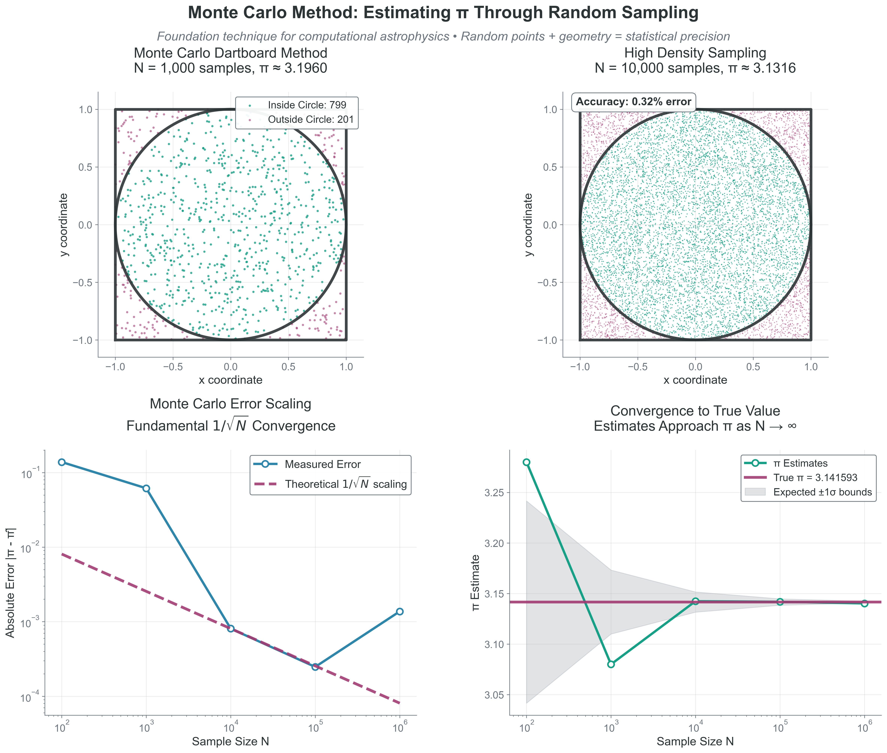
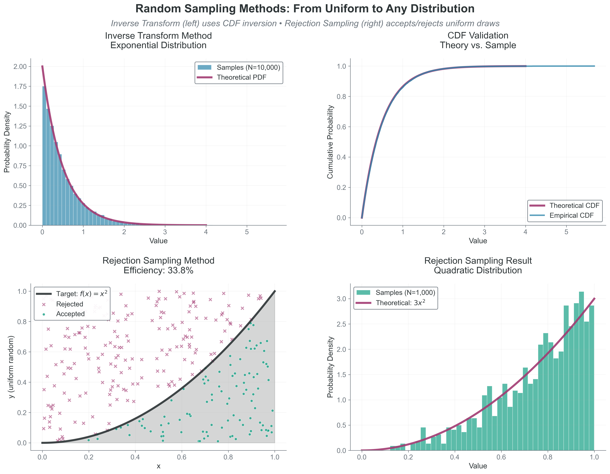
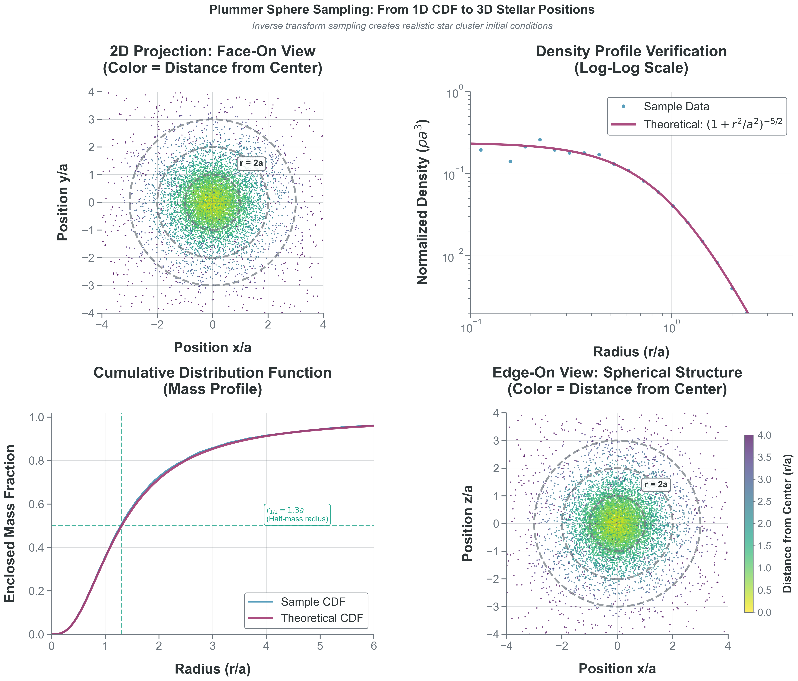

<!-- prep-banner:start -->
:::{warning} This reading is being revised for COMP 521
This chapter was adapted from COMP 536 and is still under review. You may find
references to the wrong course number, setup instructions that do not match
ours, or examples that assume material we have not covered yet.

The Python and the science are sound — it is the packaging that is catching up.
Where this page disagrees with the syllabus, the syllabus is right. If something
here does not work, tell me: that is genuinely useful and I would rather hear it
from you than not.
:::
<!-- prep-banner:end -->

## Learning Outcomes

By the end of Part 4, you will be able to:

- [ ] **Implement** the inverse transform method to sample from analytical distributions including exponentials and power laws
- [ ] **Apply** the Cumulative Distribution Function (CDF) concept to transform uniform random numbers into any desired distribution
- [ ] **Sample** from complex astrophysical distributions like the Kroupa IMF using piecewise techniques
- [ ] **Design** rejection sampling algorithms for distributions without analytical inverse transforms
- [ ] **Generate** realistic initial conditions for N-body simulations including mass, position, and velocity distributions

---

:::{tip} Core Path in 45 Minutes

**Must-read blocks**:
1. Section 4.1: Monte Carlo error scaling intuition
2. Section 4.2: inverse transform sampling workflow
3. Section 4.4: Plummer sphere sampling for Project 2

**Optional deep dives**:
- Section 4.3 rejection-efficiency tradeoffs
- IMF slope sensitivity experiments in Section 4.2
:::

## 4.1 Why Random Sampling Matters

**Priority: 🔴 Essential**

:::{note}
- **Observable:** finite random draws from a target process (darts, path lengths, masses).
- **Model:** independent samples from a probability law, generated via transforms from $U(0,1)$.
- **Inference/Implementation:** estimator variance scales as $1/N$, so standard error scales as $1/\sqrt{N}$.
:::

Sampling is how we generate distributions; moments are how we audit them.
Theory tells us distributions exist. But for simulations, we need to generate samples. The challenge: computers only produce uniform random numbers [0,1]. How do we transform these into complex astrophysical distributions?
Sampling feels like randomness; precisely, it is measure-preserving transforms from uniform draws.
**Catchphrase -> Precision**: "Random draws solve deterministic problems" means unbiased estimators converge with standard error $\propto 1/\sqrt{N}$ under the right assumptions.

This is where theory meets computation. Random sampling bridges the gap between:

- Statistical understanding (Parts 1-2)
- Computational modeling (your projects)

```{mermaid}
flowchart TD
    A[Uniform Random 0 to 1] --> B[Choose Method]
    B --> C[Inverse Transform]
    B --> D[Rejection Sampling]
    B --> E[MCMC]
    C --> F[Exponential]
    C --> G[Power Law]
    D --> H[Complex PDFs]
    E --> I[High Dimensions]
    style A fill:#f9f,stroke:#333,stroke-width:2px
```

:::{note} 🌟 The More You Know: From Solitaire to Nuclear Weapons - The Monte Carlo Origin Story
:class: dropdown

In 1946, mathematician Stanislaw Ulam was recovering from brain surgery at Los Angeles' Cedars of Lebanon Hospital. To pass the time during his convalescence, he played endless games of Canfield solitaire. Being a mathematician, he naturally wondered: what's the probability of winning?

He tried to calculate it using combinatorial analysis, but the problem was intractable – too many possible card arrangements and decision trees. Then came the insight that would revolutionize computational physics: instead of trying to solve it analytically, why not just play thousands of games and count the wins?

Back at Los Alamos, Ulam shared this idea with his colleague John von Neumann. They were working on nuclear weapon design, specifically trying to understand neutron diffusion — how neutrons travel through fissile material, sometimes causing more fissions, sometimes escaping. The equations were impossibly complex, but Ulam's solitaire insight applied perfectly: instead of solving the equations, simulate thousands of random neutron paths and count the outcomes!

They needed a code name for this classified work. Nicholas Metropolis suggested "Monte Carlo" after the famous casino in Monaco, inspired by an uncle who would borrow money from relatives to gamble there. The name was perfect – this method was essentially gambling with mathematics, rolling dice millions of times to get statistical answers.

The first Monte Carlo calculations were performed on ENIAC in 1948. It took the early computer weeks to run simulations that your laptop could do in seconds. But it worked, providing crucial insights for the hydrogen bomb design.

The irony is beautiful: a method developed for the most destructive weapon ever created now helps us understand everything from protein folding to galaxy formation. Your Project 3 radiative transfer code uses the same fundamental technique that emerged from Ulam's hospital bed solitaire games. When you launch random photon packets through your simulated atmosphere, you're using the intellectual descendant of those first neutron transport calculations.

Today, Monte Carlo methods are everywhere:

- Wall Street uses them for options pricing
- Drug companies use them for clinical trial design  
- Climate scientists use them for weather prediction
- Netflix uses them for recommendation algorithms

All because a mathematician recovering from brain surgery asked a simple question about solitaire. Sometimes the most powerful ideas come not from solving equations, but from admitting they're too hard and finding a cleverer way.
:::

::::{note} 💻 Hands-On Problem: Monte Carlo Estimation of $\pi$

**Your Challenge**: Write a function that estimates $\pi$ using Monte Carlo sampling.

**The Setup**:

- Consider a circle of radius 1 inscribed in a square with side length 2 (from -1 to 1)
- Area of square: 4
- Area of circle: $\pi$
- If you randomly throw darts at the square, the fraction landing inside the circle should be $\pi/4$

**Your Task**:

1. Write a function `estimate_pi(n_samples)` that:
   - Generates `n_samples` random points in the square [-1,1] $\times$ [-1,1]
   - Counts how many fall inside the unit circle ($x^2 + y^2 \le 1$)
   - Returns an estimate of $\pi$
   
2. Test your function with n = 100, 1000, 10000, 100000
3. Calculate the error for each sample size
4. What do you notice about how the error changes with n?

**Hint**: Use `np.random.uniform(-1, 1, n_samples)` to generate random coordinates.

:::{tip} Solution
:class: dropdown

**Code Reliability Contract**
- **Purpose**: estimate $\pi$ from area fractions using uniform samples.
- **Inputs/Outputs**: input is `n_samples`; output is $\pi$ estimate plus absolute/relative error.
- **Pitfall**: reading one run as "the answer" instead of stochastic variability.
- **Quick fix**: rerun with multiple seeds and compare confidence behavior versus $1/\sqrt{N}$.

```python
import numpy as np

def estimate_pi_monte_carlo(n_samples, rng=None):
    """
    Estimate pi using Monte Carlo sampling.
    
    Method: Generate random points in [-1,1] x [-1,1].
    Check if they fall inside unit circle (x^2 + y^2 <= 1).
    pi/4 = (points inside circle) / (total points)
    """
    if rng is None:
        rng = np.random.default_rng()

    # Generate random points in square [-1, 1] x [-1, 1]
    x = rng.uniform(-1, 1, n_samples)
    y = rng.uniform(-1, 1, n_samples)
    
    # Check if points are inside unit circle
    inside_circle = (x**2 + y**2) <= 1
    
    # Estimate pi
    # pi/4 = fraction inside circle, so pi = 4 * fraction
    pi_estimate = 4 * np.sum(inside_circle) / n_samples
    
    return pi_estimate

# Test with increasing sample sizes
rng = np.random.default_rng(536)
print(f"True value: pi = {np.pi:.10f}")
print("-" * 40)

for n in [100, 1000, 10000, 100000, 1000000]:
    pi_est = estimate_pi_monte_carlo(n, rng=rng)
    error = abs(pi_est - np.pi)
    relative_error = error / np.pi * 100
    print(f"N = {n:7d}: pi ~  {pi_est:.6f}, error = {error:.6f} ({relative_error:.2f}%)")
```

**Copy/paste quick-check**: Imports: `numpy`. Seed: the example sets `rng = np.random.default_rng(536)` for deterministic output. Variability: if you change/remove the seed, numeric lines will differ while $1/\sqrt{N}$ behavior remains.

:::

**Representative Output (seeded)**:

```bash
True value: pi = 3.1415926536
----------------------------------------
N =     100: pi ~  3.280000, error = 0.138407 (4.41%)
N =    1000: pi ~  3.164000, error = 0.022407 (0.71%)
N =   10000: pi ~  3.155600, error = 0.014007 (0.45%)
N =  100000: pi ~  3.145320, error = 0.003727 (0.12%)
N = 1000000: pi ~  3.140352, error = 0.001241 (0.04%)
```

**What You Should Observe**:

1. The estimate gets more accurate as n increases
2. Typical Monte Carlo standard error decreases as $1/\sqrt{N}$ (variance decreases as $1/N$), so 10$\times$ better accuracy needs about 100$\times$ more samples.
3. Even with 1 million samples, we only get 3-4 decimal places of accuracy
4. The method is simple but computationally expensive for high precision

**Extension**: Try plotting the error vs $N$ on a log-log plot. You should see a slope of -0.5, confirming the $N^{-1/2}$ ($1/\sqrt{N}$) scaling.
::::

:::{important} 🔑 What We Just Learned
Typical Monte Carlo standard error decreases as $1/\sqrt{N}$ (variance decreases as $1/N$):

- Want $10 \times$ better accuracy? Need $100 \times$ more samples!
- This scaling is universal - same for integrating stellar opacities or galaxy luminosity functions
- The method works in any dimension (crucial for high-dimensional integrals)
- Random sampling turns geometry problems into counting problems
:::

{#fig-monte-carlo-pi-estimation width="100%"}

**What to notice:**
- The estimate fluctuates stochastically around the true value.
- Error decreases like $1/\sqrt{N}$, not linearly with $N$.
- Accuracy gains require rapidly increasing sample counts.

:::{note} Assumptions and Failure Modes (Sampling)

- **Assumptions**: independent RNG draws, correct target density normalization, and valid geometry/domain transforms.
- **Failure mode**: wrong target density or Jacobian gives systematic bias no matter how large $N$ gets.
- **Failure mode**: correlated draws reduce effective sample size and slow convergence.
- **Practice**: validate by checking moments, histograms, and known limiting cases.
:::

**Project Hook**: This appears in **Project 2** when you transform uniform RNG draws into physically consistent mass, radius, and velocity samples.


## 4.2 The Cumulative Distribution Function (CDF) and Inverse Transform Sampling

:::{margin}
**Cumulative Distribution Function (CDF)**
For a random variable $X$ with pdf $p(x)$, the CDF is $F(x)=P(X \le x)$, giving the probability that $X$ takes a value less than or equal to $x$. Always monotonically increasing from 0 to 1.
:::

**Priority: 🔴 Essential**

:::{note}
- **Observable:** samples from positive-valued laws (path lengths, stellar masses) and their empirical CDF.
- **Model:** target pdf $p(x)$ with monotonic CDF $F(x)$ inverted as $x=F^{-1}(u)$.
- **Inference/Implementation:** transform uniform draws into physically meaningful samples and validate against theory.
:::

The key to sampling from any distribution lies in understanding the **cumulative distribution function** (CDF) and how it enables the inverse transform method — the most fundamental technique for converting uniform random numbers into samples from any distribution.

### Understanding the CDF

The CDF is defined as:

$\boxed{F(x) = P(X \leq x) = \int_{-\infty}^{x} p(x')\,dx'}$

While the probability density function (pdf) $p(x)$ tells us the relative likelihood at each point, the CDF $F(x)$ tells us the accumulated probability up to that point. This accumulation is what makes sampling possible.

To understand why this is so powerful, consider what the CDF actually represents. If you have a pdf $p(x)$ that describes the distribution of stellar masses, then $F(m)$ answers the question: "What fraction of stars have mass less than or equal to $m$?"

For example, in a stellar population:

- $F(0.5 M_\odot)$ = 0.3 means 30% of stars have mass $\le 0.5 M_\odot$
- $F(1.0 M_\odot)$ = 0.6 means 60% of stars have mass $\le 1.0 M_\odot$  
- $F(\infty) = 1.0$ means 100% of stars have some finite mass

**Key properties of CDFs**:

- **Always non-decreasing**: $F(x_1) \le F(x_2)$ if $x_1 < x_2$
- **Bounded**: $F(-\infty) = 0$ and $F(\infty) = 1$
- **Continuous from the right**: Important for discrete distributions
- **Derivative gives pdf**: $dF/dx = p(x)$ for continuous distributions

### The Inverse Transform Method

The crucial insight is that the CDF transforms any distribution — no matter how complex — into a uniform distribution on [0,1]. This provides the bridge between uniform random numbers (which computers generate) and any distribution we want.

:::{important} 🎯 The Inverse Transform Algorithm

To sample from a distribution with CDF F(x):

1. Generate $u \sim \text{Uniform}(0,1)$
2. Solve $F(x) = u \text{ for } x$
3. The solution $x = F^{-1}(u)$ follows your desired distribution

**Why it works**: If $U$ is uniformly distributed on $[0,1]$, then $F^{-1}(U)$ has the distribution $p(x).$ The CDF essentially "encodes" your distribution in a way that uniform random numbers can decode.
:::

Assumption break cue: This method can fail in practice when the CDF is not reliably invertible, numerical inversion is unstable, or endpoint handling is ignored.

**Visual intuition**: Imagine the CDF as a transformation that "stretches" the uniform distribution. Regions where the PDF is large (high probability density) correspond to steep sections of the CDF. When we invert, these steep sections get "compressed" back, allocating more samples to high-probability regions.

:::{note} Sampling Diagnostic Trio

1. **Histogram vs theory:** compare binned samples to the analytical pdf.
2. **Empirical CDF vs theory (or QQ):** test global shape agreement, not just peaks.
3. **Moments and tail fraction:** check mean/variance and a tail metric relevant to the science case.
:::

#### Example: Exponential Distribution

Before tackling power laws, let's see how this works for the exponential distribution (which describes photon path lengths, radioactive decay, and time between stellar collisions):

**pdf**: $p(x) = \lambda e^{-\lambda x}$ for x $\ge$ 0

**CDF**: $F(x) = \int_0^x \lambda e^{-\lambda x'}\,dx' = 1 - e^{-\lambda x}$

**Inverse**: Solve $u = 1 - e^{-\lambda x}$ for x:

- $e^{-\lambda x} = 1 - u$
- $x = -\frac{1}{\lambda}\ln(1-u)$

Equivalent form: $x = -\frac{1}{\lambda}\ln(u)$, since $u$ and $(1-u)$ are both uniform on [0,1].

```python
import numpy as np

# Sample exponential distribution (e.g., photon mean free paths)
def sample_exponential(lambda_param, n_samples, rng=None):
    if rng is None:
        rng = np.random.default_rng()
    u = rng.uniform(0, 1, n_samples)
    u = np.clip(u, 1e-15, 1 - 1e-15)
    return -np.log(1 - u) / lambda_param

# Example: mean free path of 1 pc
mfp = 1.0  # pc
rng = np.random.default_rng(536)
lambda_param = 1.0 / mfp
path_lengths = sample_exponential(lambda_param, 10000, rng=rng)
print(f"Mean path: {np.mean(path_lengths):.2f} pc")
print(f"Theory: {mfp:.2f} pc")
```

**Copy/paste quick-check**: Imports: `numpy`. Seed: set `rng = np.random.default_rng(536)` for repeatable means. Variability: sample mean fluctuates around the theoretical mean at finite draw counts.

### Power Law Distributions: The Foundation of Astrophysics

Power law distributions appear everywhere in astronomy:

- Stellar initial mass function (IMF)
- Galaxy luminosity functions
- Cosmic ray energy spectrum
- Size distribution of asteroids and dust grains

:::{note} 📚 Example: Sampling from a Power Law Distribution

Consider a power law PDF: $p(x) \propto x^{-\alpha}$ for $x \in [x_{\min}, x_{\max}]$

This is the foundation for understanding the Kroupa IMF, which is a broken power law with three different $\alpha$ values in different mass ranges.
:::

**Deriving the sampling formula**:

1. **Normalize the PDF**: 
   $p(x) = \frac{(\alpha-1) x^{-\alpha}}{x_{\min}^{1-\alpha} - x_{\max}^{1-\alpha}}$ 
   (for $\alpha \neq 1$)

2. **Compute the CDF**:
   $F(x) = \int_{x_{\min}}^x f(x')dx' = \frac{x^{1-\alpha} - x_{\min}^{1-\alpha}}{x_{\max}^{1-\alpha} - x_{\min}^{1-\alpha}}$

3. **Invert to get sampling formula**:
   Set F(x) = u and solve for x:
   $\boxed{x = \left[x_{\min}^{1-\alpha} + u(x_{\max}^{1-\alpha} - x_{\min}^{1-\alpha})\right]^{1/(1-\alpha)}}$

**Special case $\alpha = 1$**: The integral of $1/x$ is $\ln(x)$, so:
$\boxed{x = x_{\min} \left(\frac{x_{\max}}{x_{\min}}\right)^u}$

![**Sample Size Determines Accuracy in Power Law Distributions.** The Salpeter Initial Mass Function ($\alpha=2.35$) demonstrates how statistical convergence works in practice. Left panel ($N=100$): small samples show noisy histograms with poor fits to the theoretical power law. Center panel ($N=1{,}000$): medium samples begin to reveal the underlying distribution structure with better agreement. Right panel ($N=10{,}000$): large samples produce smooth histograms that closely match theory. Statistics boxes show quantitative metrics: mean mass, median mass, and fraction below $1\,M_\odot$. This convergence behavior is universal across Monte Carlo methods, following the expected $1/\sqrt{N}$ error scaling from Section 4.1.](figures/13_power_law_distribution_sampling.png){#fig-power-law-sampling width="100%"}


### Implementation and Visualization

The figure above shows our power law sampling in action. Keep the production path small: sample, then run the Sampling Diagnostic Trio.

```python
import numpy as np

def sample_simple_power_law(alpha, x_min, x_max, n_samples, rng=None):
    if rng is None:
        rng = np.random.default_rng()
    u = rng.uniform(0, 1, n_samples)
    return (x_min**(1-alpha) + u*(x_max**(1-alpha) - x_min**(1-alpha)))**(1/(1-alpha))

samples = sample_simple_power_law(2.35, 0.1, 100, 10_000, rng=np.random.default_rng(536))
print(np.mean(samples), np.var(samples), np.mean(samples > 10.0))
```

Use the Sampling Diagnostic Trio here: histogram-vs-theory for pdf shape, empirical CDF (or QQ) for distributional agreement, and moments plus a high-mass tail fraction for inference.

:::{tip} Full plotting example (optional deep dive)
:class: dropdown

```python
import numpy as np
import matplotlib.pyplot as plt

def sample_simple_power_law(alpha, x_min, x_max, n_samples, rng=None):
    """
    Sample from a power law distribution p(x) ~ x^(-alpha).
    
    This demonstrates the inverse transform method for power laws.
    Special case: alpha = 1 requires logarithmic sampling.
    
    Parameters:
    -----------
    alpha : float
        Power law exponent (positive for decreasing function)
    x_min, x_max : float
        Range of the distribution
    n_samples : int
        Number of samples to generate
        
    Returns:
    --------
    samples : ndarray
        Random samples from the power law
    """
    if rng is None:
        rng = np.random.default_rng()

    u = rng.uniform(0, 1, n_samples)
    
    if abs(alpha - 1.0) < 1e-10:
        # Special case: p(x) ~ x^(-1)
        # CDF integral gives logarithmic form
        samples = x_min * (x_max/x_min)**u
    else:
        # General case: p(x) ~ x^(-alpha)
        # Apply the inverse transform formula we derived
        samples = (x_min**(1-alpha) + u*(x_max**(1-alpha) - x_min**(1-alpha)))**(1/(1-alpha))
    
    return samples

# Example: Sample stellar masses with different power laws
fig, axes = plt.subplots(1, 3, figsize=(15, 4))

# Different IMF slopes (Salpeter has alpha = 2.35)
alphas = [1.3, 2.3, 3.5]
x_min, x_max = 0.1, 100  # Solar masses
rng = np.random.default_rng(536)

for ax, alpha in zip(axes, alphas):
    # Generate samples
    samples = sample_simple_power_law(alpha, x_min, x_max, 10000, rng=rng)
    
    # Plot histogram
    bins = np.logspace(np.log10(x_min), np.log10(x_max), 50)
    ax.hist(samples, bins=bins, alpha=0.7, density=True, label='Samples')
    
    # Overlay theoretical distribution
    x_theory = np.logspace(np.log10(x_min), np.log10(x_max), 100)
    # Normalized power law
    if alpha != 1:
        norm = (1-alpha)/(x_max**(1-alpha) - x_min**(1-alpha))
        p_theory = abs(norm) * x_theory**(-alpha)  # abs() for alpha < 1
    else:
        norm = 1/np.log(x_max/x_min)
        p_theory = norm / x_theory
    
    ax.plot(x_theory, p_theory, 'r-', linewidth=2, label='Theory')
    
    ax.set_xscale('log')
    ax.set_yscale('log')
    ax.set_xlabel("Mass [M_sun]")
    ax.set_ylabel('Probability Density')
    ax.set_title(rf'$\alpha = ${alpha}')
    ax.legend()
    ax.grid(True, alpha=0.3)
    
    # Add statistics
    mean_mass = np.mean(samples)
    median_mass = np.median(samples)
    text_str = f"Mean: {mean_mass:.1f} M_sun\nMedian: {median_mass:.1f} M_sun"
    ax.text(0.05, 0.95, text_str, transform=ax.transAxes, 
            verticalalignment='top', bbox=dict(boxstyle='round', facecolor='wheat', alpha=0.5))

plt.suptitle('Power Law Sampling with Different Slopes', fontsize=14)
plt.tight_layout()
plt.show()

# Show how the distribution changes with alpha
print("Effect of power law slope alpha on stellar mass distribution:")
print(f"{'alpha':<8} {'Mean [M_sun]':<14} {'Median [M_sun]':<16} {'% below 1 M_sun':<18}")
print("-" * 50)

for alpha in alphas:
    samples = sample_simple_power_law(alpha, x_min, x_max, 10000, rng=rng)
    mean_mass = np.mean(samples)
    median_mass = np.median(samples)
    frac_below_1 = np.sum(samples < 1.0) / len(samples) * 100
    print(f"{alpha:<8.1f} {mean_mass:<14.2f} {median_mass:<16.2f} {frac_below_1:<18.1f}")
```
:::

**Copy/paste quick-check**: Imports: `numpy`, `matplotlib`. Seed: set `rng = np.random.default_rng(536)` for reproducible sampling tables/plots. Variability: slope-dependent trends persist, while exact summary values vary with seed and sample count.

:::{important} 🎯 Conceptual Understanding

Notice how the power law slope $\alpha$ dramatically affects the distribution:

- **$\alpha < 2$**: Mean dominated by massive objects ("top-heavy")
  - Most of the total mass is in high-mass stars
  - Rare but massive objects dominate

- **$\alpha = 2$**: Special transition point
  - Every logarithmic mass decade contributes equally to total mass
  - log-uniform mass distribution

- **$\alpha > 2$**: Mean dominated by low-mass objects ("bottom-heavy")
  - Most of the total mass is in low-mass stars
  - Numerous small objects dominate

**Project 2: Kroupa Initial Mass Function (IMF)**
The real Kroupa IMF uses $\alpha = 2.3$ for high masses ($M > 0.5 M_\odot$), giving the steep high-mass decline associated with rare massive stars. The intermediate branch is shallower $(\alpha = 1.3)$ for $(0.08 M_\odot < M \le 0.5 M_\odot)$, and the brown-dwarf branch is flatter $(\alpha = 0.3)$ for $(0.01 M_\odot < M \le 0.08 M_\odot)$, creating a broken power law across mass scales.

$$
\xi(m) \propto
\begin{cases}
m^{-0.3} & 0.01 < m/M_\odot < 0.08 \\
m^{-1.3} & 0.08 < m/M_\odot < 0.5 \\
m^{-2.3} & 0.5 < m/M_\odot < 150
\end{cases}
$$

For power law $f(m) \propto m^{-\alpha}$ on $[m_{\min}, m_{\max}]$:

**Sampling formula** (for $\alpha \neq 1$):
$\boxed{m = \left[m_{\min}^{1-\alpha} + u(m_{\max}^{1-\alpha} - m_{\min}^{1-\alpha})\right]^{1/(1-\alpha)}}$

For $\alpha = 1$ (logarithmic):
$\boxed{m = m_{\min} \left(\frac{m_{\max}}{m_{\min}}\right)^u}$

For Project 2, you'll implement this broken power law with three segments, ensuring continuity at the break points. The principle is the same — apply the inverse transform formula piecewise — but you'll need to:

1. Calculate normalization constants for continuity
2. Choose which segment to sample from based on their relative probabilities
3. Apply the appropriate inverse transform for that segment

Assumption break cue: This piecewise approach can fail when segment probabilities are misnormalized or continuity at break points is not enforced.

:::

### Why the Inverse Transform is Powerful

The inverse transform method is the foundation of Monte Carlo sampling because:

1. **It's exact**: Every uniform random number produces exactly one sample from your distribution
2. **It's efficient**: 100% of random numbers are used (no rejections)
3. **It's deterministic**: The same uniform input always gives the same output (useful for debugging)
4. **It works in any dimension**: Can be extended to multivariate distributions

However, it requires that you can:

- Compute the CDF analytically (or numerically)
- Invert the CDF (analytically or numerically)

When these conditions aren't met, you'll need other methods like rejection sampling (Section 4.3) or Markov Chain Monte Carlo (Project 4).

:::{important} 🔑 Key Takeaways

- The CDF F(x) transforms any distribution to uniform [0,1]
- Inverse transform: $x = F^{-1}(u)$ where $u \sim \text{Uniform}(0,1)$
- Power laws have analytical inverse: $x = [x_{\min}^{1-\alpha} + u(x_{\max}^{1-\alpha} - x_{\min}^{1-\alpha})]^{1/(1-\alpha)}$
- The slope $\alpha$ determines whether the distribution is top-heavy or bottom-heavy
- This method is exact and efficient when you can compute $F^{-1}$
- For Monte Carlo estimators, variance shrinks as $1/N$ while standard error shrinks as $1/\sqrt{N}$
:::

**Example**: Exponential distribution (photon path lengths!)

- pdf: $p(x) = \lambda e^{-\lambda x}$
- CDF: $F(x) = 1 - e^{-\lambda x}$
- Inverse: $x = -\frac{1}{\lambda}\ln(1-u)$
- Equivalent form: $x = -\frac{1}{\lambda}\ln(u)$ because $u$ and $(1-u)$ are both Uniform$(0,1)$

**Simple implementation:**

```python
import numpy as np

# Sample exponential distribution (e.g., photon path lengths)
def sample_exponential(lambda_param, n_samples, rng=None):
    if rng is None:
        rng = np.random.default_rng()
    u = rng.uniform(0, 1, n_samples)
    u = np.clip(u, 1e-15, 1 - 1e-15)
    # Inverse CDF transform
    return -np.log(1 - u) / lambda_param

# Example: mean free path of 1 pc
mfp = 1.0  # pc
rng = np.random.default_rng(536)
lambda_param = 1.0 / mfp
path_lengths = sample_exponential(lambda_param, 10000, rng=rng)
print(f"Mean path: {np.mean(path_lengths):.2f} pc")
print(f"Theory: {mfp:.2f} pc")
```

**Copy/paste quick-check**: Imports: `numpy`. Seed: set `rng = np.random.default_rng(536)` to reproduce output means. Variability: finite-sample mean fluctuates around the target mean free path.

## 4.3 Rejection Sampling

**Priority: 🟡 Standard Path**

:::{note}
- **Observable:** accepted vs rejected candidate draws and realized acceptance efficiency.
- **Model:** target shape $p(x)$ with a valid envelope bound $f_{\max}$ on $[x_{\min}, x_{\max}]$.
- **Inference/Implementation:** unbiased samples are recovered when $f_{\max}$ is a true upper bound and RNG draws are independent.
:::

When inverse transform fails, use rejection sampling:

:::{important} 🎯 Rejection Algorithm

To sample from pdf $p(x)$:

1. Find envelope $M \geq \max(p(x))$
2. Generate $x \sim U(a,b)$, $y \sim U(0,M)$
3. Accept if $y \leq p(x)$
4. Otherwise reject, repeat

Efficiency = (area under curve)/(box area)

`f_max` must be a true upper bound on $p(x)$ to avoid bias, and looser envelopes reduce efficiency by increasing rejections.
:::

Example: Throw darts at rectangle, keep those under curve.

:::{note} Method-Selection Decision Tree

1. **Invertible CDF available?** Use inverse transform.
2. **Only unnormalized shape known with safe envelope?** Use rejection sampling.
3. **High-dimensional posterior with expensive normalization?** Defer to MCMC (Project 4).

**Wrong method example**: using rejection sampling for a simple exponential with known inverse CDF.
**Fix**: switch to inverse transform for exact, faster draws.
:::

```python
import numpy as np

# Example: Sample from arbitrary distribution
def rejection_sample(p_func, x_min, x_max, f_max, n_samples, max_tries=10_000_000, rng=None):
    """Sample using rejection method"""
    if rng is None:
        rng = np.random.default_rng()
    samples = []
    n_tries = 0

    while len(samples) < n_samples:
        if n_tries >= max_tries:
            raise RuntimeError("Exceeded max_tries; check f_max envelope or target PDF.")
        x = rng.uniform(x_min, x_max)
        y = rng.uniform(0, f_max)
        n_tries += 1

        if y <= p_func(x):
            samples.append(x)

    efficiency = n_samples / n_tries
    print(f"Efficiency: {efficiency:.1%}")
    return np.array(samples)
```

**Copy/paste quick-check**: Imports: `numpy`. Seed recommendation: pass `rng=np.random.default_rng(536)` for repeatable envelope comparisons. Variability: efficiency varies stochastically even with fixed target PDF.

{#fig-random-sampling-methods width="100%"}

**What to notice:**
- Inverse transform is exact and efficient when an invertible CDF exists.
- Rejection sampling is flexible but wastes draws depending on envelope tightness.
- The same uniform RNG can support very different target distributions.


## 4.4 Spatial Distributions: The Plummer Sphere

**Priority: 🔴 Essential for Project 2**

:::{note}
- **Observable:** sampled stellar radii and 3D positions from a cluster realization.
- **Model:** Plummer density $\rho(r)$ with radial CDF $F(r)=M(<r)/M_{\mathrm{total}}$ and isotropic angles.
- **Inference/Implementation:** validate both $\rho(r)$ and $M(<r)$ plus $r_{1/2}\approx1.3a$ using diagnostic checks.
:::

Now that you can sample stellar masses from the Kroupa IMF, you need to place these stars in space. The Plummer sphere is a standard density profile for globular clusters and stellar systems.

### The Plummer Profile

The Plummer sphere has density profile:
$$\rho(r) = \frac{3M_{total}}{4\pi a^3} \left(1 + \frac{r^2}{a^2}\right)^{-5/2}$$

where:

- $M_{total}$ is the total cluster mass
- $a$ is the Plummer radius (scale length)
- $r$ is the distance from center

This creates a smooth, centrally concentrated distribution that avoids the infinite density at r=0 that plagues some other profiles.

### The Sampling Challenge

You can't sample directly from $\rho(r)$ because density isn't probability! The key insight: the probability of finding a star between radius $r$ and $r+dr$ is proportional to the **mass** in that shell, not the density.

$$dP \propto \rho(r) \times \text{(volume of shell)} \propto \rho(r) \times 4\pi r^2 dr$$

So the radial PDF is:
$$p(r) \propto r^2 \rho(r) = r^2 \left(1 + \frac{r^2}{a^2}\right)^{-5/2}$$

#### Approach 1: Mass Profile Method

The enclosed mass within radius $r$ is:
$$M(<r) = M_{total} \frac{r^3}{(r^2 + a^2)^{3/2}}$$

The cumulative mass fraction (which IS a CDF!) is:
$$F(r) = \frac{M(<r)}{M_{total}} = \frac{r^3}{(r^2 + a^2)^{3/2}}$$

To sample:

1. Generate $u \sim U(0,1)$ (this represents a mass fraction)
2. Solve $u = \frac{r^3}{(r^2 + a^2)^{3/2}}$ for $r$
3. Place the star at radius $r$ with random angular coordinates

Assumption break cue: Radial sampling is biased if isotropy is violated in angle draws or if finite-radius truncation is introduced without updating the CDF.

:::{tip} 🎯 Hint: Solving for r

Let $s = r^2/a^2$. Then the equation becomes:
$$u = \frac{s^{3/2}}{(1 + s)^{3/2}} = \left(\frac{s}{1+s}\right)^{3/2}$$

Can you solve for $s$, then get $r$?

Let $q = u^{2/3}$. Then $q = s/(1+s)$, so $s = q/(1-q)$ and
$$\boxed{r = a\sqrt{\frac{q}{1-q}} = a\sqrt{\frac{u^{2/3}}{1-u^{2/3}}}}$$
This inversion is exactly consistent with $F(r)=\frac{r^3}{(r^2+a^2)^{3/2}}$ above.
:::

#### Approach 2: Rejection Sampling in 3D

Alternatively, you could:

1. Generate random positions in a cube containing your cluster
2. Accept/reject based on the density at that position
3. But this becomes inefficient for large clusters!

#### From Radius to 3D Positions

Once you have radius $r$:

1. Generate random direction on sphere:
   - $\mu = \cos\theta \sim U(-1,1)$
   - $\phi \sim U(0, 2\pi)$ (azimuthal angle)
   - $\theta = \arccos(\mu)$
2. Convert to Cartesian:
   - $x = r \sin\theta \cos\phi$
   - $y = r \sin\theta \sin\phi$  
   - $z = r \cos\theta$

Or use the simpler method: generate a random unit vector and scale by $r$.

#### Verification

Your sampled positions should reproduce:

1. The density profile $\rho(r)$ when binned radially
2. The enclosed mass profile $M(<r)$
3. The half-mass radius $r_{half} \approx 1.3a$ for Plummer
4. The Sampling Diagnostic Trio: histogram-vs-theory for $\rho(r)$, empirical CDF-vs-theory for $M(<r)/M_{\mathrm{total}}$, and summary moments/tail fraction for radial structure

{#fig-plummer-sphere-sampling width="100%"}

**What to notice:**
- Radial sampling matches both $\rho(r)$ and $M(<r)$ diagnostics.
- The half-mass radius is recovered near the theoretical value.
- Isotropic angle sampling is required to avoid directional bias.


:::{note} 🌟 Why Plummer for Globular Clusters?
:class: dropdown

The Plummer sphere, developed by H.C. Plummer in 1911 for fitting star clusters, has several advantages:

1. **Finite central density**: Unlike the singular isothermal sphere (SIS) model.
2. **Finite total mass**: Unlike the Navarro–Frenk–White (NFW) profile that extends to infinity, used to describe a spatial mass distribution of dark matter fitted to dark matter halos.
3. **Analytical everything**: Density, potential, distribution function all have closed forms.
4. **Stable**: Can be realized as equilibrium of self-gravitating system.

Real globular clusters are more complex (mass segregation, tidal truncation, rotation), but the Plummer profile is an excellent starting point that captures the essential physics: central concentration with smooth decline.
:::

:::{important} 🔑 Key Implementation Tips

- Don't sample from density directly - sample from mass!
- The radial CDF is the **enclosed** mass fraction
- Check your profile by plotting both $\rho(r)$ and $M(<r)$ (1D profiles).
- For Project 2, combine this with Kroupa IMF masses and virial velocities.
:::

### Part 4 Synthesis: Theory to Computation

:::{important} 🎯 What We Just Learned

**Random sampling bridges theory and simulation**:

1. **CDFs** map any distribution to [0,1]
2. **Inverse transform** samples from analytical distributions
3. **Power laws** (IMF) use piecewise sampling with special $\alpha=1$ case
4. **Density profiles** sample from mass not density
5. **Rejection sampling** handles complex cases

You now have everything for Project 2:

- Realistic masses (Kroupa IMF)
- Spatial structure (Plummer)
- Velocities (virial equilibrium)

This creates self-consistent initial conditions ready for N-body integration!
:::

:::{important} Predict - Play - Explain (Part 4)

- **Predict**: Which error shrinks faster with added compute time: Monte Carlo sampling error or systematic model bias?
- **Play**: Re-run one sampling routine with $10^2$, $10^4$, and $10^6$ draws; compare diagnostics.
- **Explain**: Distinguish failures caused by wrong sampling geometry versus insufficient sample size.
:::

:::{tip} Micro-Challenge (30-90 seconds)

You need samples from $p(x)\propto x$ on $[0,1]$. Choose a method and write a one-line formula or pseudocode for the draw.

**Feedback cue**: A strong answer identifies inverse transform with $F(x)=x^2$ and $x=\sqrt{u}$.
:::

:::{tip} Quick Retrieval Check (Part 4)

Your sampled radii match the expected enclosed-mass profile, but your 3D point cloud is strongly concentrated near the poles.

Most likely cause:

1. Too few samples in the radial CDF inversion.
2. Incorrect angular sampling (for example, drawing $\theta \sim U(0,\pi)$ directly instead of using $\mu=\cos\theta \sim U(-1,1)$).
3. A small normalization error in the IMF slope.

**Answer**: 2. Isotropic directions require uniform sampling in $\mu=\cos\theta$, not in $\theta$.
:::

---

:::{important} Mastery Artifact: Sampling Method Memo (2-5 minutes)

Build a one-page "sampling method memo" for your next simulation:
- target distribution(s),
- chosen method and why,
- one diagnostic per method (histogram/CDF/moment/profile),
- and one failure mode you will guard against.
:::

:::{tip} Minimum Mastery Checklist

- I can choose inverse transform versus rejection sampling for a concrete target distribution.
- I can explain why Monte Carlo accuracy improves like $1/\sqrt{N}$, not $1/N$.
- I can verify isotropic 3D direction sampling without introducing angular bias.
:::
