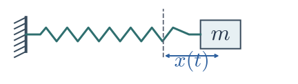

## Ordinary differential equations

```{slide-options}
{"layout": "title", "class": "ode-deck ode-title", "eyebrow": "COMP 521 · Lecture 11", "transition": "slide"}
```

:::{slide-element}
:class: ode-title-subtitle

Models, solutions, and numerical methods
:::

:::{slide-element}
:class: ode-byline

Anna Rosen · San Diego State University
:::

(slide-001)=
## What does an ODE tell us?

```{slide-options}
{"class": "ode-deck ode-opening", "eyebrow": "What an ODE describes"}
```

An **ODE** relates an unknown function to its derivatives with respect to **one independent variable**.

:::{slide-element}
:class: ode-hero-equation

$$
\frac{dy}{dx}=f(x,y)
$$
:::

::::::::{slide-columns}
:ratio: 1 1 1
:gap: 28
:align: stretch

:::::::{slide-column}

:::::{fragment}
:effect: fade-in
:index: 0

::::{slide-element}
:class: ode-card

**Independent variable**

$$
x
$$

Time, depth, radius, …
::::
:::::


:::::::

:::::::{slide-column}

:::::{fragment}
:effect: fade-in
:index: 1

::::{slide-element}
:class: ode-card

**Unknown state function**

$$
y(x)
$$

State at coordinate $x$
::::
:::::


:::::::

:::::::{slide-column}

:::::{fragment}
:effect: fade-in
:index: 2

::::{slide-element}
:class: ode-card

**Derivative**

$$
\frac{dy}{dx}
$$

Change per unit coordinate
::::
:::::


:::::::


::::::::

:::::{fragment}
:effect: fade-in
:index: 3

::::{slide-element}
:class: ode-prompt

**Think:** Does a slope rule determine a unique function? What else is needed?
::::
:::::

(slide-002)=
## What information belongs in the state?

```{slide-options}
{"class": "ode-deck ode-opening ode-state", "eyebrow": "What an ODE describes"}
```

The **state** is the set of quantities we track to describe a system.

It can be a **scalar** $y$ or a **vector** $\mathbf y$ of coupled variables.

$$
\frac{d\mathbf y}{dx}=\mathbf f(x,\mathbf y)
$$

::::{fragment}
:effect: fade-in
:index: 0

:::{slide-element}
:class: ode-examples-label

**Examples:**
:::
::::

::::::::{slide-columns}
:ratio: 1 1 1
:gap: 28
:align: stretch

:::::::{slide-column}

:::::{fragment}
:effect: fade-in
:index: 0

::::{slide-element}
:class: ode-card

**Population · scalar**

$$
y(t)=N(t)
$$

How many individuals?
::::
:::::


:::::::

:::::::{slide-column}

:::::{fragment}
:effect: fade-in
:index: 0

::::{slide-element}
:class: ode-card

**Spring · vector**



$$
\mathbf y(t)=\begin{pmatrix}x(t)\\v(t)\end{pmatrix}
$$

Position and velocity
::::
:::::


:::::::

:::::::{slide-column}

:::::{fragment}
:effect: fade-in
:index: 0

::::{slide-element}
:class: ode-card

**Star or planet · vector**

$$
\mathbf y(r)=\begin{pmatrix}m(r)\\P(r)\end{pmatrix}
$$

Enclosed mass and pressure
::::
:::::


:::::::


::::::::

:::::{fragment}
:effect: fade-in
:index: 1

::::{slide-element}
:class: ode-prompt

**Predict:** Two spring masses have the same position but opposite velocities. How will their positions change next?
::::
:::::

(modeling)=
## Modeling: turn assumptions into equations

```{slide-options}
{"class":"ode-deck ode-modeling ode-modeling-overview", "eyebrow":"From a system to a mathematical model"}
```

- **Choose the quantities.** What do we want to describe?
- **State the assumptions.** What detail can we neglect?
- **Write relationships.** What laws or rules connect the quantities?
- **Set parameters and conditions.** What specifies the problem?

(modeling-example)=
## An ODE model: radioactive decay

```{slide-options}
{"class":"ode-deck ode-modeling ode-modeling-example", "eyebrow":"From assumptions to a rate law"}
```

:::::{fragment}
:effect: fade-in
:index: 0

::::{slide-element}
:class: ode-card

**Example: one radioactive isotope**

- **State:** $N(t)$, expected undecayed nuclei.
- **Assumptions:** independent decays; no replenishment.

$$
\text{Rate law:}\qquad \frac{dN}{dt}=-\lambda N
$$

**Parameter:** constant $\lambda>0$, units $\mathrm{s^{-1}}$.

**Initial condition:** $N(0)=N_0$.

**Initial value problem (IVP):** an ODE and its starting state.
::::
:::::

:::::{fragment}
:effect: fade-in
:index: 1

::::{slide-element}
:class: ode-prompt

**ODE models** describe change with one independent variable, such as time or radius.

**Applications:** reactions and growth in time; pressure balance along radius.
::::
:::::

(slide-003)=
## “Ordinary” and “first order” mean different things

```{slide-options}
{"class": "ode-deck ode-opening", "eyebrow": "What an ODE describes"}
```

- **Ordinary:** derivatives with respect to one independent variable.
- **Order:** the highest derivative present.

::::::::{slide-columns}
:ratio: 1 1
:gap: 28
:align: stretch

:::::::{slide-column}

:::::{fragment}
:effect: fade-in
:index: 0

::::{slide-element}
:class: ode-card

**First order**

$$
\frac{dN}{dt}=rN
$$

Population growth
::::
:::::


:::::::

:::::::{slide-column}

:::::{fragment}
:effect: fade-in
:index: 0

::::{slide-element}
:class: ode-card

**Second order**

$$
m\frac{d^2x}{dt^2}=-kx
$$

An undamped spring: mass $m$, stiffness $k$ (force per displacement).
::::
:::::


:::::::


::::::::

:::::{fragment}
:effect: fade-in
:index: 1

::::{slide-element}
:class: ode-takeaway

Both are ODEs. Neither “ordinary” nor “order” requires time as the coordinate.
::::
:::::

(slide-004)=
## Partial differential equations (PDEs)

```{slide-options}
{"class": "ode-deck ode-visual ode-pde", "eyebrow": "Define an ODE and its state"}
```

:::::::{slide-columns}
:ratio: 1 1.2
:gap: 36
:align: center

::::::{slide-column}

**Heat equation**

$$
\frac{\partial T}{\partial t}=\alpha\frac{\partial^2T}{\partial x^2}
$$

- $T(x,t)$: temperature varies with **position and time**.
- $\alpha$: **thermal diffusivity**, in $\mathrm{cm^2\,s^{-1}}$.

:::::{fragment}
:effect: fade-in
:index: 1

**One-temperature ODE:** $T(t)$ keeps one value for the whole object.
:::::

::::::

::::::{slide-column}

:::::{fragment}
:effect: fade-in
:index: 0

::::{slide-figure} ode-figures.ipynb#heat-profiles
:alt: Temperature-excess profiles at scaled times 0, 0.5, and 1 on an infinite rod. The peak becomes lower and the hot region becomes wider as heat diffuses.
:caption: Heat diffusion lowers and broadens the peak. Scaled variables.
::::
:::::

::::::
:::::::

::::{fragment}
:effect: fade-in
:index: 2

:::{slide-element}
:class: ode-prompt

**PDEs are central to computational modeling:** fluid dynamics, electrostatics, and general relativity.
:::
::::

(slide-005)=
## Model a growing bacterial culture

```{slide-options}
{"class":"ode-deck ode-visual ode-growth-model","eyebrow":"From a rate law to an exact solution"}
```

::::::::::::{tab-set}

:::::::::::{tab-item} Model and plot

:::::::{slide-columns}
:ratio: 1 1.15
:gap: 36
:align: center

::::::{slide-column}

- **State:** $N(t)$, population size.

**Rate law:**

$$
\frac{dN}{dt}=rN
$$

- **Parameter:** constant net per-cell rate $r>0$ ($\mathrm{s^{-1}}$).
- **Initial condition:** $N(0)=N_0>0$.


:::{fragment}
:effect: fade-in
:index: 1

- **Assumptions:** no resource limit or migration.
:::

::::::

::::::{slide-column}

::::{fragment}
:effect: fade-in
:index: 0

:::{slide-figure} ode-figures.ipynb#growth
:alt: Exact normalized population growth for a constant per-capita rate; rt is dimensionless.
:caption: Early culture growth with a constant net rate per cell.
:::
::::

::::::
:::::::

:::::::::::

:::::::::::{tab-item} Run Python

```{slide-python}
:packages: numpy,matplotlib
:alt: Computed exponential population growth with dimensionless rt and normalized population axes.
:fallback: ode-figures.ipynb#growth
import numpy as np
import matplotlib.pyplot as plt
# Change the dimensionless final coordinate s_max, then run again.
s_max = 1.5
s = np.linspace(0, s_max, 301)
plt.rcParams.update({'font.size': 18, 'axes.labelsize': 20,
                     'xtick.labelsize': 18, 'ytick.labelsize': 18,
                     'mathtext.fontset': 'cm',
                     'axes.spines.top': False, 'axes.spines.right': False})
fig, ax = plt.subplots(figsize=(5.2, 4.5))
fig.subplots_adjust(left=.24, right=.96, bottom=.19, top=.89)
ax.plot(s, np.exp(s), color='#2c5f9e', linewidth=2.5)
ax.set(xlabel=r'$rt$', ylabel=r'$N/N_0$', xlim=(0, s_max), ylim=(0, 5))
ax.set_xticks(np.linspace(0, s_max, 4))
ax.set_yticks([0, 1, 2, 3, 4, 5])
ax.grid(alpha=.18)
plt.show()
```

:::::::::::
::::::::::::

(slide-006)=
## Derive exponential growth and doubling time

```{slide-options}
{"class":"ode-deck ode-visual ode-derivation","eyebrow":"Exact growth and decay models"}
```

$r$: constant **net growth rate per individual**, units $\mathrm{time^{-1}}$.

:::::::{slide-columns}
:ratio: 1 1.15
:gap: 36
:align: center

::::::{slide-column}

For $N(0)=N_0>0$ and $r>0$:

$$\frac{dN}{N}=r\,dt$$
:::::{fragment}
:effect: fade-in
:index: 0

$$
\begin{aligned}
\int_{N_0}^{N(t)}\frac{dN}{N}&=\int_0^t r\,d\tau\\
\ln\frac{N(t)}{N_0}&=rt
\end{aligned}
$$
:::::

:::::{fragment}
:effect: fade-in
:index: 1

$$N(t)=N_0e^{rt}$$
:::::

:::::{fragment}
:effect: fade-in
:index: 2

**Doubling time:** set $N(t_2)=2N_0$.

$$2=e^{rt_2}\quad\Rightarrow\quad t_2=\frac{\ln2}{r}$$
:::::

::::::

::::::{slide-column}

:::::{fragment}
:effect: fade-in
:index: 1

::::{slide-figure} ode-figures.ipynb#doubling
:alt: Exponential growth doubles at each equal interval of length ln(2)/r.
:caption: Equal doubling intervals add equal factors, not equal numbers.
::::
:::::

::::::
:::::::

(slide-008)=
## Derive exponential decay and half-life

```{slide-options}
{"class":"ode-deck ode-visual ode-derivation","eyebrow":"Exact growth and decay models"}
```

**Rate law:** $N'=-\lambda N$, with constant $\lambda>0$ and $N(0)=N_0>0$.

::::::::{slide-columns}
:ratio: 1 1.15
:gap: 36
:align: center

:::::::{slide-column}

**Separate:**

$$\frac{dN}{N}=-\lambda\,dt$$
:::::{fragment}
:effect: fade-in
:index: 0

$$
\begin{aligned}
\int_{N_0}^{N(t)}\frac{dN}{N}&=-\lambda\int_0^t d\tau\\
\ln\frac{N(t)}{N_0}&=-\lambda t
\end{aligned}
$$
:::::

:::::{fragment}
:effect: fade-in
:index: 1

$$N(t)=N_0e^{-\lambda t}$$
:::::

:::::{fragment}
:effect: fade-in
:index: 2

**Half-life:** set $N(t_{1/2})=N_0/2$.

$$\ln(1/2)=-\lambda t_{1/2}\quad\Rightarrow\quad t_{1/2}=\frac{\ln2}{\lambda}$$
:::::

:::::::

:::::::{slide-column}

::::::{slide-stack}

:::::{fragment}
:effect: fade-out
:index: 2

::::{fragment}
:effect: fade-in
:index: 1

:::{slide-figure} ode-figures.ipynb#decay
:alt: Remaining population on a logarithmic y axis. Equal half-life intervals halve the population and form a straight line.
:caption: Log y: equal time intervals give equal fractional drops.
:::
::::
:::::

:::::{fragment}
:effect: fade-in
:index: 2

::::{slide-figure} ode-figures.ipynb#sign
:alt: Growth and decay on log y: straight lines with opposite slopes, starting from the same normalized population.
::::

::::{slide-element}
:class: ode-comparison-rate

$a=r>0$: growth. $a=-\lambda<0$: decay.
::::
:::::

::::::

:::::::
::::::::

(slide-010)=
## Derive cooling toward the bath temperature

```{slide-options}
{"class":"ode-deck ode-visual ode-derivation ode-cooling-derivation","eyebrow":"Exact growth and decay models"}
```

:::::::{slide-columns}
:ratio: 1 1.15
:gap: 36
:align: center

::::::{slide-column}

- **Bath:** fixed $T_{\rm cold}$.
- **Initial state:** $T_{\rm hot}(0)=T_0>T_{\rm cold}$.

**1. Shift the temperature**

$$
\begin{aligned}
\theta(t)&=T_{\rm hot}(t)-T_{\rm cold}\\
\theta_0&=T_0-T_{\rm cold}
\end{aligned}
$$

:::::{fragment}
:effect: fade-in
:index: 0

**2. Separate and integrate**

$$
\begin{aligned}
\frac{d\theta}{\theta}&=-k\,dt\\
\ln\frac{\theta(t)}{\theta_0}&=-kt
\end{aligned}
$$
:::::

:::::{fragment}
:effect: fade-in
:index: 1

**3. Recover the temperature**

$$
\begin{aligned}
\theta(t)&=\theta_0e^{-kt}\\
T_{\rm hot}(t)&=T_{\rm cold}+\theta_0e^{-kt}
\end{aligned}
$$

**Limit:** $\theta\to0$; $T_{\rm hot}\to T_{\rm cold}$.
:::::

::::::

::::::{slide-column}

:::::{slide-stack}

::::{fragment}
:effect: fade-out
:index: 1

:::{slide-element}
:class: ode-card

**Newton's law of cooling**

$$
\frac{dT_{\rm hot}}{dt}=-k(T_{\rm hot}-T_{\rm cold})
$$

- **Uniform temperature** within the object.
- **Fixed bath** temperature $T_{\rm cold}$.
- **Constant rate:** $k>0$, units $\mathrm{s^{-1}}$.
:::
::::

::::{fragment}
:effect: fade-in
:index: 1

:::{slide-figure} ode-figures.ipynb#coffee
:alt: Logarithmic normalized temperature excess. Exponential cooling is a straight line and remains positive while approaching equilibrium.
:caption: Log y reveals the cooling tail; the temperature excess stays positive.
:::
::::

:::::

::::::
:::::::

(slide-011)=
## Derive pressure as a function of depth

```{slide-options}
{"class":"ode-deck ode-visual ode-derivation","eyebrow":"Spatial ODEs and computational motivation"}
```

:::::::{slide-columns}
:ratio: 1 1.15
:gap: 36
:align: center

::::::{slide-column}

$$\frac{dP}{dz}=\rho g$$

- $z$ increases **downward** from the surface.
- Assume constant $\rho$ and $g$; $P(0)=P_{\rm surface}$.
:::::{fragment}
:effect: fade-in
:index: 0

$$
\begin{aligned}
\int_{P_{\rm surface}}^{P(z)} dP&=\int_0^z\rho g\,ds\\
P(z)-P_{\rm surface}&=\rho gz\\
P(z)&=P_{\rm surface}+\rho gz
\end{aligned}
$$
:::::

:::::{fragment}
:effect: fade-in
:index: 1

**Explain:** Why can $dP/dz\ne0$ while $\partial P/\partial t=0$?
:::::

::::::

::::::{slide-column}

:::{slide-element}
:class: ode-comparison-rate

**Parameters:** $\rho$: density; $g$: gravitational acceleration.
:::

:::::{fragment}
:effect: fade-in
:index: 0

::::{slide-figure} ode-figures.ipynb#water
:alt: Pressure increases linearly with downward depth when density and gravity are constant.
:caption: Pressure rises linearly with depth for constant density and gravity.
::::
:::::

::::::
:::::::

(slide-012)=
## Inside a planet, radius is the coordinate

```{slide-options}
{"class": "ode-deck ode-visual ode-hse", "eyebrow": "Spatial ODEs and computational motivation"}
```

:::::::{slide-columns}
:ratio: 1 1.15
:gap: 32
:align: center

::::::{slide-column}

$$
\mathbf y(r)=\begin{pmatrix}m(r)\\P(r)\end{pmatrix}
$$

:::{fragment}
:effect: fade-in
:index: 0

$$
\begin{aligned}\frac{dm}{dr}&=4\pi r^2\rho\\\frac{dP}{dr}&=-\frac{Gm\rho}{r^2}\end{aligned}
$$
:::

- $m(r)$: **enclosed mass**.
- $P(r)$: **pressure**.
- $G$: gravitational constant.

:::{fragment}
:effect: fade-in
:index: 0

- Outward: mass increases; pressure decreases.
:::


::::::

::::::{slide-column}

::::{fragment}
:effect: fade-in
:index: 0

:::{figure} assets/hse-balance.svg
:alt: A highlighted local patch of a spherical shell, with inner pressure force outward, outer pressure force inward, and gravity inward.

:::
::::

::::{fragment}
:effect: fade-in
:index: 1

:::{slide-element}
:class: ode-prompt

**Hydrostatic equilibrium:** pressure forces balance gravity.

**Newton's second law:** $F_{\rm pressure}+F_{\rm gravity}=0$.

**Static model:** neither expanding nor contracting.
:::
::::


::::::


:::::::

(slide-013)=
## The equations need a material model and boundaries

```{slide-options}
{"class": "ode-deck ode-visual", "eyebrow": "Spatial ODEs and computational motivation"}
```

:::::::{slide-columns}
:ratio: 1 1.15
:gap: 32
:align: center

::::::{slide-column}

$$
\rho=\rho(P)
$$

:::{fragment}
:effect: fade-in
:index: 0

$$
m(0)=0,\qquad P(R)=0
$$
:::

- **Equation of state:** pressure determines density, $\rho(P)$.

:::{fragment}
:effect: fade-in
:index: 0

- Start with a trial central pressure; find the surface $R$.
:::

::::{fragment}
:effect: fade-in
:index: 1

:::{slide-element}
:class: ode-prompt

**Diagnose:** Can smaller radial steps fix an incorrect $\rho(P)$? Explain.
:::
::::


::::::

::::::{slide-column}

::::{fragment}
:effect: fade-in
:index: 0

:::{figure} assets/closure.svg
:alt: Density closure joins radial mass and pressure equations into a specified planet model.

Density closure joins radial mass and pressure equations into a specified planet model.
:::
::::


::::::


:::::::

(slide-014)=
## We know the slope. Why still compute?

```{slide-options}
{"class": "ode-deck ode-visual", "eyebrow": "Spatial ODEs and computational motivation"}
```

:::::::{slide-columns}
:ratio: 1 1.15
:gap: 32
:align: center

::::::{slide-column}

$$
\frac{dy}{dx}=f(x,y)
$$

- Knowing the derivative does **not** guarantee a useful solution formula.

- Coupled equations, nonlinear material laws, and events lead us to **compute**.


::::::

::::::{slide-column}

::::{fragment}
:effect: fade-in
:index: 0

:::{figure} assets/compute.svg
:alt: Computable derivatives lead to an approximate solution with explicit numerical checks.

Computable derivatives lead to an approximate solution with explicit numerical checks.
:::
::::


::::::


:::::::

(slide-015)=
## Specify an initial value problem (IVP)

```{slide-options}
{"class": "ode-deck ode-visual ode-ivp", "eyebrow": "Spatial ODEs and computational motivation"}
```

:::::::{slide-columns}
:ratio: 1 1.15
:gap: 32
:align: center

::::::{slide-column}

**IVP:** an ODE plus a specified starting state.

$$
\begin{aligned}
\frac{d\mathbf y}{dx}&=\mathbf f(x,\mathbf y) &&\text{ODE}\\
\mathbf y(x_0)&=\mathbf y_0 &&\text{initial condition}
\end{aligned}
$$

- $x_0$: **starting coordinate**.
- $\mathbf y_0$: **full starting state**.
- **Solve:** find $\mathbf y(x)$ satisfying both over the chosen interval.

:::::{slide-stack}

::::{fragment}
:effect: fade-out
:index: 1

:::{slide-question}

For $y'=y$, if $y(0)$ doubles, does $y(1)$ double too? Why?
:::
::::

::::{slide-answer}
:index: 1

Yes: $2y(x)$ obeys the same ODE with twice the starting value.
::::
:::::


::::::

::::::{slide-column}

::::{fragment}
:effect: fade-in
:index: 0

:::{slide-figure} ode-figures.ipynb#slope-field
:alt: Two initial values select different exact solutions in the same slope field dy/dx=y.
:caption: Two initial values select different solutions of the same ODE.
:::
::::


::::::


:::::::

(finite-differences)=
## Approximate a derivative on a grid

```{slide-options}
{"class":"ode-deck ode-visual ode-finite-differences","eyebrow":"From slopes to numerical steps"}
```

**Grid:** $x_n=x_0+nh$, with $h>0$. Assume smooth $y(x)$ and exact samples.

:::::::{slide-columns}
:ratio: 1 1.15
:gap: 32
:align: center

::::::{slide-column}

**Forward:** derivative error $O(h)$.

$$\frac{y(x_n+h)-y(x_n)}{h}$$

:::::{fragment}
:effect: fade-in
:index: 0

**Backward:** derivative error $O(h)$.

$$\frac{y(x_n)-y(x_n-h)}{h}$$
:::::

:::::{fragment}
:effect: fade-in
:index: 1

**Centered:** derivative error $O(h^2)$.

$$\frac{y(x_n+h)-y(x_n-h)}{2h}$$
:::::

::::::

::::::{slide-column}

::::{figure} assets/finite-difference-stencils.svg
:alt: Schematic of three equally spaced samples on a smooth curve. Forward uses the middle and right samples, backward uses the left and middle, and centered uses the two outer samples.

Nearby values give secant slopes that approximate $y'(x_n)$.
::::

::::::
:::::::

(slide-016)=
## Euler turns a slope into a step

```{slide-options}
{"class": "ode-deck ode-visual", "eyebrow": "Euler, stability, and error"}
```

:::{slide-element}
:class: ode-method-order

**Euler: first order.** Global state error $O(h)$ over a fixed interval.
:::

:::::::::{slide-columns}
:ratio: 1 1.15
:gap: 32
:align: center

::::::::{slide-column}

:::::{slide-stack}

::::{fragment}
:effect: fade-out
:index: 0

**Discretize the derivative:**

$$
\frac{y_{n+1}-y_n}{h}=f(x_n,y_n)
$$

- $y_n\approx y(x_n)$: a **computed state**.
::::

::::{fragment}
:effect: fade-in
:index: 0

**Solve for the next state:**

$$
y_{n+1}=y_n+h f(x_n,y_n)
$$

- Use the **starting slope** for the whole step.
::::

:::::

:::::{fragment}
:effect: fade-in
:index: 1

::::{fragment}
:effect: fade-out
:index: 2

:::{slide-question}

For growth $y'=y$, $y(0)=1$, the exact solution is $y(t)=e^t$. Will Euler lie above or below this curve? Why?
:::
::::
:::::


::::::::

::::::::{slide-column}

::::::{slide-stack}

:::::{fragment}
:index: 0

::::{fragment}
:effect: fade-out
:index: 2

:::{slide-element}
:class: ode-comparison-rate

**Decay model:** $u'=-u$, $u(0)=1$.

**Exact solution:** $u_{\mathrm{exact}}(t)=e^{-t}$.
:::

:::{slide-figure} ode-figures.ipynb#euler-tangent
:alt: Euler follows the initial tangent for u′=−u; the convex exact decay lies above it.
:::
::::
:::::

:::::{fragment}
:index: 2

**Exact increment: integrate the ODE**

$$
\begin{aligned}
\Delta y&=y(x_n+h)-y(x_n)\\
&=\int_{x_n}^{x_n+h}f(s,y(s))\,ds
\end{aligned}
$$

- The intermediate state $y(s)$ is **unknown**.

**Euler uses a left rectangle:**

$$
\Delta y\approx h f(x_n,y_n)
$$

- Starting slope × step approximates the increment.
:::::
::::::


::::::::


:::::::::

(slide-017)=
## Predict one Euler step

```{slide-options}
{"class": "ode-deck ode-visual", "eyebrow": "Euler, stability, and error"}
```

:::::::{slide-columns}
:ratio: 1 1.15
:gap: 32
:align: center

::::::{slide-column}

**Decay model and exact solution:**

$$
\begin{aligned}
u'&=-u,\qquad u(0)=u_0=1\\
u_{\mathrm{exact}}(t)&=e^{-t}
\end{aligned}
$$

**Step:** $t_0=0$, $h=0.2$, so $t_1=0.2$.

:::::{slide-stack}

::::{fragment}
:effect: fade-out
:index: 0

:::{slide-question}

Compute the Euler value $u_1$. Compare it with $u_{\mathrm{exact}}(0.2)$ from the displayed solution. Explain using curvature.
:::


::::

::::{fragment}
:index: 0

$$
\begin{aligned}
f(0,u_0)&=-u_0=-1\\
u_1&=1+0.2(-1)=0.8
\end{aligned}
$$

- **Exact:** $u_{\mathrm{exact}}(0.2)=e^{-0.2}\approx0.818731$.

::::


:::::


::::::

::::::{slide-column}

:::::{fragment}
:index: 0

::::{slide-figure} ode-figures.ipynb#decay-step
:alt: One Euler step from u(0)=1 with h=0.2 gives 0.8; the exact endpoint is about 0.818731.
:caption: The starting tangent undershoots the convex exact decay.
::::


:::::


::::::


:::::::

(slide-018)=
## Shrinking magnitude does not guarantee positive states

```{slide-options}
{"class":"ode-deck ode-visual","eyebrow":"Euler, stability, and error"}
```

:::::::::{slide-columns}
:ratio: 1 1.15
:gap: 36
:align: center

::::::::{slide-column}

**Same decay model:** $u'=-u$, $u(0)=1$.

**Exact:** $u_{\mathrm{exact}}(t)=e^{-t}>0$.

**Euler:** substitute $f(t_n,u_n)=-u_n$.

$$u_{n+1}=u_n-hu_n=(1-h)u_n$$

- $h=0.25$: multiplier $0.75$ → positive decay.

:::{fragment}
:index: 0

- $h=1.5$: $-0.5$ → alternating sign. $h=3$: $-2$ → growing magnitude.
:::

::::::::

::::::::{slide-column}

:::::::{slide-stack}
::::::{fragment}
:effect: fade-out
:index: 1

:::::{fragment}
:index: 0

::::{slide-figure} ode-figures.ipynb#decay-negative
:alt: Euler with h=1.5 alternates sign while its magnitude shrinks; exact decay stays positive.
:caption: Linear axes retain the sign changes.
::::
:::::
::::::

::::::{fragment}
:index: 1

::::{slide-figure} ode-figures.ipynb#decay-magnitude
:alt: Log magnitude of exact decay and Euler at steps 0.25, 1.5 and 3 over the same time interval. Step 3 grows while the smaller steps shrink at different rates; this panel hides sign.
:caption: Log magnitude separates decay rates and instability. Signs are shown in the preceding plot.
::::
::::::
:::::::

::::::::
:::::::::

(slide-019)=
## One old state supplies every coupled slope

```{slide-options}
{"class":"ode-deck ode-visual","eyebrow":"Euler, stability, and error"}
```

:::::::{slide-columns}
:ratio: 1 1.15
:gap: 36
:align: center

::::::{slide-column}

$$
\mathbf y_{n+1}=\mathbf y_n+h\,\mathbf f(x_n,\mathbf y_n)
$$

- Compute **every slope** from the same old state.


:::{fragment}
:effect: fade-in
:index: 1

- Slope → increment → new state.
:::

::::::

::::::{slide-column}

::::{fragment}
:effect: fade-in
:index: 0

:::{figure} assets/update-flow.svg
:alt: Euler computes all coupled slopes from the same old state.

Euler computes all coupled slopes from the same old state.
:::
::::

::::::
:::::::

(slide-020)=
## What does Euler leave out?

```{slide-options}
{"class": "ode-deck ode-visual ode-derivation", "eyebrow": "Euler, stability, and error"}
```

:::::::{slide-columns}
:ratio: 1 1.15
:gap: 32
:align: center

::::::{slide-column}

:::::{slide-stack}

::::{fragment}
:effect: fade-out
:index: 0

**Exact step: Taylor expansion**

$$
\begin{aligned}
y(x+h)&=y(x)+h y'(x)\\
&\quad+\tfrac12 h^2 y''(x)+O(h^3)
\end{aligned}
$$

- The ODE supplies $y'=f(x,y)$.
::::

::::{fragment}
:index: 0

**Euler keeps the constant and linear terms:**

$$
y_{\rm Euler}=y(x)+h f(x,y(x))
$$

**First omitted term:**

$$
\tfrac12 h^2y''(x)
$$

- **One-step state defect:** $O(h^2)$.
- Divide by $h$: **derivative defect** $O(h)$.
::::
:::::

:::{fragment}
:index: 1

- Over a fixed interval: **global error** $O(h)$.
:::


::::::

::::::{slide-column}

::::{fragment}
:effect: fade-in
:index: 0

:::{slide-element}
:class: ode-comparison-rate

**Decay model:** $u'=-u$, $u(0)=1$.

**Exact solution:** $u_{\mathrm{exact}}(t)=e^{-t}$.
:::

:::{slide-figure} ode-figures.ipynb#decay-step
:alt: One Euler step from u(0)=1 with h=0.2 gives 0.8; the exact endpoint is about 0.818731.
:::
::::


::::::


:::::::

(slide-021)=
## Local defects become global error

```{slide-options}
{"class": "ode-deck ode-visual", "eyebrow": "Euler, stability, and error"}
```

:::::::{slide-columns}
:ratio: 1 1.15
:gap: 32
:align: center

::::::{slide-column}

**State error:** $e_n=\|\mathbf y_n-\mathbf y(x_n)\|$.

- $L$: bound on the slope's sensitivity to the state.
- $Ch^2$: bound on the new defect from one Euler step.

$$
e_{n+1}\leq(1+hL)e_n+Ch^2
$$

:::{fragment}
:effect: fade-in
:index: 0

$$
\begin{aligned}
e_0&=0,\quad T=Nh\ \mathrm{fixed}\\
e_N&=O(h)
\end{aligned}
$$

- Propagated error + new defects: **first-order global error**.
:::


::::::

::::::{slide-column}

::::{fragment}
:effect: fade-in
:index: 0

:::{slide-element}
:class: ode-comparison-rate

**Decay model:** $u'=-u$, $u(0)=1$.

**Exact solution:** $u_{\mathrm{exact}}(t)=e^{-t}$.
:::

:::{slide-figure} ode-figures.ipynb#global-error
:alt: Five Euler steps and exact decay on focused linear axes. A vertical arrow marks the endpoint state error at T=1.
:::
::::


::::::


:::::::

(slide-022)=
## Halve the step; measure the error

```{slide-options}
{"class": "ode-deck ode-visual ode-derivation", "eyebrow": "Euler, stability, and error"}
```

:::::::{slide-columns}
:ratio: 1 1.15
:gap: 32
:align: center

::::::{slide-column}

**Decay benchmark:** $u'=-u$, $u(0)=1$.

$$
\begin{aligned}
u_{\mathrm{exact}}(t)&=e^{-t}\\
e(h)&=|u_h(T)-e^{-T}|
\end{aligned}
$$

:::{fragment}
:effect: fade-in
:index: 0

$$
\frac{e(h)}{e(h/2)}\approx2^p
$$

- $p$: the method's **global order**.
:::

- Hold fixed: initial state, endpoint $T$, and error norm.

:::{fragment}
:effect: fade-in
:index: 0

- Euler: halving $h$ should approach **half the error**.
:::


::::::

::::::{slide-column}

::::{fragment}
:effect: fade-in
:index: 0

:::{slide-figure} ode-figures.ipynb#grids
:alt: Coarse and fine grids end at exactly the same coordinate; compare states at that endpoint.
:caption: Both grids end at the same coordinate.
:::
::::


::::::


:::::::

(slide-023)=
## A spring needs position and velocity

```{slide-options}
{"class": "ode-deck ode-visual", "eyebrow": "Oscillators as numerical laboratories"}
```

:::::::{slide-columns}
:ratio: 1 1.15
:gap: 32
:align: center

::::::{slide-column}

$$
m\frac{d^2x}{dt^2}=-kx,\qquad\omega=\sqrt{k/m}
$$

:::{fragment}
:effect: fade-in
:index: 0

$$
\frac{dx}{dt}=v,\qquad\frac{dv}{dt}=-\omega^2x
$$
:::

- $m$: mass; $k$: **spring stiffness**, force per displacement.
- $x$: displacement from equilibrium; $v$: velocity.
- $\omega$: angular frequency, units $\mathrm{s^{-1}}$.

:::{fragment}
:effect: fade-in
:index: 0

- Position **and** velocity determine the next change.
:::


::::::

::::::{slide-column}

::::{fragment}
:effect: fade-in
:index: 0

:::{figure} assets/spring-mass.svg
:alt: A mass m on a spring of stiffness k is displaced right from equilibrium x=0; the restoring force F=-kx points left.

**Hooke’s law:** the restoring force opposes displacement.
:::
::::


::::::


:::::::

(slide-024)=
## Derive the oscillator benchmark

```{slide-options}
{"class":"ode-deck ode-visual ode-derivation","eyebrow":"The harmonic oscillator as a benchmark"}
```

**Displacement amplitude:** $A$.

**Dimensionless variables:** $q=\frac{x}{A}$, $p=\frac{v}{A\omega}$, $t=\omega t_{\rm phys}$.

:::::::{slide-columns}
:ratio: 1 1.15
:gap: 36
:align: center

::::::{slide-column}

$$q'=p,\qquad p'=-q$$

Initial state: $q(0)=1$, $p(0)=0$.
:::::{fragment}
:effect: fade-in
:index: 0

$$
\begin{aligned}
q''+q&=0\\
q(t)&=C\cos t+D\sin t
\end{aligned}
$$
:::::

:::::{fragment}
:effect: fade-in
:index: 1

$$\begin{aligned}C&=q(0)=1\\D&=q'(0)=p(0)=0\end{aligned}$$
:::::

:::::{fragment}
:effect: fade-in
:index: 2

$$\begin{aligned}q(t)&=\cos t\\p(t)&=q'(t)=-\sin t\end{aligned}$$
:::::

::::::

::::::{slide-column}

:::::{fragment}
:effect: fade-in
:index: 2

::::{slide-figure} ode-figures.ipynb#oscillator-traces
:alt: Exact cosine position and negative-sine velocity for the scaled oscillator with initial state (1,0).
:caption: A quarter-cycle phase offset.
::::
:::::

::::::
:::::::

(slide-025)=
## Phase diagram: same energy, different states

```{slide-options}
{"class":"ode-deck ode-visual","eyebrow":"The harmonic oscillator as a benchmark"}
```

:::::::{slide-columns}
:ratio: 1 1.15
:gap: 36
:align: center

::::::{slide-column}

- **Phase diagram:** each point $(q,p)$ represents a state.
- **Energy conservation** imposes an **algebraic constraint**:

$$
\begin{aligned}
E=\tfrac12(q^2+p^2)&=\tfrac12\\
q^2+p^2&=1
\end{aligned}
$$

- $(1,0)$ and $(0,-1)$ lie on the **same energy circle**.

:::{fragment}
:effect: fade-in
:index: 1

- Energy fixes the circle, **not the state at a given time**.
:::

::::::

::::::{slide-column}

::::{fragment}
:effect: fade-in
:index: 0

:::{slide-figure} ode-figures.ipynb#phase-circle
:alt: Phase diagram with scaled position q on the horizontal axis and scaled velocity p on the vertical axis. Distinct states lie on the same constant-energy circle.
:caption: Horizontal: scaled position. Vertical: scaled velocity. Equal axis scales.
:::
::::

::::::
:::::::

(slide-026)=
## Why does Euler spiral outward?

```{slide-options}
{"class": "ode-deck ode-visual", "eyebrow": "The harmonic oscillator as a benchmark"}
```

:::::::{slide-columns}
:ratio: 1 1.15
:gap: 32
:align: center

::::::{slide-column}

$$
\begin{aligned}q_{n+1}&=q_n+hp_n\\p_{n+1}&=p_n-hq_n\end{aligned}
$$

:::{fragment}
:effect: fade-in
:index: 0

$$
E_{n+1}=(1+h^2)E_n
$$
:::

- Both updates use the **original state**.
- **Phase experiment:** $(q_0,p_0)=(1,0)$, $h=0.1$, $T=12$.

:::{fragment}
:effect: fade-in
:index: 0

- Every $h\ne0$ expands this numerical orbit.
:::


::::::

::::::{slide-column}

::::{fragment}
:effect: fade-in
:index: 0

:::{slide-figure} ode-figures.ipynb#euler-phase
:alt: Equal-scale q,p phase plane. Euler h=0.1 over scaled duration 12 spirals outward.
:caption: Euler spirals outward; the exact oscillator stays on the circle.
:::
::::


::::::


:::::::

(slide-027)=
## Midpoint: predict, sample, update

```{slide-options}
{"class": "ode-deck ode-visual ode-derivation", "eyebrow": "Midpoint and classical RK4"}
```

:::{slide-element}
:class: ode-method-order

**Explicit midpoint (RK2): second order.** Global state error $O(h^2)$.
:::

::::::::::::{slide-columns}
:ratio: 1 1.15
:gap: 32
:align: center

:::::::::::{slide-column}

::::::::::{slide-stack}
:::::::::{fragment}
:effect: fade-out
:index: 3


$$
\begin{aligned}k_1&=f(x_n,y_n)\\k_2&=f(x_n+h/2,y_n+hk_1/2)\end{aligned}
$$

:::::{fragment}
:index: 0

$$
y_{n+1}=y_n+hk_2
$$

- Predict a **temporary midpoint state**.

- Update from the **original state**, using the midpoint slope.
:::::

::::::{slide-stack}

:::::{fragment}
:effect: fade-in
:index: 1

::::{fragment}
:effect: fade-out
:index: 2

:::{slide-question}

For $y'=y$, set $k_2=f(x_n+h/2,y_n)$. Does the update differ from Euler?
:::
::::
:::::

:::::{fragment}
:index: 2

For $y'=y$, missing the midpoint state gives **Euler, first order**.
:::::
::::::


:::::::::

:::::::::{fragment}
:index: 3

**Same oscillator:** $q'=p$, $p'=-q$.

- $(q_0,p_0)=(1,0)$; $h=0.1$, $T=12$.
- **RK2:** much less outward drift than Euler.

$$E_{n+1}=\left(1+\frac{h^4}{4}\right)E_n$$

- Small drift is still **not exact energy conservation**.

:::::::::

::::::::::

:::::::::::

:::::::::::{slide-column}

::::::::::{slide-stack}
:::::::::{fragment}
:effect: fade-out
:index: 3


::::::{slide-stack}

:::::{fragment}
:index: 0

::::{fragment}
:effect: fade-out
:index: 2

:::{figure} assets/midpoint.svg
:alt: Explicit midpoint: starting slope, predicted midpoint, new slope, and old-state base.

Explicit midpoint: starting slope, predicted midpoint, new slope, and old-state base.
:::
::::
:::::

:::::{fragment}
:index: 2

**Local Taylor check:** set $y_n=y(x_n)=y$.

$$
\begin{aligned}
y''&=f_x+f_y f\\
k_2&=f+\tfrac h2 y''+O(h^2)\\
y_{n+1}&=y+h f+\tfrac{h^2}{2}y''+O(h^3)
\end{aligned}
$$

- $f_x=\partial f/\partial x$, $f_y=\partial f/\partial y$.
- Matches the exact step through $h^2$.
- **One-step** $O(h^3)$ → **global** $O(h^2)$.
:::::
::::::


:::::::::

:::::::::{fragment}
:index: 3

:::{slide-figure} ode-figures.ipynb#rk2-phase
:alt: Equal-scale phase diagram comparing exact, Euler, and explicit midpoint RK2 from (1,0), with h=0.1 over T=12. Euler spirals outward; RK2 nearly follows the exact circle.
:caption: Add RK2 to the same phase diagram. Same step and duration; unequal derivative cost.
:::

:::::::::

::::::::::

:::::::::::


::::::::::::

(slide-028)=
## Trace one midpoint step

```{slide-options}
{"class": "ode-deck ode-visual", "eyebrow": "Midpoint and classical RK4"}
```

:::::::{slide-columns}
:ratio: 1 1.15
:gap: 32
:align: center

::::::{slide-column}

$$
y^\prime=y,\quad y_0=1,\quad h=0.1
$$

:::::{slide-stack}

::::{fragment}
:effect: fade-out
:index: 0

:::{slide-question}

Compute $y_{\rm mid}$ and $y_1$. Is the trial midpoint exact at $x_0+h/2$?
:::


::::

::::{fragment}
:index: 0

$$
k_1=1,\quad y_{\mathrm{mid}}=1.05,\quad k_2=1.05
$$

- **Midpoint:** $y_1=1+0.1(1.05)=1.105$.

- **Exact midpoint:** $e^{0.05}\approx1.051271096$.
- **Exact endpoint:** $e^{0.1}\approx1.105170918$.


::::


:::::


::::::

::::::{slide-column}

:::::{fragment}
:index: 0

::::{slide-figure} ode-figures.ipynb#stage-growth
:alt: Log absolute state differences at the trial midpoint x=0.05 and final endpoint x=0.1. Trial error is about 0.00127; endpoint error is about 0.000171.
:caption: Log y resolves both approximation errors at their own coordinates.
::::


:::::


::::::


:::::::

(slide-029)=
## RK4: build four trial slopes

```{slide-options}
{"class": "ode-deck ode-visual", "eyebrow": "Midpoint and classical RK4"}
```

:::{slide-element}
:class: ode-method-order

**Classical RK4: fourth order.** Global state error $O(h^4)$.
:::

**Trace:** $y'=y$, $y_0=1$, $h=0.1$.

:::::::::{slide-columns}
:ratio: 1 1.15
:gap: 32
:align: center

::::::::{slide-column}

:::::::{slide-stack}

::::::{fragment}
:effect: fade-out
:index: 1

$$
k_1=f(x_n,y_n)
$$

$$
k_2=f(x_n+h/2,y_n+hk_1/2)
$$

:::::{slide-stack}

::::{fragment}
:effect: fade-out
:index: 0

:::{slide-question}

If we stop here and use $y_1=y_0+h k_2$, what method and order do we get?
:::
::::

::::{fragment}
:index: 0

$k_1=1$, $k_2=1.05$.

Stopping here gives **midpoint RK2, second order**.
::::
:::::
::::::

::::::{fragment}
:effect: fade-in
:index: 1

**Known:** $k_2=1.05$.

$$
k_3=f(x_n+h/2,y_n+hk_2/2)
$$

:::::{slide-stack}

::::{fragment}
:effect: fade-out
:index: 2

:::{slide-question}

For this same step, is $k_3=k_2$? Explain before calculating.
:::
::::

::::{fragment}
:effect: fade-in
:index: 2

$$
k_4=f(x_n+h,y_n+hk_3)
$$

$k_3=1.0525$, $k_4=1.10525$.

Same midpoint coordinate; **different predicted states**.
::::
:::::
::::::
:::::::
::::::::

::::::::{slide-column}

:::::::{slide-stack}

::::::{fragment}
:effect: fade-out
:index: 2

:::::{fragment}
:effect: fade-in
:index: 0

::::{figure} assets/rk-stages-12.svg
:alt: RK4's starting slope supplies the first midpoint state; the displayed trace uses h=0.1.

The first trial midpoint.
::::
:::::
::::::

::::::{fragment}
:effect: fade-in
:index: 2

:::::{figure} assets/rk-stages-34.svg
:alt: RK4 stages 3 and 4 construct new trial states from earlier slopes, retaining the original state as their base.

New slopes use new trial states.
:::::
::::::
:::::::
::::::::
:::::::::

(slide-031)=
## RK4: combine slopes, then update once

```{slide-options}
{"class": "ode-deck ode-visual ode-derivation", "eyebrow": "Midpoint and classical RK4"}
```

::::::::::::{slide-columns}
:ratio: 1 1.15
:gap: 32
:align: center

:::::::::::{slide-column}

::::::::::{slide-stack}
:::::::::{fragment}
:effect: fade-out
:index: 2


$$
\bar k=\tfrac16(k_1+2k_2+2k_3+k_4)
$$

:::::{fragment}
:index: 0

$$
y_{n+1}=y_n+h\bar k
$$
:::::

::::::{slide-stack}

:::::{fragment}
:index: 0

::::{fragment}
:effect: fade-out
:index: 1

$$
\begin{aligned}y_1&=1+\tfrac{0.1}{6}(6.31025)\\&=1.105170833\ldots\end{aligned}
$$

- **Exact midpoint:** $e^{0.05}\approx1.051271096$.
- **Exact endpoint:** $e^{0.1}\approx1.105170918$.
- Update the original state **once**.
::::
:::::

:::::{fragment}
:index: 1

**For $y'=y$, the RK4 update becomes**

$$
\begin{aligned}
R_{\rm RK4}(h)&=1+h+\tfrac{h^2}{2}\\
&\quad+\tfrac{h^3}{6}+\tfrac{h^4}{24}\\
y_{n+1}&=y_n R_{\rm RK4}(h)
\end{aligned}
$$

- $R_{\rm RK4}$: the step multiplier for this model.
:::::
::::::


:::::::::

:::::::::{fragment}
:index: 2

**Same oscillator:** $q'=p$, $p'=-q$.

- $(q_0,p_0)=(1,0)$; $h=0.1$, $T=12$.
- **RK4:** nearly overlaps the exact circle.

$$E_{n+1}=\left(1-\frac{h^6}{72}+\frac{h^8}{576}\right)E_n$$

- Energy is **not conserved exactly**.
- Inspect the endpoint for **state and phase error**.

:::::::::

::::::::::

:::::::::::

:::::::::::{slide-column}

::::::::::{slide-stack}
:::::::::{fragment}
:effect: fade-out
:index: 2


::::::{slide-stack}

:::::{fragment}
:index: 0

::::{fragment}
:effect: fade-out
:index: 1

:::{figure} assets/rk-stages-all.svg
:alt: Completed scalar RK4 trace with the four stage states and slopes.

Completed scalar RK4 trace with the four stage states and slopes.
:::
::::
:::::

:::::{fragment}
:index: 1

**Exact step:** $y(x+h)=y(x)e^h$.

$$
\begin{aligned}
e^h&=1+h+\tfrac{h^2}{2}\\
&\quad+\tfrac{h^3}{6}+\tfrac{h^4}{24}+O(h^5)
\end{aligned}
$$

- Matches the exact step through $h^4$.
- **One-step state defect:** $O(h^5)$.
- **Global state error:** $O(h^4)$.


:::{slide-element}
:class: ode-prompt

**Order:** global accuracy, not ODE order or stage count. This example is **not a general RK4 order proof**.
:::
:::::
::::::


:::::::::

:::::::::{fragment}
:index: 2

:::::{slide-stack}

::::{fragment}
:effect: fade-out
:index: 3

:::{slide-figure} ode-figures.ipynb#rk4-phase
:alt: Equal-scale phase diagram with exact, Euler, RK2, and RK4 for the same initial state, step 0.1, and duration 12. RK4 and exact nearly overlap at this scale.
:caption: Add RK4. Same step and duration; unequal derivative cost.
:::
::::

::::{fragment}
:effect: fade-in-then-out
:index: 3

:::{slide-figure} ode-figures.ipynb#phase-endpoint-zoom
:alt: Magnified phase-plane endpoint at T=12 on equal axis scales. RK2 has a visible state offset; RK4 and exact nearly overlap at this magnification.
:caption: Endpoint zoom: RK2 is displaced. RK4 and exact nearly overlap at this scale.
:::
::::

::::{fragment}
:index: 4

:::{slide-figure} ode-figures.ipynb#rk4-endpoint-zoom
:alt: Further phase-plane zoom centered on the exact endpoint at T=12. Equally scaled coordinate offsets in microunits separate RK4 from exact; an arrow shows the small state error.
:caption: Further zoom: offsets from the exact endpoint in millionths. RK4 has a small, nonzero state error.
:::
::::
:::::

:::::::::

::::::::::

:::::::::::


::::::::::::


(slide-032)=
## Higher order versus more work per step

```{slide-options}
{"class": "ode-deck ode-visual", "eyebrow": "Midpoint and classical RK4"}
```

:::::::{slide-columns}
:ratio: 1 1.15
:gap: 32
:align: center

::::::{slide-column}

$$
e=\|\mathbf y_h(2)-\mathbf y_{\mathrm{exact}}(2)\|_\infty
$$

- **Same experiment:** $(q_0,p_0)=(1,0)$, $T=2$; halve $h$.
:::{fragment}
:effect: fade-in
:index: 1

- **Euler / midpoint / RK4:** orders $1,2,4$; calls/step $1,2,4$.
- Compare work at **equal error**.
:::

::::::

::::::{slide-column}

::::{fragment}
:effect: fade-in
:index: 0

:::{slide-figure} ode-figures.ipynb#order
:alt: Common-endpoint oscillator errors at T=2 using h=0.1 halved four times; linear reference maps only.
:caption: State error at one common endpoint decreases with step refinement.
:::
::::

::::::
:::::::

(slide-033)=
## Richardson: refine, then cancel the leading error

```{slide-options}
{"class": "ode-deck ode-visual", "eyebrow": "Two ways to improve a numerical answer"}
```

**Same problem, same endpoint:** $u'=-u$, $u_0=1$, $h=0.2$.

:::::::::{slide-columns}
:ratio: 1 1.15
:gap: 32
:align: center

::::::::{slide-column}

:::::::{slide-stack}

::::::{fragment}
:effect: fade-out
:index: 1

One full Euler step, or two half steps.

:::::{slide-stack}

::::{fragment}
:effect: fade-out
:index: 0

:::{slide-question}

Are two half Euler steps a second-order method? Distinguish refinement from correction.
:::
::::

::::{fragment}
:effect: fade-in
:index: 0

$$
Y_{\mathrm{coarse}}=1-0.2=0.8
$$

$$
Y_{\mathrm{fine}}=(1-0.1)^2=0.81
$$

Two half steps still give a **first-order method**.
::::
:::::
::::::

::::::{fragment}
:effect: fade-in
:index: 1

$$
Y_{\mathrm{ext}}=Y_{\mathrm{fine}}+\frac{Y_{\mathrm{fine}}-Y_{\mathrm{coarse}}}{2^p-1}
$$

$$
p=1:\quad Y_{\mathrm{ext}}=2(0.81)-0.8=0.82
$$

:::::{slide-element}
:class: ode-method-order

**This Euler correction is second order.**
:::::

- Assume a smooth solution and stable error propagation.
- Order depends on the base method and its error expansion.
::::::
:::::::
::::::::

::::::::{slide-column}

:::::::{fragment}
:effect: fade-in
:index: 1

::::::{slide-figure} ode-figures.ipynb#richardson
:alt: Euler step doubling over duration 0.2 gives coarse 0.8, fine 0.81 and corrected 0.82, compared with exact exp(-0.2).
:caption: Refinement and correction are different operations at the same endpoint.
::::::
:::::::
::::::::
:::::::::

(slide-035)=
## Leapfrog: kick, drift, kick

```{slide-options}
{"class": "ode-deck ode-visual", "eyebrow": "Leapfrog, energy, and phase"}
```

:::{slide-element}
:class: ode-method-order

Leapfrog belongs to the **symplectic family**: **second order**, global state error $O(h^2)$.
:::

:::::::{slide-columns}
:ratio: 1 1.15
:gap: 32
:align: center

::::::{slide-column}

$$
p_{n+1/2}=p_n+\frac h2F(q_n)
$$

- $H=p^2/(2m)+V(q)$; force $F(q)=-V^\prime(q)$.

:::::{fragment}
:effect: fade-in
:index: 0

$$
q_{n+1}=q_n+\frac hm p_{n+1/2}
$$
:::::

:::::{fragment}
:effect: fade-in
:index: 1

$$
p_{n+1}=p_{n+1/2}+\frac h2F(q_{n+1})
$$
:::::


::::::

::::::{slide-column}

:::{slide-element}
:class: ode-comparison-rate

**State:** $q$: position; $p$: momentum.

**Energy:** $H$: total; $V(q)$: potential; $m$: mass.

**Scaled oscillator:** $m=1$, $F(q)=-q$.
:::

:::::{fragment}
:index: 1

::::{figure} assets/kick-drift-kick.svg
:alt: The symmetric composition changes momentum, position, then momentum.

The symmetric composition changes momentum, position, then momentum.
::::


:::::


::::::


:::::::

(slide-036)=
## Preserve the structure of the equations

```{slide-options}
{"class": "ode-deck ode-visual", "eyebrow": "Leapfrog, energy, and phase"}
```

:::::::{slide-columns}
:ratio: 1 1.15
:gap: 32
:align: center

::::::{slide-column}

- $\Phi_h$: the **one-step map** from $(q_n,p_n)$ to $(q_{n+1},p_{n+1})$.
- $J=D\Phi_h$: the **state Jacobian** of the map.

$$
\Omega=\begin{pmatrix}0&1\\-1&0\end{pmatrix},\qquad
J^{\mathsf T}\Omega J=\Omega
$$

- For one canonical pair: **oriented phase-space area is preserved**.


::::::

::::::{slide-column}

::::{fragment}
:effect: fade-in
:index: 0

:::{figure} assets/symplectic.svg
:alt: Symplectic structure, state accuracy, and physical energy are separate claims.

Symplectic structure, state accuracy, and physical energy are separate claims.
:::
::::


::::::


:::::::

**Fixed-step kick–drift–kick:** symplectic, **second order**, and **time reversible**.

(slide-037)=
## Same oscillator, different energy behavior

```{slide-options}
{"class": "ode-deck ode-visual ode-energy", "eyebrow": "Leapfrog, energy, and phase"}
```

::::::::{slide-columns}
:ratio: 1 1.15
:gap: 36
:align: center

:::::::{slide-column}

- **Resolution:** 100 steps per period.
- **Duration:** 20 periods.
- **Initial state:** $(q_0,p_0)=(1,0)$.
- Same step; costs differ.

**First plot (log):** $|E-E_0|/E_0$. Zero errors omitted.

- RK2: growing error.
- Leapfrog: bounded oscillations.
- RK4: much smaller drift.

Next: signed RK4 error.

:::::::

:::::::{slide-column}

::::::{slide-stack}

:::::{fragment}
:effect: fade-out
:index: 0

::::{slide-figure} ode-figures.ipynb#energy
:alt: Logarithmic absolute relative energy error over 20 periods. RK2 grows, leapfrog oscillates below a bounded envelope, and RK4 has much smaller nonzero drift. Zero errors are omitted.
:caption: Energy-error magnitude on a logarithmic scale. Zero values are omitted; same step, unequal derivative cost.
::::


:::::

:::::{fragment}
:index: 0

::::{slide-figure} ode-figures.ipynb#rk4-energy
:alt: Magnified nonzero RK4 energy error over 20 oscillator periods.
:caption: RK4 has a small, nonzero energy drift. Magnified vertical scale.
::::


:::::


::::::

:::::::
::::::::

(slide-038)=
## Good energy; wrong timing?

```{slide-options}
{"class":"ode-deck ode-visual","eyebrow":"Leapfrog, energy, and phase"}
```

:::::::{slide-columns}
:ratio: 1 1.15
:gap: 36
:align: center

::::::{slide-column}

- **Phase:** timing along the orbit.
- **Energy:** its level set.
- **Log scale:** phase-error magnitude. Zero values are omitted.
- Same 100 steps per period and 20 periods.


:::{fragment}
:effect: fade-in
:index: 1

- Check the full state at the **same time**.
:::

::::::

::::::{slide-column}

::::{fragment}
:effect: fade-in
:index: 0

:::{slide-figure} ode-figures.ipynb#phase-error
:alt: Logarithmic phase-error magnitude. RK2 and leapfrog accumulate larger timing errors than RK4 in the same oscillator experiment. Zero errors are omitted.
:caption: Energy alone misses accumulating timing error.
:::
::::

::::::
:::::::

(slide-039)=
## A planet model wraps integration in a root solve

```{slide-options}
{"class": "ode-deck ode-visual", "eyebrow": "Return to Project 4 and synthesize"}
```

:::::::{slide-columns}
:ratio: 1 1.15
:gap: 32
:align: center

::::::{slide-column}

$$
P(R)=0
$$

:::{fragment}
:effect: fade-in
:index: 0

$$
g(P_c)=M(P_c)-M_{\mathrm{target}}
$$
:::

- Choose $P_c$ → integrate → locate the surface → return $M,R$.

:::{fragment}
:effect: fade-in
:index: 0

- Adjust $P_c$ until $M(P_c)=M_{\rm target}$.
:::


::::::

::::::{slide-column}

::::{fragment}
:effect: fade-in
:index: 0

:::{figure} assets/shooting.svg
:alt: Shooting wraps center-to-surface IVP integrations in an outer root solve.

Shooting wraps center-to-surface IVP integrations in an outer root solve.
:::
::::


::::::


:::::::

(slide-040)=
## Explain the mechanism

```{slide-options}
{"class": "ode-deck ode-visual", "eyebrow": "Return to Project 4 and synthesize"}
```

:::::::{slide-columns}
:ratio: 1 1.15
:gap: 32
:align: center

::::::{slide-column}

:::{fragment}
:effect: fade-in
:index: 0

- Halving $h$ halves endpoint error. Which order does this suggest?
:::

:::{fragment}
:effect: fade-in
:index: 1

- An RK4 routine reuses $k_2$ as $k_3$. Which state calculation did it skip?
:::

:::{fragment}
:effect: fade-in
:index: 2

- Oscillator peaks arrive late despite small energy error. Which diagnostic detects this?
:::

::::{fragment}
:effect: fade-in
:index: 3

:::{slide-element}
:class: ode-prompt

**Discuss:** Which checks apply to a static planet profile? Which are oscillator-specific?
:::
::::


::::::

::::::{slide-column}

:::::{fragment}
:index: 3

::::{figure} assets/diagnostics.svg
:alt: State, energy, and phase measurements answer different questions.

State, energy, and phase measurements answer different questions.
::::
:::::


::::::


:::::::

(reference-1)=
## Euler’s finite-interval error bound

```{slide-options}
{"class": "ode-deck ode-visual", "eyebrow": "Optional references", "backup": true}
```

:::::::{slide-columns}
:ratio: 1 1.15
:gap: 32
:align: center

::::::{slide-column}

$$
e_{n+1}\leq(1+hL)e_n+Ch^2
$$

$$
e_N\leq\frac{Ch}{L}(e^{LT}-1),\quad L>0
$$

- Exact initial data; fixed $T=Nh$.

- If $L=0$, the bound is $CTh$.


::::::

::::::{slide-column}

::::{slide-figure} ode-figures.ipynb#global-error
:alt: Smooth local defects plus Lipschitz propagation give first-order finite-time error.
:caption: Each computed state supplies the next slope; errors propagate.
::::


::::::


:::::::

(reference-2)=
## Why explicit midpoint is second order

```{slide-options}
{"class": "ode-deck ode-visual", "eyebrow": "Optional references", "backup": true}
```

:::::::{slide-columns}
:ratio: 1 1.15
:gap: 32
:align: center

::::::{slide-column}

$$
y^{\prime\prime}=f_x+J_f f
$$

- $f_x=\partial f/\partial x$: coordinate derivative.
- $J_f=\partial f/\partial\mathbf y$: **state Jacobian**.

$$
k_2=f+\frac h2(f_x+J_f f)+O(h^2)
$$

- Multiply by $h$; add the original state.

- The expansions agree through $h^2$.


::::::

::::::{slide-column}

::::{figure} assets/midpoint.svg
:alt: Stage-state and stage-coordinate shifts both contribute to the expansion.

Stage-state and stage-coordinate shifts both contribute to the expansion.
::::


::::::


:::::::

(reference-3)=
## Implicit stability is not resolved accuracy

```{slide-options}
{"class": "ode-deck ode-visual", "eyebrow": "Optional references", "backup": true}
```

:::{slide-element}
:class: ode-method-order

**Backward Euler: first order.** Global state error $O(h)$.
:::

:::::::{slide-columns}
:ratio: 1 1.15
:gap: 32
:align: center

::::::{slide-column}

$$
u^\prime=-1000u,\qquad h=0.01
$$

$$
u_{n+1}=u_n+h f(t_{n+1},u_{n+1})
$$

**Amplification factor:** $R=u_{n+1}/u_n$.

$$
R_{\rm Euler}=-9,\qquad R_{\rm BE}=1/11
$$

- Exact amplification: $e^{-10}$.

- Stable, but the fast transient is **unresolved**.


::::::

::::::{slide-column}

::::{slide-figure} ode-figures.ipynb#stiff-transient
:alt: At the stated h=0.01, backward Euler stays positive but decays much more slowly than the exact fast transient.
:caption: Backward Euler stays stable while missing the rapid transient.
::::


::::::


:::::::

(reference-4)=
## Adaptive steps control an error estimate

```{slide-options}
{"class":"ode-deck ode-visual","eyebrow":"Optional references","backup":true}
```

:::::::{slide-columns}
:ratio: 1 1.15
:gap: 36
:align: center

::::::{slide-column}

- Compare two approximations to estimate local error.


- Accept or reject **before advancing**.
- Internal steps need not match output spacing.

::::::

::::::{slide-column}

::::{figure} assets/adaptive-flow.svg
:alt: The error scale depends on component units and the requested observable.

The error scale depends on component units and the requested observable.
::::

::::::
:::::::
