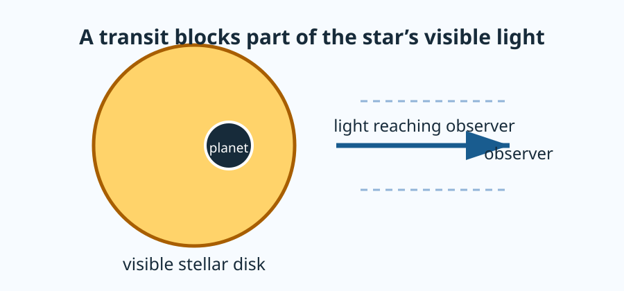

# What Is a Transit?

A **transit** occurs when an orbiting planet passes between its star and an
observer. From the observer's viewpoint, the planet covers a small part of the
star's visible disk, so the received starlight decreases.

## What is—and is not—seen

For most transit systems, the star and planet are not separately resolved in
the image. The detector records their combined light. During a transit, we do
not watch a dark planet move across a detailed stellar photograph; we infer its
effect from a very small change in the star's measured brightness.

## A transit has stages

As the planet moves across the apparent stellar disk, the amount of blocked
light changes.

1. **Out of transit:** the planet does not overlap the visible stellar disk.
2. **Ingress:** overlap begins and grows.
3. **Interior transit:** the planet is in front of the stellar disk; complete
   overlap is possible for some geometries.
4. **Egress:** overlap shrinks to zero.

The course’s first calculation intentionally starts with the simplest interior
case. Project 1 later adds the geometry needed to describe the changing overlap
through ingress and egress.

:::{warning} A transit is an alignment, not a universal viewing angle

An orbiting planet produces a transit only when its orbit is aligned closely
enough with our line of sight. No observed transit does not, by itself, prove a
star has no planet.
:::

## Next connection

Read [Light curves and normalized flux](light-curves.md) for the actual data
record, or [The uniform-source transit model](uniform-source-model.md) for the
first geometric approximation.
