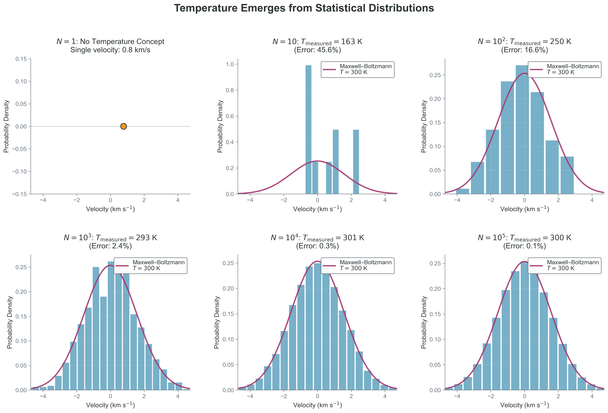
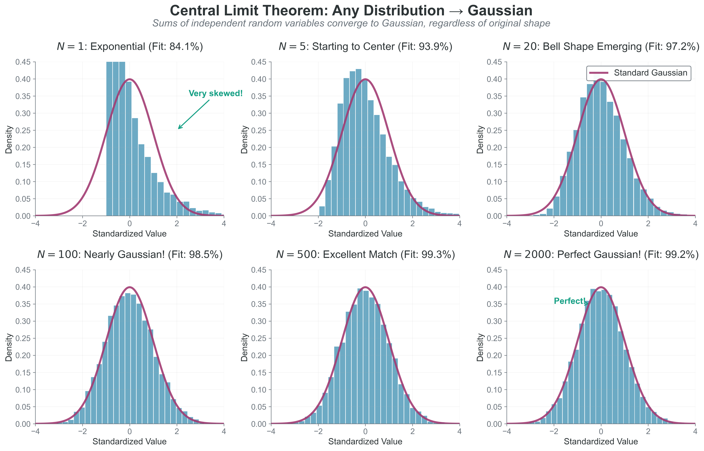
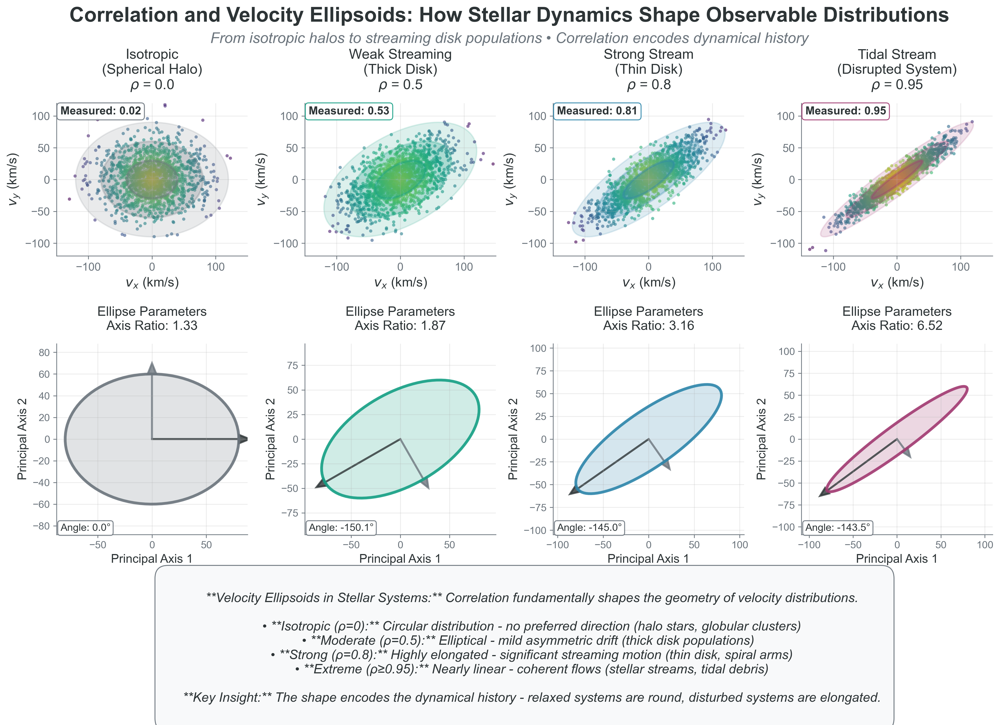
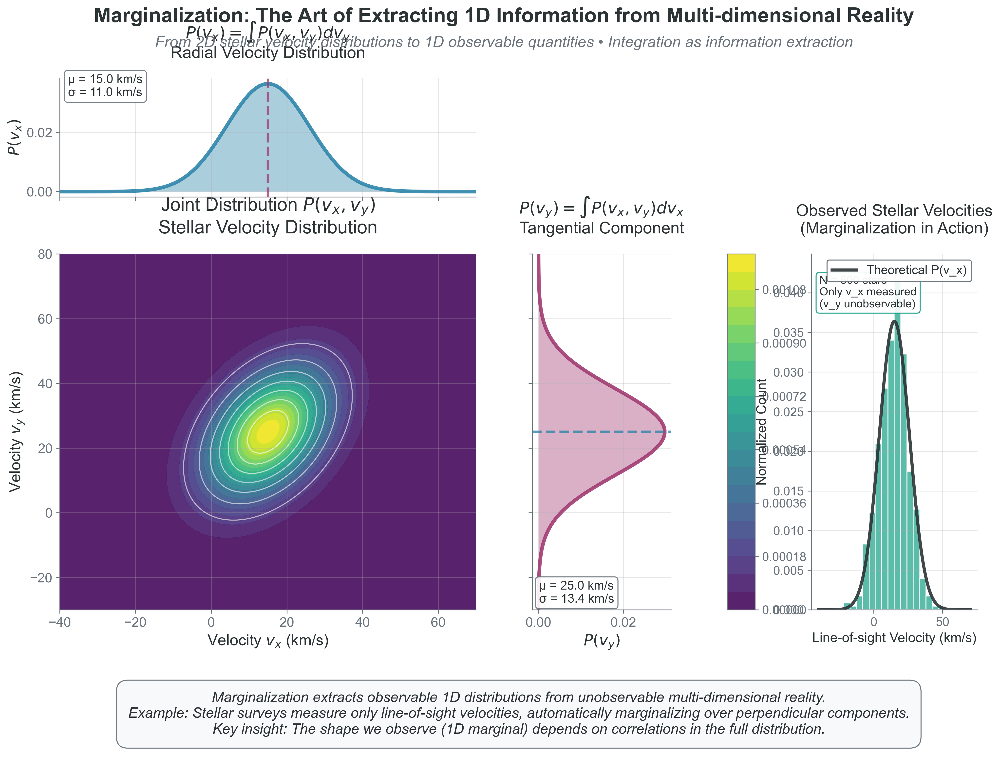
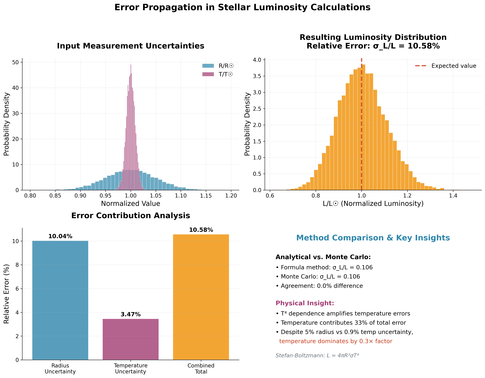
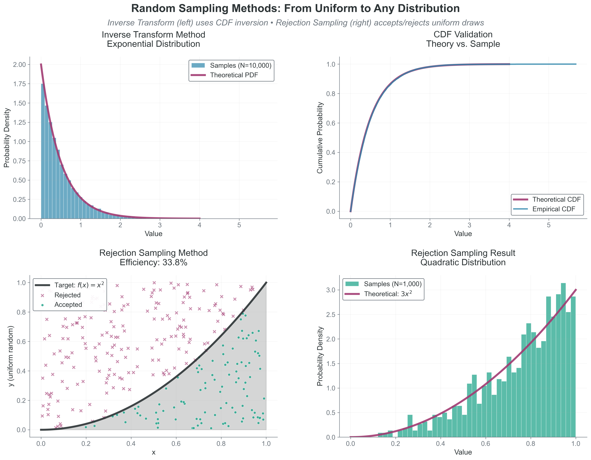
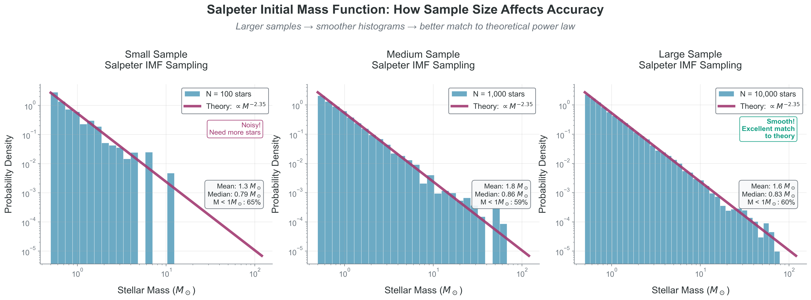
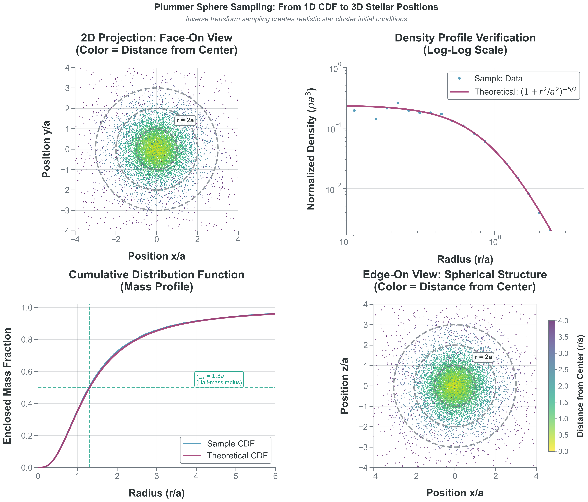

## Learning Outcomes

By the end of this lecture, you will be able to:

::::::::::::::::::::::::{slide-incremental}
- Explain why temperature and pressure are ensemble-level statistical quantities
- Apply CLT, marginalization, and ergodicity ideas to computational diagnostics
- Use moments to connect physical interpretation to machine-learning practice
- Choose and validate sampling strategies; connect the COMP 536 case studies to COMP 521 uncertainty and model-fitting work
- Build a trustworthy stochastic computation with reproducibility and diagnostics
::::::::::::::::::::::::

::::::::::::::::::::::::{speaker-note}
Time: 0:00-2:00. Read outcomes and state that today unifies physics and computational statistics.
::::::::::::::::::::::::

## Why This Lecture Exists

You are about to use Monte Carlo methods, random sampling, and population modeling in the original COMP 536 sequence and in later computational work.

::::::::::::::::::::::::{fragment}
Without statistical foundations, those methods become recipes without understanding.
::::::::::::::::::::::::

::::::::::::::::::::::::{fragment}
With strong foundations, you can diagnose when a method is failing and fix it quickly.
::::::::::::::::::::::::

::::::::::::::::::::::::{speaker-note}
Time: 2:00-4:00. Set stakes: this is about judgment, not memorization.
::::::::::::::::::::::::

## Roadmap and pacing

::::::::::::::::::::::::{slide-columns}
:::::::::::::::::::::::{slide-column}


### Concept Loops
- Loop A: Emergence (temperature, pressure, CLT)
- Loop B: Core statistical tools (correlation, marginalization, uncertainty)
- Loop C: Moments as information compression
- Loop D: Sampling for realistic simulation
:::::::::::::::::::::::

:::::::::::::::::::::::{slide-column}
### Practice Components
- Livecoding-lite with deterministic snippets
- Code Craft micro-segment
- Exit Ticket for transfer to sampling and model diagnostics
:::::::::::::::::::::::
::::::::::::::::::::::::

::::::::::::::::::::::::{speaker-note}
Time: 4:00-5:00. Emphasize predict-play-explain cadence.
::::::::::::::::::::::::

## Delivery timing

```{slide-options}
{"vertical":true}
```

Original 65-minute outline: emergence (13 min), statistical tools (17 min), moments (11 min), sampling (11 min), code craft (5 min), exit ticket (3 min), opening (5 min). The original gaps within these blocks are discussion and transition time; the added detail slides need additional time or a second session.


## Loop A: Emergence from Randomness

::::::::::::::::::::::::{speaker-note}
Time: 5:00-18:00.
::::::::::::::::::::::::

## Predict: Can One Particle Have a Temperature?

A single particle has velocity and kinetic energy.

::::::::::::::::::::::::{fragment}
Does it have a temperature?
::::::::::::::::::::::::

- A) Yes, because kinetic energy implies temperature
- B) No, because temperature describes a distribution over many particles

::::::::::::::::::::::::{speaker-note}
Time: 5:00-6:30. Poll quickly before reveal.
::::::::::::::::::::::::

## Reveal: Temperature is a Distribution Parameter



Temperature scales with velocity variance across an ensemble, not with one particle state.

::::::::::::::::::::::::{speaker-note}
Time: 6:30-8:00. Reinforce ensemble definition and units in CGS context.
::::::::::::::::::::::::

## Play: Estimate Temperature from Velocity Samples

::::::::::::::::::::::::{note}
Purpose: infer an ensemble temperature proxy from sampled velocities.
Inputs/Outputs: input `n_samples`; output sample variance and inferred relative temperature.
Pitfall: interpreting small-`N` fluctuation as a physics change rather than sampling noise.
::::::::::::::::::::::::


```{slide-code-example} statistical-thinking-computations.ipynb#statistical-thinking-cell-2
:view: output
:alt: Executed output for Play: Estimate Temperature from Velocity Samples.
```


::::::::::::::::::::::::{speaker-note}
Time: 8:00-10:00. If live run is slow, describe expected trend verbally.
::::::::::::::::::::::::


## Play: Estimate Temperature from Velocity Samples — code

```{slide-options}
{"vertical":true}
```

```{slide-code} python
:title: statistical-thinking-cell-2
:start: 1
def infer_temperature_proxy(n_samples, sigma_true=1.0):
    v = rng.normal(0.0, sigma_true, n_samples)
    variance = np.var(v, ddof=1)
    return variance

for n in [20, 200, 2000, 20000]:
    var_hat = infer_temperature_proxy(n)
    print(f"N={n:5d}  variance~{var_hat:0.4f}")

print("Interpretation: larger N gives a more stable estimate of ensemble properties.")
```

[Complete executed source](statistical-thinking-computations.ipynb#statistical-thinking-cell-2)
## Explain: Why Pressure is Stable



Under suitable independence or weak-dependence and finite-variance conditions, a central-limit approximation describes fluctuations of aggregate collision statistics. It does not say that every underlying distribution becomes Gaussian.

::::::::::::::::::::::::{speaker-note}
Time: 10:00-12:00. Connect to atmospheric and stellar contexts.
::::::::::::::::::::::::

## Loop A: Predict - Play - Explain Checkpoint

- Predict: if particle count increases by $100\times$, what happens to relative fluctuation scale?
- Play: compare sample means for $N=10^2$ and $N=10^4$ draws from the same parent distribution.
- Explain: use the $1/\sqrt{N}$ law to justify whether a mismatch is expected.

::::::::::::::::::::::::{speaker-note}
Time: 12:00-13:00. Keep this brisk and participatory.
::::::::::::::::::::::::

## Loop B: Tools for Inference and Diagnostics

::::::::::::::::::::::::{speaker-note}
Time: 18:00-35:00.
::::::::::::::::::::::::

## Correlation is Not Independence



Uncorrelated can still be dependent, and dependence structure controls uncertainty propagation.

::::::::::::::::::::::::{speaker-note}
Time: 18:00-21:00. Use one astronomy example and one ML example.
::::::::::::::::::::::::

## Marginalization: Keep What You Can Observe



From 3D velocity density to speed density:

$$g(v) = 4\pi v^2 f_{\vec{v}}(v)$$

This is where geometry enters through the $v^2$ shell factor.

::::::::::::::::::::::::{speaker-note}
Time: 21:00-24:00. State assumption of isotropy explicitly.
::::::::::::::::::::::::

## Error Propagation and Convergence Rates



For independent identically distributed draws with finite variance, the sample-mean standard error scales as $\sigma/\sqrt{N}$. Dependence, heavy tails or nonstationarity require additional analysis.

::::::::::::::::::::::::{speaker-note}
Time: 24:00-27:00. Keep focus on practical uncertainty reasoning for current projects.
::::::::::::::::::::::::

## Play: Monte Carlo Error Scaling in Practice

::::::::::::::::::::::::{note}
Purpose: quantify how estimate precision improves with sample count.
Inputs/Outputs: inputs draw counts `N`; outputs mean estimate and standard error.
Pitfall: expecting linear error reduction with compute budget.
::::::::::::::::::::::::


```{slide-code-example} statistical-thinking-computations.ipynb#statistical-thinking-cell-3
:view: output
:alt: Executed output for Play: Monte Carlo Error Scaling in Practice.
```


::::::::::::::::::::::::{speaker-note}
Time: 27:00-30:00. Emphasize diminishing returns and planning compute budgets.
::::::::::::::::::::::::


## Play: Monte Carlo Error Scaling in Practice — code

```{slide-options}
{"vertical":true}
```

```{slide-code} python
:title: statistical-thinking-cell-3
:start: 1
def mc_estimate_and_stderr(n):
    x = rng.normal(0.0, 1.0, n)
    mean = np.mean(x)
    stderr = np.std(x, ddof=1) / np.sqrt(n)
    return mean, stderr

for n in [10**2, 10**3, 10**4, 10**5]:
    mean, se = mc_estimate_and_stderr(n)
    print(f"N={n:6d}  mean={mean:+0.4f}  stderr={se:0.4f}")
```

[Complete executed source](statistical-thinking-computations.ipynb#statistical-thinking-cell-3)
## Loop B: Predict - Play - Explain Checkpoint

- Predict: for $z=x+y$, how does positive versus negative covariance change $\operatorname{Var}(z)$?
- Play: compare $\operatorname{Var}(x)+\operatorname{Var}(y)+2\operatorname{Cov}(x,y)$ with the independent-input approximation.
- Explain: decide whether mismatch came from dependence structure, wrong propagation assumptions, or finite sample count.

::::::::::::::::::::::::{speaker-note}
Time: 30:00-31:00.
::::::::::::::::::::::::

## Loop C: Moments as Information Compression

::::::::::::::::::::::::{speaker-note}
Time: 35:00-46:00.
::::::::::::::::::::::::

## Moments: What They Preserve and What They Lose

For a distribution $f(x)$:

$$M_n = E[X^n]$$

Low-order moments often capture core behavior for smooth unimodal distributions, but can miss multimodality and heavy tails.

::::::::::::::::::::::::{speaker-note}
Time: 35:00-38:00. Keep caveats explicit to avoid overgeneralization.
::::::::::::::::::::::::

## Physics and ML Use the Same Statistical Machinery

- Physics: variance links to velocity dispersion and thermal width.
- ML: first/second moments appear in momentum and adaptive optimizers.
- Shared move: compress high-dimensional stochastic behavior into stable summary statistics.

::::::::::::::::::::::::{speaker-note}
Time: 38:00-40:00. Show transfer explicitly; students need this bridge.
::::::::::::::::::::::::

## Play: Moment Tracking in a Synthetic Stream

::::::::::::::::::::::::{note}
Purpose: observe how mean/variance/skewness evolve as sample size grows.
Inputs/Outputs: input sample stream; output running mean, sample variance and standardized skewness.
Pitfall: over-interpreting unstable skewness at low sample count.
::::::::::::::::::::::::


```{slide-code-example} statistical-thinking-computations.ipynb#statistical-thinking-cell-4
:view: output
:alt: Executed output for Play: Moment Tracking in a Synthetic Stream.
```


::::::::::::::::::::::::{speaker-note}
Time: 40:00-43:00. If scipy import fails, describe expected stabilization trend.
::::::::::::::::::::::::


## Play: Moment Tracking in a Synthetic Stream — code

```{slide-options}
{"vertical":true}
```

```{slide-code} python
:title: statistical-thinking-cell-4
:start: 1
from scipy.stats import skew

samples = rng.normal(loc=0.0, scale=1.0, size=5000)
for n in [50, 200, 1000, 5000]:
    x = samples[:n]
    m1 = np.mean(x)
    m2 = np.var(x, ddof=1)
    m3 = skew(x, bias=False)
    print(f"N={n:4d}  mean={m1:+0.3f}  var={m2:0.3f}  skew={m3:+0.3f}")
```

[Complete executed source](statistical-thinking-computations.ipynb#statistical-thinking-cell-4)
## Loop C: Predict - Play - Explain Checkpoint

- Predict: which moment stabilizes slowest for symmetric noise, variance or skewness?
- Play: compare stabilization rates across $N$.
- Explain: connect sensitivity to rare events and tail sampling.

::::::::::::::::::::::::{speaker-note}
Time: 43:00-44:00.
::::::::::::::::::::::::

## Loop D: Sampling to Build Simulations

::::::::::::::::::::::::{speaker-note}
Time: 46:00-57:00.
::::::::::::::::::::::::

## Inverse Transform and Rejection Sampling



Inverse transform is exact when $F^{-1}$ is tractable; rejection sampling is flexible when it is not.

::::::::::::::::::::::::{speaker-note}
Time: 46:00-49:00.
::::::::::::::::::::::::

## Power Laws and Astrophysical Populations



For $f(m) \propto m^{-\alpha}$ on $[m_{\min}, m_{\max}]$, careful inversion generates draws from that declared model. Physical realism depends on the chosen limits, model and supporting evidence.

::::::::::::::::::::::::{speaker-note}
Time: 49:00-51:00. Mention special-case handling near $\alpha=1$.
::::::::::::::::::::::::

## Isotropic 3D Sampling Matters



## Sample directions without pole clustering

```{slide-options}
{"vertical":true}
```

Use
- $\mu = \cos\theta \sim U(-1,1)$
- $\phi \sim U(0,2\pi)$
- $\theta = \arccos(\mu)$

to avoid pole clustering artifacts.

::::::::::::::::::::::::{speaker-note}
Time: 51:00-53:00. This is a frequent bug to call out explicitly.
::::::::::::::::::::::::

## Play: Minimal Isotropic Direction Sampler

::::::::::::::::::::::::{note}
Purpose: generate unbiased direction vectors for 3D initial conditions.
Inputs/Outputs: input `n`; output arrays `(x, y, z)` on the unit sphere.
Pitfall: sampling $\theta$ uniformly in $[0,\pi]$ creates non-isotropic clustering.
::::::::::::::::::::::::


```{slide-code-example} statistical-thinking-computations.ipynb#statistical-thinking-cell-5
:view: output
:alt: Executed output for Play: Minimal Isotropic Direction Sampler.
```


::::::::::::::::::::::::{speaker-note}
Time: 53:00-55:00.
Fallback: describe qualitative isotropy check if runtime issues occur.
::::::::::::::::::::::::


## Play: Minimal Isotropic Direction Sampler — code

```{slide-options}
{"vertical":true}
```

```{slide-code} python
:title: statistical-thinking-cell-5
:start: 1
def sample_isotropic_directions(n):
    mu = rng.uniform(-1.0, 1.0, n)
    phi = rng.uniform(0.0, 2 * np.pi, n)
    theta = np.arccos(mu)

    x = np.sin(theta) * np.cos(phi)
    y = np.sin(theta) * np.sin(phi)
    z = np.cos(theta)
    return x, y, z

x, y, z = sample_isotropic_directions(5)
print(np.round(np.column_stack([x, y, z]), 3))
```

[Complete executed source](statistical-thinking-computations.ipynb#statistical-thinking-cell-5)
## Loop D: Predict - Play - Explain Checkpoint

- Predict: does Monte Carlo error always decrease faster than model bias as compute increases?
- Play: compare diagnostics for $10^2$, $10^4$, $10^6$ samples.
- Explain: identify whether failure is geometric bias, model mismatch, or finite-sample noise.

::::::::::::::::::::::::{speaker-note}
Time: 55:00-56:00.
::::::::::::::::::::::::

## Code Craft: Trustworthy Stochastic Computing

::::::::::::::::::::::::{speaker-note}
Time: 57:00-62:00.
::::::::::::::::::::::::

## Code Craft Pattern: From Idea to Reliable Result

A reliable stochastic workflow has five explicit steps:

1. State assumptions and target observable.
2. Seed randomness for reproducibility.
3. Validate against analytical or limiting-case checks.
4. Track uncertainty and convergence rate.
5. Record diagnostics before interpretation.

::::::::::::::::::::::::{speaker-note}
Time: 57:00-59:00.
::::::::::::::::::::::::

## Code Craft Example: Reproducible Monte Carlo Estimate

::::::::::::::::::::::::{note}
Purpose: demonstrate a reproducible estimate with an explicit uncertainty report.
Inputs/Outputs: input `n`; output estimate and standard error.
Pitfall: reporting a point estimate without uncertainty or reproducibility metadata.
::::::::::::::::::::::::


```{slide-code-example} statistical-thinking-computations.ipynb#statistical-thinking-cell-6
:view: output
:alt: Executed output for Code Craft Example: Reproducible Monte Carlo Estimate.
```


::::::::::::::::::::::::{speaker-note}
Time: 59:00-61:00. This is the coding habit to enforce across projects.
::::::::::::::::::::::::


## Code Craft Example: Reproducible Monte Carlo Estimate — code

```{slide-options}
{"vertical":true}
```

```{slide-code} python
:title: statistical-thinking-cell-6
:start: 1
def mc_mean_with_error(n, seed=536):
    local_rng = np.random.default_rng(seed)
    draws = local_rng.normal(0.0, 1.0, n)
    estimate = np.mean(draws)
    stderr = np.std(draws, ddof=1) / np.sqrt(n)
    return estimate, stderr

est, se = mc_mean_with_error(20000)
print(f"estimate={est:+0.4f}, stderr={se:0.4f}")
print("Report both estimate and uncertainty in all project summaries.")
```

[Complete executed source](statistical-thinking-computations.ipynb#statistical-thinking-cell-6)
## Livecoding-lite Fallback Plan

If a live snippet fails during class:

- Use pre-rendered figures already in the deck.
- Ask students to predict the expected trend before revealing fallback output.
- Debrief what the snippet was intended to test.

This keeps pedagogy intact even when runtime is imperfect.

::::::::::::::::::::::::{speaker-note}
Time: 61:00-62:00.
::::::::::::::::::::::::

## Exit Ticket

## Exit Ticket 1: Concept Transfer

You quadrupled your Monte Carlo sample count from $N=10^4$ to $N=4\times 10^4$.

Under the independent finite-variance sampling model, what should happen to the standard error?

- A) It should drop by about $2\times$
- B) It should drop by about $4\times$
- C) It should stay about the same

::::::::::::::::::::::::{speaker-note}
Time: 62:00-63:00. Correct answer: A from $1/\sqrt{N}$ scaling.
::::::::::::::::::::::::

## Exit Ticket 2: Implementation Decision

In the COMP 536 initial-condition case study, you need masses from a declared power law and isotropic directions. Full positions additionally require a radial distribution.

Which pipeline is most defensible?

1. Draw $m$ from an inverse-CDF sampler. For directions, draw $\mu$ uniformly on $(-1,1)$ and set $\theta=\arccos(\mu)$.
2. Draw $\theta \sim U(0,\pi)$ and $\phi \sim U(0,2\pi)$ directly, then adjust by hand.
3. Use rejection sampling everywhere without diagnostics.

Write one sentence justifying your choice with one diagnostic you would run.

::::::::::::::::::::::::{speaker-note}
Time: 63:00-65:00. Correct choice: 1 with a profile/anisotropy diagnostic.
::::::::::::::::::::::::

## Closing and Reading Link

For background, retain the COMP 536 Module 1 overview and Parts 1–4 below. In COMP 521, connect these ideas to sampling, uncertainty and model-fitting work; these links do not assign COMP 536 Projects 2 or 3.

- [Module 1 Overview](https://astrobytes-edu.github.io/comp536-sp26/05-the-statistical-universe/module-1-how-nature-computes/00-mod1-part0-overview.html)
- [Part 2 Statistical Tools](https://astrobytes-edu.github.io/comp536-sp26/05-the-statistical-universe/module-1-how-nature-computes/02-mod1-part2-statistical-tools.html)
- [Part 4 Sampling](https://astrobytes-edu.github.io/comp536-sp26/05-the-statistical-universe/module-1-how-nature-computes/04-mod1-part4-sampling.html)

::::::::::::::::::::::::{speaker-note}
End on transfer: statistics is your modeling language across astrophysics and ML.
::::::::::::::::::::::::


## Detail: assumptions behind the error bar

```{slide-options}
{"vertical":true}
```

For iid draws with finite variance $\sigma^2$, the sample mean has variance $\sigma^2/N$. A sample standard deviation estimates $\sigma$; the displayed code reports $s/\sqrt{N}$.

- Correlated draws generally require an effective-sample-size or covariance analysis.
- A stable-looking finite sample does not establish finite population variance.
- Model bias does not vanish merely by increasing the sample count.
- Separate reproducibility of random draws from validity of the statistical model.

## Detail: raw, central and standardized moments

```{slide-options}
{"vertical":true}
```

The raw moment is $M_n=E[X^n]$. Central moments use $X-\mu$ instead of $X$.

$$\mu=E[X],\qquad \sigma^2=E[(X-\mu)^2]$$

$$\gamma_1=\frac{E[(X-\mu)^3]}{\sigma^3}.$$

The code reports **sample estimates of mean, variance and skewness**, not three raw moments. These population quantities require the corresponding moments to exist; skewness also requires a nonzero finite variance.

## Detail: direction is not a radial distribution

```{slide-options}
{"vertical":true}
```

The direction sampler returns unit vectors. Uniform $\mu=\cos\theta$ and uniform azimuth give isotropic directions.

To construct positions, additionally sample a radius from a stated spatial model and set $\mathbf{r}=r\hat{\mathbf{n}}$.

The retained Plummer figure illustrates a particular spatial model. Isotropic directions alone do not specify that model or its radial density.

## COMP 521: use the diagnostics together

When fitting or simulating data, report the target quantity, assumptions, estimate, uncertainty and a reproducibility record.

Use a controlled example to distinguish sampling variability, dependence, geometric bias and model mismatch. Increasing the sample size is only a remedy for the sampling component under the stated assumptions.
